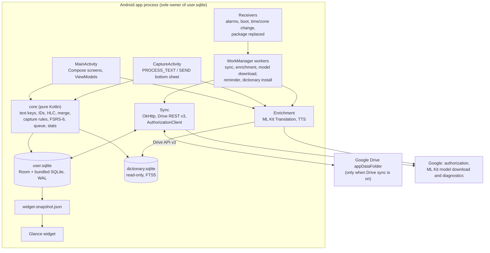

# ToriWords for Android: architecture

This file covers how the Android app is put together: platform and stack, manifest components, modules, threading, files on the device, start-up, launch animation, haptics, background entry points, observability, performance targets, repository layout, CI and release prerequisites.

Related files:
- [data-model.md](data-model.md): local database, settings storage, backup, export and restore.
- [sync.md](sync.md): Google Drive sync.
- [scheduler.md](scheduler.md): spaced repetition, day model, queue, widget snapshot, reminders.
- [capture-and-enrichment.md](capture-and-enrichment.md): capture, dictionary, translation, pronunciation.
- [testing.md](testing.md): parity fixtures and test suites.
- [product.md](product.md), [domain.md](domain.md), [ui.md](ui.md), [copy.md](copy.md): behaviour, concepts, screens and wording.

The iOS app on `main` (`ios/`) is the reference implementation. Android does what iOS does wherever the platform allows. Deliberate differences are listed in [ios-differences.md](ios-differences.md).

## 1. System overview

ToriWords is local-first. Each device keeps the user's whole vocabulary in a local SQLite database (`user.sqlite`) and works fully offline. There is no ToriWords server and no account. Optionally, the user turns on **Google Drive sync**: the app then stores merged records as files in the hidden **appDataFolder** of the Google account the user picks, and other Android devices on the same account merge them. There is no sync between Android and iOS. A JSON backup file is the only way to move words between the two platforms ([data-model.md](data-model.md#9-export-and-restore)).

Principles:
1. **Local-first.** Every feature except Drive sync and the one-time translation model download works offline. No screen waits for the network.
2. **No account, no backend.** With Drive sync off, the app talks to no sync service. Network use is limited to Google Drive (only when sync is on), the ML Kit translation model download and ML Kit's own diagnostics (see [Observability](#13-observability-and-privacy)).
3. **Domain logic runs on the device and is pinned by fixtures.** Text keys, IDs, clocks, merge, capture text rules, FSRS-6, the day model, the daily queue and the widget snapshot must behave exactly like iOS. The shared JSON fixtures in `spec/fixtures/` are normative ([testing.md](testing.md)).
4. **Derived data is never synced.** Card scheduling state, due days, match keys, canonical IDs, search folds and all counts are recomputed locally.
5. **One process.** Every Android entry point (main activity, capture sheet, widget, workers, alarm and system receivers) runs in the app process and shares one database instance. No `android:process` attribute is declared anywhere. iOS needs an inbox, a vocabulary index and a sticky-fields file only because its Share Extension is a separate process; Android has none of these.
6. **Machine output only suggests.** Dictionary and ML Kit results are offered and stored only when the user accepts them. The one exception is the automatic fill of words saved without a translation ([capture-and-enrichment.md](capture-and-enrichment.md)).
7. **No analytics, crash or ads SDKs.**



## 2. Platform and stack

| Item | Value |
|---|---|
| Language | Kotlin 2.x (K2), coroutines and `Flow`. No Java sources. |
| UI | Jetpack Compose with Material 3. No XML layouts, no Fragments. ViewModels expose `StateFlow`; screens collect with `collectAsStateWithLifecycle`. Navigation: Navigation Compose with type-safe routes, or Navigation 3 if stable at implementation time (no behaviour depends on the choice). Colours are the fixed ToriWords palette in light and dark (green accent `#12875A` light / `#2FBF7F` dark, as on iOS). No dynamic colour. Visuals: [ui.md](ui.md). |
| SDK levels | **minSdk 31** (Android 12), **targetSdk and compileSdk 37**. Behaviour forced by a recent targetSdk is accepted: edge-to-edge, predictive Back, resizable layouts on large screens. Review and the capture sheet must survive resizing and rotation. |
| Devices | Phones first. Tablets and foldables run the same adaptive layouts; there are no tablet-specific screens. |
| Localisation | English and Russian UI (`values/`, `values-ru/`), `locales_config.xml`. The app follows the system language when it is English or Russian, otherwise English. Override: [App language](#12-app-language). Learning content is never translated. |
| Persistence | Room (KSP) on the **bundled SQLite driver** (`androidx.sqlite:sqlite-bundled`), WAL. The dictionary is read with the same bundled SQLite, which provides FTS5 on every device. DataStore (Preferences) for per-device settings and sticky capture fields ([data-model.md](data-model.md#82-per-device-settings-datastore)). |
| Background | WorkManager; `AlarmManager` with inexact alarms only; Glance for the widget. No foreground services. |
| Dependencies | AndroidX: Compose BOM + Material 3, Activity, Lifecycle (incl. `ProcessLifecycleOwner`), Navigation, Room, `sqlite-bundled`, DataStore, WorkManager, Glance (`glance-appwidget`, `glance-material3`), AppCompat (only for the per-app language on API 31–32), Core SplashScreen, ProfileInstaller. Google: `play-services-auth` (`Identity.getAuthorizationClient`, Drive appdata scope only), ML Kit Translation (`com.google.mlkit:translate`). Square: OkHttp. JetBrains: kotlinx.coroutines, kotlinx.serialization (JSON). DI: Hilt (with `hilt-work`) or hand-written constructor injection, implementer's choice. **Nothing else.** No analytics, crash or ads SDKs, no Firebase SDK in our code. |
| Crypto | `java.security.MessageDigest` (SHA-256; SHA-1 for UUIDv5), `SecureRandom` (UUIDv7 random bits). |
| Tests | JUnit 5 for the JVM `core` module, Robolectric for store and sync scenario tests on the host, AndroidX Test on emulators, Room `MigrationTestHelper`, Macrobenchmark + Baseline Profile ([testing.md](testing.md)). |

## 3. Components and manifest

Everything ships in one App Bundle. There are no extensions and no second process. `applicationId` = `com.toriwords.app` (as the iOS bundle ID).

| Component | Type | Exported | Responsibilities |
|---|---|---|---|
| `ToriwordsApp` | `Application` | — | Creates the app graph and the application `CoroutineScope`. Does **no I/O** in `onCreate`, so cold starts of the capture sheet, widget and receivers stay cheap. |
| `MainActivity` | `AppCompatActivity`, single activity for all screens | Launcher | All screens. Opens Review when started by the widget or a reminder (an extra on an explicit intent). |
| `CaptureActivity` | `AppCompatActivity`, translucent theme, Compose `ModalBottomSheet` | Yes: intent filters `android.intent.action.PROCESS_TEXT` and `android.intent.action.SEND`, both `text/plain` | Capture sheet ([capture-and-enrichment.md](capture-and-enrichment.md)). `excludeFromRecents="true"`, `taskAffinity=""`, `windowSoftInputMode="adjustResize"`. |
| `TodayWidgetReceiver` | `GlanceAppWidgetReceiver` | Yes (system) | Home-screen due-count widget ([scheduler.md](scheduler.md)). |
| `AlarmReceiver` | `BroadcastReceiver` | No | Reminder and day-rollover alarms. |
| `SystemEventsReceiver` | `BroadcastReceiver` | Yes (system broadcasts only) | `BOOT_COMPLETED`, `TIME_SET`, `TIMEZONE_CHANGED`, `MY_PACKAGE_REPLACED`: re-arm alarms, refresh the snapshot, pre-install the dictionary. |
| WorkManager workers | `CoroutineWorker`s | — | [Background work](#10-background-work-and-entry-points). |
| `FileProvider` | `androidx.core.content.FileProvider` | No (grants per URI) | Hands export files to the share sheet. |

**No custom URL scheme and no App Links.** The widget and the reminder open Review with explicit intents. iOS has `toriwords://review` and `toriwords://add?text=`; Android has no caller that needs them.

**Permissions:** `INTERNET`, `ACCESS_NETWORK_STATE`, `POST_NOTIFICATIONS` (runtime prompt on API 33+ only), `RECEIVE_BOOT_COMPLETED`, `VIBRATE` (launch haptic, [Haptics](#9-haptics)). **Not requested:** `SCHEDULE_EXACT_ALARM`, `USE_EXACT_ALARM`, `QUERY_ALL_PACKAGES`, any storage or foreground-service permission. Reminders are deliberately inexact ("around" the chosen time).

**Package visibility (`<queries>`):** `android.intent.action.TTS_SERVICE` (bind the TTS engine) and `android.speech.tts.engine.INSTALL_TTS_DATA` (voice-data installer). The app that starts the capture activity is visible to us automatically and needs no entry.

**Backup:** `android:allowBackup="true"`, `android:dataExtractionRules="@xml/data_extraction_rules"` (rules in [data-model.md](data-model.md#10-os-backup)).

**Network:** HTTPS only (`usesCleartextTraffic` false, the default), system CAs, no certificate pinning (Google endpoints only).

**Launcher icon:** the ToriWords tree mark as an adaptive icon. It is the same mark as the iOS app icon: a tree "T" growing out of an accent "W", with a waved branch and an accent leaf. Resources:
- `mipmap-anydpi-v26/ic_launcher.xml`, 108 dp canvas. Background layer: solid `#F2F2F7`. Foreground layer: the mark (T in `#000000`, W and leaf in `#12875A`, a background-coloured gap around the stem), its box about 46 dp, so every stroke stays inside the 66 dp safe zone.
- `mipmap-night-anydpi-v26/ic_launcher.xml`: background `#000000`, T `#FFFFFF`, W and leaf `#2FBF7F`. Launchers that resolve app resources in night mode show it.
- Monochrome layer for themed icons (Android 13+).
- Notification small icon `ic_stat_tori`: the mark as a white-on-transparent vector.

The mark's geometry is defined by `LogoMark` in `ios/ToriKit/Sources/ToriUI/Brand.swift` (fractions of a square frame, stroke 0.12 of the frame). The Android vector drawables and the Compose `LogoMark` are derived from those numbers. The SVG files in `ios/Resources/AppIcon/` are out of date (they still show the old blue mark) and are not a source. Art details: [ui.md](ui.md).

## 4. Gradle modules

Arrows are the only allowed dependencies. Modules are Gradle projects under `android/`.

| Module | Type | Contents | Depends on |
|---|---|---|---|
| `core` | Pure Kotlin/JVM library, no Android imports | Text normalisation and keys, URL key, UUIDv7/UUIDv5, unsigned-byte ID order, HLC, field comparator and envelope merge, capture text rules, FSRS-6, day model, replay fold, daily queue, practice list, snapshot day counts, stats, domain value types, a `Clock` interface (time is always passed in). | — |
| `dictionary` | Android library | Installer and read-only access to `dictionary.sqlite`: autocomplete, lookup, forms, reverse RU→EN, related words, `meta`. | `core`, `sqlite-bundled` |
| `store` | Android library | Room database, entities, DAOs, migrations. Repositories whose write path stamps HLC clocks and outbox rows in the same transaction. Capture and edit use cases, duplicate merge, canonical-ID resolution, replay orchestration, snapshot writer, export/restore, DataStore for per-device settings and sticky fields. | `core`, `dictionary` |
| `sync` | Android library | Drive REST client (OkHttp + kotlinx.serialization), Drive authorization, `SyncEngine`, status model, network monitor. | `core`, `store` |
| `enrichment` | Android library | Enrichment orchestrator (pending fills, retries), ML Kit adapter and model manager, TTS player. | `core`, `dictionary`, `store` |
| `designsystem` | Android library | Compose M3 theme and tokens (fixed palette), shared components, `LogoMark` (drawable part by part: W, stem, branch, leaf; poseable for the header sway), `BrandHeader` with its spring model, `Haptics` helper ([Haptics](#9-haptics)). | — |
| `app` | Android application | Activities, navigation, screens, ViewModels, Glance widget, receivers, workers, app graph, manifest. | all of the above |
| `baselineprofile` | Test (Macrobenchmark) | Generates the Baseline Profile for cold start, Home, Review and the capture sheet. | `app` |

## 5. Concurrency

- One Room database instance per process, a singleton in the app graph. All writes go through `store`'s `UserStore.write { }`, which runs an **immediate** transaction on Room's single writer connection, so writes are serialised. Reads are Room `Flow` queries; invalidation tracking works because everything is in one process.
- `SyncEngine` and the enrichment orchestrator each serialise their work with a `Mutex` and coalesce triggers through a conflated `Channel`. They are the Kotlin counterparts of the Swift actors on iOS. A worker and a foreground trigger never run two sync cycles at once because they share the in-process `Mutex`.
- Long work (full replay, restore, first pull, dictionary install) runs on `Dispatchers.IO` or `Dispatchers.Default` in the application scope, never on the main thread. Room refuses main-thread queries; StrictMode is on in debug builds.
- Writes that must survive leaving a screen (the pending review answer, pending deletions after Undo) run in the application scope under `NonCancellable`.

## 6. Files on the device

All paths are app-private.

| Path | Content | Cloud backup | Device transfer | Writer → reader |
|---|---|---|---|---|
| `databases/user.sqlite` (+ `-wal`, `-shm`) | User data ([data-model.md](data-model.md)). | Yes | Yes | app → app |
| `no_backup/device-marker` (`Context.noBackupFilesDir`) | The Device ID of this installation (16 bytes). Detects a restore. | No | No (explicit exclude) | app → app |
| `no_backup/dictionary/dictionary.sqlite` | Installed read-only dictionary ([capture-and-enrichment.md](capture-and-enrichment.md)). | No | No | app → app |
| `no_backup/widget-snapshot.json` | Widget data ([scheduler.md](scheduler.md)). | No | No | app → widget (same process) |
| `datastore/device_settings.preferences_pb` | Per-device settings. | Yes | Yes | app → app |
| `datastore/capture_sticky.preferences_pb` | Sticky capture fields. | No | No | capture sheet → capture sheet |
| `cache/exports/` | Export files handed to the share sheet. | No | No | app → other apps via `FileProvider` |

SQLite settings for `user.sqlite`: `encoding = 'UTF-8'` (asserted at open), `journal_mode = WAL`, `synchronous = NORMAL`, `foreign_keys = ON`. When the app goes to the background (`ProcessLifecycleOwner` `ON_STOP`) it runs `PRAGMA wal_checkpoint(TRUNCATE)`, so a backup copy is consistent and small.

The dictionary asset is stored compressed in the APK (about 25 MB) and copied once to `no_backup/dictionary/` (about 58 MB), because SQLite cannot open a file inside the APK. iOS reads its copy in place from the app bundle; this two-copy cost is forced by the platform.

## 7. Start-up, first run, restore and reinstall

Android has several cold-start entry points: launcher, capture, widget update, alarm, boot and worker. Every one of them calls one idempotent, single-flight `AppReady.await()` before touching user data:

1. **Open and migrate** `user.sqlite` ([data-model.md](data-model.md#7-migrations)).
2. **Fresh install** (no `device` row with `is_this_device = 1`): create the Device row (new UUIDv7, `platform = android`, `display_name = Build.MODEL`, rank 0), write `device-marker`, and create the LanguagePair (`v5("pair:ru:en")`) and Settings (`v5("settings")`) defaults with rank 0.
3. **Restored** (a local device row exists but `device-marker` is missing or holds another ID; this is Auto Backup or device-to-device transfer): in one transaction:
   - generate a new Device ID, set `is_this_device = 0` on the old row, insert the new row;
   - reset the Drive bookkeeping: clear `pageToken`, `generation`, `generationCreatedTime`, `deviceSeq` and `snapshotN`, and delete all `drive_file` and `drive_file_owner` rows;
   - mark every synced record pending (one `*` outbox row per record, tombstones included), because the restored database is an older snapshot than Drive.

   Then write the new marker. `driveAccount` and `driveDeleted` are kept. On the next cycle, `AuthorizationClient` returns a token silently if that Google account is on the device; otherwise the sync status is "Google Drive access was removed" ([sync.md](sync.md)).
4. **Dictionary:** install or replace it if the bundled SHA-256 differs from the installed one ([capture-and-enrichment.md](capture-and-enrichment.md)).
5. **Then, in the background:** pending enrichment, a sync cycle if Drive sync is on, snapshot rewrite, alarm re-arm.

"Clear storage" in system settings and uninstall + reinstall are a fresh install: DataStore files and the marker go with the app data. `CaptureActivity` shows its sheet immediately and awaits `AppReady` only for the parts that need it (dictionary lookup, duplicate check, Save).

## 8. Launch animation

Behaviour and timings are the iOS ones; the user-visible description is in [ui.md](ui.md). Mechanism:

- `MainActivity` calls `installSplashScreen()` with theme `Theme.Toriwords.Starting`. `windowSplashScreenBackground` is the app background (`#F2F2F7` light, `#000000` dark). `windowSplashScreenAnimatedIcon` is a transparent drawable, so the system splash shows only the background colour (the API always reserves an icon slot; a transparent icon is allowed).
- `setOnExitAnimationListener` removes the splash view at once. The first Compose frame is a full-screen `LaunchOverlay` in the same colour, above the nav host.
- The overlay draws the 150 dp `LogoMark`, which grows in four parts:
  - **W:** 0.5 s, ease-out `cubic-bezier(0.23, 1, 0.32, 1)`.
  - **Stem:** rises through the W from 0.3 s for 0.7 s.
  - **Branch:** unfurls from 0.85 s for 0.55 s.
  - **Leaf:** unfolds from its base from 1.25 s for 0.45 s.

  Stem, branch and leaf use `cubic-bezier(0.4, 0, 0.2, 1)`. Strokes are trimmed with `PathMeasure.getSegment`. The gap around the stem is cut with `BlendMode.Clear` in an offscreen `graphicsLayer`.
- **Hold:** the finished mark stays for 400 ms, even when the data is already ready.
- **Still launching:** `AppReady.await()` not yet complete. A dim band (40 % opacity) sweeps across the mark (1.1 s pass, 0.5 s pause) until it completes.
- **Leave:** fade out over 0.3 s (ease-out) while moving 8 dp up, then remove the overlay.
- **Launch haptic:** the rolling haptic ([Haptics](#9-haptics)) is scheduled so its last tap lands at about 70 % of the leaf unfold (1.565 s after start).
- **"Remove animations"** (`ValueAnimator.areAnimatorsEnabled() == false`) is the counterpart of iOS Reduce Motion. No drawing: the finished mark fades in over 0.25 s, the haptic ends as the fade ends, then the 400 ms hold, no sweep or offset, and a 0.2 s fade-out.
- `contentDescription` is "ToriWords". Warm starts skip the overlay: the activity is recreated while the process lives and `AppReady` is already complete.
- Not used: an `AnimatedVectorDrawable` splash icon. It is clipped to the splash icon mask, limited to the system timing and cannot show the waiting sweep.

## 9. Haptics

This section is the single owner of the haptic mechanism. The user-visible behaviour and timing are in [ui.md](ui.md). All haptics go through one `Haptics` helper in `designsystem`. Haptics never carry information that is not also visible.

### 9.1 Launch roll

On iOS this is a CoreHaptics pattern of 7 transient taps with low sharpness. As (time s, intensity) pairs: (0, 0.35), (0.04, 0.6), (0.08, 0.85), (0.12, 1.0), (0.17, 0.75), (0.23, 0.45), (0.30, 0.2). Android plays the same pattern with `VibrationEffect.Composition`:

- Vibrator: `context.getSystemService(VibratorManager::class.java).defaultVibrator`. Skip if `hasVibrator()` is false.
- **Gate:** `vibrator.areAllPrimitivesSupported(PRIMITIVE_LOW_TICK, PRIMITIVE_TICK)`.
- **Primitives supported:** one composition of 7 primitives. Taps with intensity ≤ 0.6 use `PRIMITIVE_LOW_TICK`; stronger taps use `PRIMITIVE_TICK`. The `scale` argument is the intensity.
  - `addPrimitive` delays are relative to the end of the previous primitive. Each delay is therefore the target gap minus the previous primitive's duration from `getPrimitiveDurations()` (API 31), clamped at 0.
  - The composition starts at (target end − 0.30 s), using a coroutine `delay` on the overlay's scope. It is cancelled if the overlay leaves first.
- **Primitives unsupported** (common on API 31–33 devices): one `VibrationEffect.createPredefined(VibrationEffect.EFFECT_CLICK)` at the target end time.
- **System setting:** on API 33+ vibrate with `VibrationAttributes.createForUsage(VibrationAttributes.USAGE_TOUCH)`, so the system touch-feedback setting applies. On API 31–32 skip the haptic when `Settings.System.HAPTIC_FEEDBACK_ENABLED` is 0.
- Needs the `VIBRATE` permission (install-time, no user prompt).

### 9.2 Review swipe detent

While a Review card is dragged horizontally, crossing the grade angle (±10°) in either direction "arms" a grade, and dropping back under it disarms. Releasing the card grades with the **armed** rating; with nothing armed it springs back. The haptic fires only when the armed state changes:

| Event | API 34+ | API 31–33 |
|---|---|---|
| Armed (crossed the grade angle) | `HapticFeedbackConstants.GESTURE_THRESHOLD_ACTIVATE` | `HapticFeedbackConstants.CONFIRM` |
| Disarmed (back under it) | `HapticFeedbackConstants.GESTURE_THRESHOLD_DEACTIVATE` | `HapticFeedbackConstants.CLOCK_TICK` |

Played with `View.performHapticFeedback` on the Compose host view (`LocalView.current`). This needs no permission and follows the system touch-feedback setting.

### 9.3 Home header taps

The live header (behaviour in [ui.md](ui.md)) gives a light click on every tap and a softer click when the leaf falls. iOS uses a light impact and a soft impact.

| Event | All supported API levels |
|---|---|
| Tap on the header | `HapticFeedbackConstants.CONTEXT_CLICK` |
| Leaf falls (every 5th tap) | `HapticFeedbackConstants.CLOCK_TICK` |

Played with `View.performHapticFeedback` on the Compose host view, like the detent. No permission needed, and the system touch-feedback setting applies. The header ignores Remove animations, and so do its haptics.

No other haptics in v1. The swipe demo and the grade buttons play none.

## 10. Background work and entry points

All work is unique WorkManager work or an inexact alarm in the app process. Every worker and receiver calls `AppReady.await()` first. No foreground services; long jobs (first pull, large enrichment backlog) are resumable and continue in the next run. Expedited work on API 31+ is backed by JobScheduler expedited jobs and needs no foreground notification.

| Work / alarm | Kind | Constraints | Purpose | Details |
|---|---|---|---|---|
| `sync-periodic` | Periodic 4 h (flex 1 h) | `CONNECTED` | Background sync while Drive sync is on | [sync.md](sync.md) |
| `sync-debounced` | One-time, `REPLACE`, 5 s initial delay | `CONNECTED` | Sync shortly after local changes and captures | [sync.md](sync.md) |
| `sync-retry` | One-time, `KEEP` | `CONNECTED` | Retry after a network failure while the app is in the background | [sync.md](sync.md) |
| `mlkit-model` | One-time, `KEEP` | `UNMETERED` (automatic) / `CONNECTED` (Settings) | Translation model download | [capture-and-enrichment.md](capture-and-enrichment.md) |
| `enrichment` | One-time, `KEEP` | none | Pending translation fills and retries | [capture-and-enrichment.md](capture-and-enrichment.md) |
| `dictionary-install` | One-time, `KEEP` | none | Install a new bundled dictionary after an app update | [capture-and-enrichment.md](capture-and-enrichment.md) |
| `reminder` | One-time, expedited | none | Started by the reminder alarm; posts the daily reminder | [scheduler.md](scheduler.md) |
| Day-rollover alarm | `AlarmManager.set(RTC, …)`, inexact, non-wakeup | — | Rewrites the widget snapshot at the 04:00 day boundary | [scheduler.md](scheduler.md) |
| Reminder alarm | `AlarmManager.setAndAllowWhileIdle(RTC_WAKEUP, …)`, inexact | — | Fires around the chosen reminder time | [scheduler.md](scheduler.md) |

All `PendingIntent`s are `FLAG_IMMUTABLE | FLAG_UPDATE_CURRENT` with fixed request codes, so re-arming is idempotent. Alarms are re-armed on every `AppReady`, on `BOOT_COMPLETED`, `TIME_SET`, `TIMEZONE_CHANGED` and `MY_PACKAGE_REPLACED`. A force-stop cancels alarms until the app is opened again (OS rule).

**Notification and widget taps open the activity directly.** The reminder's content intent is `PendingIntent.getActivity(...)` for an explicit `MainActivity` intent with the Review destination extra. Since Android 12 an activity may not be started from a receiver or service launched by a notification tap (notification trampolines are blocked for apps targeting API 31+). So the tap never goes through `AlarmReceiver` or a worker. The widget uses Glance `actionStartActivity<MainActivity>` with the same extra.

**Process-lifecycle hooks** (`ProcessLifecycleOwner`):
- `ON_START`: sync trigger.
- `ON_STOP`: commit the pending review answer and pending deletions, flush the widget snapshot, WAL checkpoint.

The Review screen also commits on its host activity's `onStop` when `isChangingConfigurations` is false, so rotation, resizing and theme changes do not commit ([scheduler.md](scheduler.md)).

**Widget pin request** (the **Add widget** button in the widget hint, behaviour in [product.md](product.md)):
- The button is shown only when `AppWidgetManager.isRequestPinAppWidgetSupported()` is true and no ToriWords widget is placed yet. Both are checked each time the hint or the Widget screen is shown, and again on `ON_RESUME`.
- "Placed" means `GlanceAppWidgetManager(context).getGlanceIds(TodayWidget::class.java)` is not empty.
- Tapping calls `requestPinAppWidget(ComponentName(context, TodayWidgetReceiver::class.java), null, null)`. The launcher shows its own confirmation. The app needs no permission and passes no success callback. On return, the `ON_RESUME` check hides the hint once the widget is placed.
- If `requestPinAppWidget` returns false, the button hides for the rest of the visit.

## 11. Header sway model

The Home header (mark + "ToriWords") reacts to taps as on iOS (behaviour in [ui.md](ui.md)). `designsystem` holds the physics as a pure Kotlin class, a port of iOS `SwayModel` (`ios/ToriKit/Sources/ToriUI/BrandHeader.swift`):
- Three damped springs (unit mass), angles in degrees, positive clockwise:
  - crown (branch + leaf about the stem top): response 0.55 s, damping 0.35, limit ±12°;
  - leaf (about its base): response 0.44 s, damping 0.25, limit ±25°, driven by the crown's acceleration × 1.2;
  - grass (the W, skewed from its baseline): response 0.4 s, damping 0.45, limit ±8°.
- A tap adds to each part's current speed the speed that, from rest, peaks at about 6° (crown) and 3° (grass).
- Integration: semi-implicit Euler in substeps of at most 1/240 s.
- Every 5th tap the leaf falls (1.2 s); the next tap grows a new one.

Frames are driven by `withFrameNanos` only while something moves; at rest there is no per-frame work. Like iOS, the sway does not check "Remove animations": it only follows the user's own tap and stays small and local.

## 12. App language

- **Android 13+ (API 33+):** Settings → Language opens the system per-app language screen (`Settings.ACTION_APP_LOCALE_SETTINGS`). The system stores the choice.
- **Android 12 (API 31–32):** there is no system screen. Settings shows an in-app list (System / English / Русский) that calls `AppCompatDelegate.setApplicationLocales`. The manifest declares the AppCompat `AppLocalesMetadataHolderService` with `autoStoreLocales = true`, so AppCompat persists the choice and hands it to the system setting after an OS upgrade. This is why both activities extend `AppCompatActivity`.
- "System" follows the device language when it is English or Russian, otherwise English.

## 13. Observability and privacy

- **No analytics, crash or ads SDK in the app.** No telemetry endpoint, no install ID, no local telemetry tables.
- Crash and ANR data come only from **Google Play Console → Android vitals** (users who allow usage and diagnostics) and pre-launch reports.
- Release builds are **App Bundles**, which carry the R8 mapping, so Play deobfuscates stack traces. `ndk.debugSymbolLevel = "SYMBOL_TABLE"` symbolicates crashes in native libraries (bundled SQLite, ML Kit).
- Local logging: `android.util.Log` with tag `Toriwords`. Never logs user content (words, translations, sentences, titles, URLs, tokens). R8 strips `Log.v`/`Log.d` from release builds. Logs never leave the device.
- **ML Kit diagnostics.** The ML Kit Translation SDK sends Google device information, ML hardware information and the configured source and target languages, for diagnostics and usage analytics. It also uses Firebase Installations and Remote Config internally. There is no supported way to turn this off, and the app does not try. It is **disclosed**: the About privacy note says so ([copy.md](copy.md)), and the Play Data safety form declares it. Otherwise the note says: data stays on the device and, if Drive sync is on, in the user's own Google Drive app data; no ToriWords server; no analytics, tracking or crash SDK.
- Settings has no privacy switches.
- **Play Data safety:** user content and identifiers are stored in the user's own Google Drive app data and are not collected by the developer. The ML Kit diagnostics above are declared as collected by the SDK.

## 14. Performance targets

Reference device: a mid-range phone on Android 12 (for example a Pixel 6a), to be replaced by the owner's device when known.

| Operation | Target |
|---|---|
| Autocomplete query (user words + dictionary) | < 10 ms |
| Capture: cold start to sheet visible | ≤ 1 s (Baseline Profile) |
| Selection → saved (dictionary hit) | ≤ 2 s |
| App cold start to Home | ≤ 1.5 s (Baseline Profile; the launch animation's own 1.7 s plus hold is not counted) |
| First-launch dictionary install | measured; never blocks Home (background) |
| Full Card rebuild (40k Cards / 200k logs) | < 2 s, background (iOS target < 1 s) |
| Applying one pulled chunk (≤ 400 envelopes) | < 1 s, off the main thread |
| First pull of 300k records | paged, resumable, UI usable throughout |
| Main thread | no disk or network I/O (StrictMode in debug); no ANRs in Play vitals |

## 15. Repository layout

```
android/
  docs/                 this specification
  README.md             build and run, architecture summary, modules, technologies
  settings.gradle.kts, build.gradle.kts, gradle/libs.versions.toml (version catalog)
  app/                  application: activities, navigation, screens, ViewModels,
                        Glance widget, receivers, workers, app graph, manifest
    src/main/assets/dictionary/   dictionary.sqlite + manifest.json (build artefacts, not in git)
    src/main/res/xml/             data_extraction_rules.xml, locales_config.xml, file_paths.xml
  core/                 pure Kotlin/JVM (+ fixture tests)
  dictionary/           read-only dictionary access + installer
  store/                Room DB, migrations, schemas/ (exported Room JSON, committed), repositories, use cases
  sync/                 Drive client, authorization, sync engine
  enrichment/           ML Kit adapter, enrichment orchestrator, TTS
  designsystem/         Compose M3 theme, LogoMark, BrandHeader, Haptics
  baselineprofile/      Macrobenchmark + Baseline Profile generator
spec/fixtures/          shared with iOS (not under android/)
tools/dictionary/, tools/fixtures/   dev tools (Python), not app code
```

**Dictionary file.** Like iOS, the full `dictionary.sqlite` (about 60 MiB, CC BY-SA 4.0) is not in git.
- `tools/dictionary/fetch.sh` downloads the GitHub Release asset named in `tools/dictionary/release.json` and checks it against the committed `dictionary.sqlite.sha256`. The Android build copies it into `app/src/main/assets/dictionary/` and generates `manifest.json` (`dictionaryVersion`, `sha256`, `size`).
- Without the full file, debug builds and CI use the committed sample (`ios/Resources/dictionary-sample.sqlite`, same schema).
- Release builds fail without the full file.

## 16. Build, CI and release

**Build.** Gradle with the version catalog. Release: R8 full mode, resource shrinking, App Bundle, Play App Signing. All native libraries (bundled SQLite, ML Kit) must be **16 KB page-aligned**, as Play requires for current target SDKs; CI checks the alignment.

**CI** (`.github/workflows/android.yml`, shaped like `ios.yml`):
- Runs on **every pull request** and on pushes to `main`. A first job detects changed paths. The other jobs are skipped unless `android/**`, `spec/fixtures/**`, `tools/fixtures/**` or the workflow file changed, so the required check always reports.
- Every run (when not skipped):
  - fixture JSON validation against `spec/fixtures/schema/` (the shared `tools.yml` job);
  - `core` JVM tests;
  - `store`/`sync` Robolectric tests;
  - lint;
  - debug assemble.
- Gradle build cache and configuration cache, with the Gradle wrapper and dependency caches restored between runs.
- The App Bundle release build runs only on `main`.
- **Instrumented suites** on API 31 and API 37 emulators run before each release and on `spec/fixtures/**` changes, not on every PR ([testing.md](testing.md)).
- `known-deviations.json` must be `[]` for a release build.

**Release prerequisites** (Google Drive sync):
- A Google Cloud project with the **Google Drive API** enabled and an **OAuth consent screen** that lists the `https://www.googleapis.com/auth/drive.appdata` scope. Before public release, check whether that scope requires Google's OAuth app verification for the consent screen, and complete it if so.
- One **OAuth client of type Android** per signing certificate: package `com.toriwords.app` plus the SHA-1 of (a) the Play App Signing key, (b) the upload key, (c) each developer's debug keystore that should have working sync.
- A debug build signed with a key that has no registered OAuth client cannot authorize Drive. Settings → Google Drive sync then shows "Not available on this device" (the same state as a device without Google Play services), and everything else works. `android/README.md` explains how a contributor registers their debug SHA-1.

## 17. Open questions

1. The reference device for the performance targets is a placeholder until the owner names their test phone.
2. Whether the `drive.appdata` scope needs Google's OAuth verification before public release; confirm in the Google Cloud console when the project is set up.
