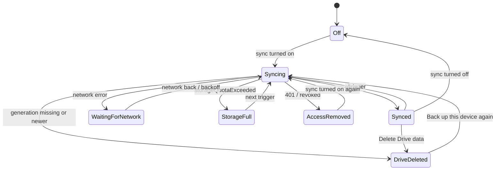

# Sync: data model, merge rules and the sync engine

ToriWords is local-first. All data lives in `user.sqlite` on the phone, and the app is fully usable without sync. There is no ToriWords server and no account.

Optional sync uses the **Google Drive appDataFolder** of a Google account the user picks:
- Drive only stores files of record envelopes.
- All merging happens on the device.
- There is no iPhone↔Android sync. The iOS app uses the same data model and merge rules over iCloud.

**What this file covers:**
- the records and their envelopes, IDs, clocks and the merge rules (shared with iOS and pinned by fixtures);
- the outbox, applying pulled data, the sync cycle, errors, status;
- triggers, authorization and the user actions.

**Related files:**
- [Google Drive transport](#google-drive-transport): how records are laid out in Drive files (push, fetch, compaction, purge, the generation marker).
- [data-model.md](data-model.md): tables and columns.
- [architecture.md](architecture.md): modules and process model.

**Fixtures win:** `fixtures/ids/`, `fixtures/hlc/`, `fixtures/merge/` and the multi-device scenarios in `fixtures/sync/` are normative. Their format is in `fixtures/README.md`. The scenarios use CloudKit vocabulary; [Drive fake for the fixtures](#drive-fake-for-the-fixtures) maps it to Drive, and [testing.md](testing.md) describes how the suites run.

## Goals

- Offline first, and no answers lost.
- The user is never asked to "pick a side", and no one-way full sync is ever needed, even after schema changes.
- A **dumb cloud** that only stores merged envelopes.
- Planning scale: one user, 1–4 devices, 20k Entries, 300k synced records (~200k ReviewLogs).
- No push notifications: another device picks up changes when it next syncs.

## Records

**Synced record types** (wire `type` = table name):

| Wire `type` |
|---|
| `language_pair` |
| `entry` |
| `sense` |
| `context` |
| `source` |
| `card` |
| `review_log` |
| `tag` |
| `entry_tag` |
| `device` |
| `settings` |

**Never synced** (derived locally):
- Entry match key and kind;
- Card stage, due day and all scheduler state;
- ReviewLog elapsed time, review day and review type;
- canonical-ID columns;
- search folds;
- stats, due counts, widget counts.

## Envelope (wire format)

```json
{
  "id": "0192f3c1-7a4e-7cc3-9b1e-3f5a2d6c8e01",
  "type": "entry",
  "schema": 1,
  "owner": null,
  "deleted": false,
  "mergedInto": null,
  "fields": {
    "text":              { "v": "take off",  "c": "0192f3c17a4e00001a2b3c4d5e6f7081", "u": 1 },
    "ipa":               { "v": "/teɪk ɒf/", "c": "0192f3c1802000001a2b3c4d5e6f7081", "u": 0 },
    "enrichment_status": { "v": "done",      "c": "0192f3c1802000001a2b3c4d5e6f7081", "u": 0 }
  }
}
```

| Member | Meaning |
|---|---|
| `id` | UUID string, lowercase, hyphenated. |
| `owner` | The Entry ID for `sense`, `context`, `card`, `entry_tag` (= `entry_id`) and `review_log` (= `owner_entry_id`). Null otherwise. Fixed at creation. Used only by the purge. |
| `fields` | The record's synced columns by column name, plus everything kept in `extra`. |
| `schema` | The payload schema version of this type. |
| `deleted` | Terminal tombstone flag. |
| `mergedInto` | Terminal redirect to the surviving duplicate. |

**Field values:**
- strings, numbers, null;
- booleans (0/1 columns are sent as JSON `true`/`false`);
- IDs as UUID strings;
- `fsrs_w` as a JSON array.

Each field carries:
- `v`: the value;
- `c`: its clock;
- `u`: its author rank.

**Kotlin notes:**
- Envelopes are kotlinx.serialization JSON.
- `extra` keeps each unknown value as a raw `JsonElement`, so numbers and strings round-trip byte for byte.
- Uploads always carry the **full** merged envelope of a record. The outbox only says which records changed.

## IDs

### Random IDs

UUIDv7 (RFC 9562), generated on the device:
- 48-bit Unix ms;
- version 7;
- 12 random bits;
- the variant bits;
- 62 random bits.

The random bits come from `SecureRandom`. The time part is used only for ordering and tie-breaks.

### Deterministic IDs

UUIDv5 (SHA-1, `MessageDigest`) under the ToriWords namespace **`6f1c2a4e-3b7d-5e59-9a0c-5d8e7f2b1c34`**, fixed forever. Names are UTF-8, and IDs inside names are lowercase hyphenated strings.

| Record | Name |
|---|---|
| LanguagePair | `pair:<native>:<target>`, i.e. `pair:ru:en` |
| Card | `card:<entryId>:<direction>` |
| Source with URL | `source:<urlKey>` |
| EntryTag | `entrytag:<entryId>:<tagId>` |
| Settings | `settings` |
| Automatic Sense | `autosense:<entryId>:<ordinal>` |
| Imported ReviewLog (later) | `import:<collectionId>:<ankiRevlogId>` |

All other records use UUIDv7:
- Entry;
- user-chosen Sense;
- Context;
- Source without URL;
- Tag;
- ReviewLog;
- Device.

### ID order

IDs are 16-byte BLOBs. "Smallest ID" always means **unsigned** byte order: SQLite BLOB order, or an unsigned comparator in Kotlin, because Kotlin `Byte` is signed. Pinned by `fixtures/ids/byte-order.json`.

## Hybrid logical clock

**Format:**
- 32 lowercase hex characters: `ms` (12 hex, 48-bit Unix ms) ‖ `counter` (4 hex) ‖ `node` (16 hex = the first 64 bits of the Device ID).
- String order = clock order.

**State:**
- `{ms, counter}` is kept in `sync_state.hlc`.
- It is persisted in the same transaction as each write.
- One stamp per write call.

**Local write.** Let `pt = now()`:
- If `pt > ms`: `ms = pt`, `counter = 0`.
- Else: `counter += 1`.
- On counter overflow (> 0xFFFF): `ms += 1`, `counter = 0`.

**Receive** (each clock `r` in pulled records):
- Standard HLC receive with `ms' = max(ms, r.ms, pt)`.
- **Except:** a remote `r.ms` more than **24 h** ahead of `pt` is not adopted. The record is still stored, and its fields still win.

### Author rank `u`

**Rank 1:** any change caused directly by a user action:
- typing, picking a variant, editing;
- exclude and resume;
- tagging and untagging;
- reordering Senses;
- deleting.

**Rank 0:** everything automatic:
- enrichment fills and `enrichment_status`;
- **both setting and clearing `needs_check`**;
- Card creation and `mergedInto`;
- Device bookkeeping;
- LanguagePair and Settings defaults.

### Comparator

The only conflict rule (`fixtures/merge/field-comparator.json`):

```
wins(a, b) = (a.u, a.c) > (b.u, b.c)        // rank first, then clock string
merge(local, remote) = wins(remote, local) ? remote : local
```

**Envelope merge** (`fixtures/merge/envelope.json`):
- `deleted` = OR.
- `mergedInto`: non-null beats null; the smaller ID beats the larger.
- Fields are merged per field.
- Unknown fields are kept, and disjoint field sets are unioned.
- A tombstone drops all field values.
- A push with only some fields merges exactly like a full envelope.

**Local write rules:**
- A no-op write (same value, rank not rising) creates no clock and no outbox row.
- An automatic (rank 0) write never replaces a rank-1 field.

**Accepted consequence:** if the same field is edited on two devices offline, the later edit wins silently.

**Device-time warning:**
- After each Drive response, compare the device time when the response arrived with the response's HTTP `Date` header.
- More than **1 h** apart in either direction sets an in-memory `clockWarning`, and the status shows "Check your device time".
- A later response within 1 h clears it.
- It never blocks or delays sync.

## Outbox

**Pending changes:**
- Every local write to a synced record upserts `pending_changes(record_id, type, field, clock)` in the same transaction, **but only while sync is active**: `driveAccount` is set and `driveDeleted` is unset.
- Envelope changes use the field names `_deleted` and `_mergedInto`.
- `field = '*'` means the whole record. It is used when sync is turned on, after an account switch, after a device restore and for Back up this device again.

**While sync is inactive:** no outbox rows are written, but every write still gets clocks and ranks.

**After an upload:** an uploaded batch deletes the outbox rows whose `clock` equals the clock that was sent. Rows rewritten in the meantime stay.

## Sync cycle

One cycle at a time. The steps:

1. **Account check:**
   - Without an authorized account, Drive sync is off: stop.
   - If the authorized account differs from `driveAccount` (an account switch), run one transaction:
     - store the new account;
     - clear `pageToken`, `generation` and the Drive file index;
     - clear `driveDeleted`;
     - mark every record pending (`*`, tombstones included).
   - The local words then merge silently into that Drive. Nothing is asked.
2. **Generation:** resolve `generation.json` ([Generation marker](#generation-marker)). A deleted or recreated generation means **Drive data was deleted**:
   - set `driveDeleted = 1` (the outbox goes inactive);
   - set the status;
   - stop.
3. **Clock-ahead check:**
   - If `hlc.ms − lastServerTime > 1 h`, reset `hlc = {ms: max(lastServerTime, now()), counter: 0}`.
   - Re-stamp every pending outbox field: a new local-write clock with the same value and rank, also written to the local `field_clocks`.
   - `lastServerTime` = the latest Drive `modifiedTime` seen on fetched files or own uploads.
4. **Pull:** fetch changed files and apply them ([Fetch](#fetch)), in page transactions (below).
5. **Push:** upload the pending records, minus excluded ones, as batch files ([Push](#push)).
6. **Cleanup:**
   - retry deleting covered files left from an earlier compaction;
   - run the cloud purge of deleted merge groups;
   - compact if due.
7. **After the cycle:**
   - set `lastSyncAt = now`;
   - rewrite the widget snapshot and update the widget;
   - re-arm the reminder.

## Applying pulled records (one transaction per chunk)

Apply in chunks of at most 400 envelopes per Room transaction.

**For each record:**
1. Unknown `type`: skip it (it stays in Drive, see [Schema evolution](#schema-evolution)).
2. Run the HLC receive for each field clock.
3. Not present locally: insert it, with known fields to columns and unknown ones to `extra`. Present: envelope merge.
4. **Child of a known deleted Entry** (by `owner` or canonical owner): drop it, and queue it for the cloud purge.
5. **Tombstone** (new or merged in):
   - drop the field values locally;
   - if it lands on any member of an Entry merge group, write the tombstone on the canonical survivor (rank 0, outbox) in this transaction;
   - hide and later purge the group's children.
6. If a field of a **merged loser** changed: re-run the survivor field merge for that record, so a newer user value reaches the survivor.

**Then, for the records touched in the chunk:**

7. Recompute derived columns:
   - `match_key`, `url_key`, `name_key`;
   - the canonical-ID columns;
   - `review_day`;
   - search folds.

   Resolve newly arrived parents of orphans.
8. Run the duplicate merge for the affected natural keys, parents first.
9. Create missing Cards for Entries that became reviewable (deterministic IDs, rank 0).
10. Replay the affected canonical Cards ([scheduler.md](scheduler.md#replay-and-rebuild)).
11. Store the Drive bookkeeping (`pageToken` with the last file of a page, the file index) and commit.

The final state must equal applying everything at once. Fixture `sync/012-orphans-across-pages.json` covers a child in one page and its parent in the next.

## Duplicate merge

Pinned by the `sync/` fixtures.

### Natural keys

Every key starts with NFC. The key functions are in `fixtures/normalization/`.

| Type | Natural key |
|---|---|
| Entry | canonical LanguagePair + `matchKey(text)` |
| Sense | canonical Entry + `t:` `matchKey(translation)`. If the translation is empty: canonical Entry + `d:` `matchKey(definition)`. A Sense with neither never merges. |
| Context | canonical Entry + `sentenceKey(sentence)` (empty for a source-only Context) + canonical Source (the raw `source_id` if the Source is missing, or none) |
| Tag | `tagKey(name)` |
| Source without URL | `matchKey(title)` + app name as stored + `kind` (keeps a `suggested` Source apart from a typed title with the same text) |

Sources with a URL never need merging: their ID is deterministic from the URL key.

### Algorithm

The merge runs:
- after every pulled chunk;
- after a restore;
- after a local edit that changes a natural key.

The order is Entries, then Senses, Contexts, Tags, Sources.

1. Group live records (not deleted, not merged) by natural key.
2. **Survivor** = the smallest ID (unsigned).
3. **Losers** get `merged_into = survivor.id` (rank 0, outbox).
4. **Fields:**
   - For each field, the survivor takes the loser's `{v, c, u}` if `wins(loser.field, survivor.field)`.
   - The original clocks and ranks are copied; no new clocks are made.
   - These copies are not outbox writes, because every device computes the same result. Only `merged_into` is pushed.
   - The owner column is never copied.
5. **Children are not rewritten.** They resolve through the local canonical-ID columns. ReviewLogs keep `card_id`; their canonical Card is `v5("card:"+canonicalEntryId+":"+direction)`.
6. Re-check child types for new duplicates (repeat steps 1–5).
7. Replay the affected canonical Cards.

### Tags

- **EntryTag membership** of `(canonicalEntry, canonicalTag)` = OR of `present` over all EntryTag records that resolve to it.
- **Tag:** write `present = 1` (rank 1) to `v5("entrytag:"+canonicalEntry+":"+canonicalTag)`, creating it if needed.
- **Untag:** write `present = 0` (rank 1) to every EntryTag record that resolves to the pair.

### Sense order after a merge

`(sense.entry_id == canonical entry ? 0 : 1, position, id)`. A user reorder writes new `position` values (rank 1).

### User-initiated merge

When an edit makes a match key collide with another word, the product asks the user. On confirm, the same algorithm runs.

## Deletion

### Delete wins

- Deleting sets `deleted = true`, and the merge is an OR.
- Once a record is deleted on any device it never comes back, even if another device edited or reviewed it offline.
- An Entry (or Sense, Context, Tag, Source) is deleted when **any** record of its merge group carries a tombstone. The client then writes the tombstone on the canonical survivor.

### What gets tombstoned

- Only the Entry is tombstoned, not each child.
- Its Senses, Contexts, Cards, EntryTags and ReviewLogs are hidden through `owner` and canonical resolution, then purged locally. Children that arrive later are dropped.
- Senses, Contexts, Tags and Sources can be deleted individually; ReviewLogs never are.
- Deleted Entries do not count for duplicate detection.
- Re-capturing a deleted word creates a new Entry with no history.
- Tombstones are kept forever (envelope only, about 100 bytes).

### Deletion with Undo

- During the Undo window (about 4 s) the Entry is only hidden; nothing is written.
- The tombstone is written (rank 1, one transaction) when:
  - the window closes;
  - another delete starts;
  - the app goes to the background (`ProcessLifecycleOwner` `ON_STOP`, in the application scope under `NonCancellable`).
- A crash inside the window leaves the Entry undeleted.

### Local purge

- While sync is **inactive**: immediate.
- While sync is **active**: once the Entry tombstone has been uploaded, followed by the cloud purge. It covers the whole merge group.

### Cloud purge

This is for privacy, not correctness. Once an Entry tombstone has been uploaded, or a pulled tombstone lands on a merge group, the client removes from Drive:
- every envelope owned by any Entry of that group: Senses, Contexts, Cards, EntryTags, ReviewLogs;
- every non-tombstone envelope of the group's Entries.

It keeps the tombstones, so no word text remains in Drive. The Drive mechanics (rewriting files in place) are in [Purge](#purge).

**Purge on sight:** a device that later fetches a live child of a tombstoned group (a late upload from an offline device) purges it the same way. Entry tombstones stay forever, so delete still wins everywhere.

## Schema evolution

- **Unknown fields** go to `extra`, and are merged and uploaded back unchanged.
- **Unknown record types** are skipped on pull and left untouched in Drive. A file holding them is never put in a snapshot's `covers` and never deleted.
- **Backfill:** after an app update that knows a new type, the app runs a download-only backfill: one fetch with no page token, applying only records of the newly known types. Nothing is re-uploaded. It waits while `driveDeleted` is set. (Not needed in v1: no new types exist yet.)
- **A newer `schema`:** known fields are applied, and unknown ones go to `extra`.
- **Within an envelope version, changes are additive only:**
  - new optional fields with defaults;
  - new record types.

  A field's meaning never changes: add a new field instead.
- **Derived-data changes** (normalisation, scheduler version) only trigger local recomputation.
- **A breaking envelope or file change** uses a new Drive file `layout` ([Layout versioning](#layout-versioning)). Old app versions keep syncing the old layout.

## Errors and backoff

| Drive response | Reaction |
|---|---|
| No connection, timeout, 5xx | Exponential backoff with ±20 % jitter: 5 s, 10 s, 20 s … up to 15 min while the app is open. In the background, the `sync-retry` work uses WorkManager backoff. Status "Waiting for network". |
| `403 rateLimitExceeded` / `userRateLimitExceeded`, `429` | Wait for `Retry-After` (else the backoff), then resume. |
| `403 storageQuotaExceeded` | Stop this cycle. Status "Google Drive storage is full". Retried on the next trigger. Local use continues. |
| `401` after one silent re-authorization, or access revoked | Status "Google Drive access was removed". The outbox keeps queueing. The user turns sync on again to re-grant. |
| `410` or an invalid `pageToken` | Fetch everything again with no page token ([Fetch](#fetch)). |
| `413` | Halve the batch and retry. |
| Download `404` | The file was compacted or purged away: skip it. |
| Any other per-file error | Log locally (no telemetry). Keep the records' outbox rows but exclude them from uploads until the app version changes. |

**Excluded records:**
- Excluded records are stored as `excludedRecords = {appVersion, ids}` and cleared when the app version changes.
- An envelope over **64 KB** is never uploaded and is excluded the same way.

## Sync status



| State | Status line in Settings → Google Drive sync | Sync now |
|---|---|---|
| Off | off: words stay on this device | hidden |
| Syncing (the first sync shows progress; the app stays usable) | "Syncing…" | disabled |
| Synced | "Synced {time ago}", e.g. "Synced 2 min ago" | enabled |
| WaitingForNetwork | "Waiting for network" | enabled |
| StorageFull | "Google Drive storage is full" | enabled |
| AccessRemoved | "Google Drive access was removed" | disabled |
| DriveDeleted | "Drive data was deleted" + **Back up this device again** | disabled |
| Any state with `clockWarning` | "Check your device time" (sync continues) | as the underlying state |

Exact copy: [copy.md](copy.md).

## Triggers and background work

**Concurrency:**
- `SyncEngine` runs one cycle at a time, behind an in-process `Mutex`.
- Triggers coalesce through a conflated `Channel`.
- A worker and a foreground trigger share the same singleton, so they never run two cycles at once.

**Triggers** (all are no-ops while sync is off or `driveDeleted` is set):

| Trigger | Android mechanism |
|---|---|
| App comes to the foreground | `ProcessLifecycleOwner` `ON_START` |
| ~5 s after the last local change (in-app edits, answers, captures) | `sync-debounced` work: unique, `REPLACE`, initial delay 5 s, `CONNECTED` |
| "Sync now" | Direct call from Settings |
| Sync turned on / Back up this device again | Direct call |
| Background refresh | `sync-periodic` work: unique periodic **every 4 h** (flex 1 h), `CONNECTED`. Enqueued while Drive sync is on; cancelled when sync is turned off, access is removed or Drive data was deleted |
| Network back after a failure | `ConnectivityManager.registerDefaultNetworkCallback` while the process lives; otherwise `sync-retry` work (unique, `KEEP`, `CONNECTED`) |

**Rules:**
- **Capture:** the capture sheet never syncs itself. After Save it enqueues `sync-debounced`, so a capture syncs within seconds when online.
- **Pending deletions** are written on `ON_STOP` (see [Deletion with Undo](#deletion-with-undo)), and the debounced sync picks them up.
- **No foreground service:** long work (first sync, large backlogs) is resumable and continues in the next run.

## Authorization

There is no sign-in, session or token store of our own.

### Turning sync on

1. **Turn on Google Drive sync** calls `Identity.getAuthorizationClient(activity).authorize(AuthorizationRequest)` with the single scope `https://www.googleapis.com/auth/drive.appdata`.
2. If a `PendingIntent` comes back, the app launches it: the system account picker and consent screen.
3. Cancelling does nothing.

### Account and tokens

- The granted account is stored only as an opaque hash in `sync_state.driveAccount`. No email address is stored.
- Access tokens come from `AuthorizationClient` and are held in memory only.
- On a `401` the app re-requests a token silently once. Failing that, the status is "Google Drive access was removed".
- The Drive REST API v3 is called over OkHttp. There is no Drive Android SDK.

### Turning sync off

- Clears `driveAccount`, so the outbox stops.
- Cancels the sync works.
- Revokes access through `AuthorizationClient.revokeAccess` where available.
- The Drive copy stays.

### Release prerequisite

A Google Cloud project with an OAuth consent screen and an Android OAuth client per signing key (SHA-1). Debug builds signed with an unregistered key cannot authorize, so their Drive sync shows "Not available on this device".

### Devices without Google Play services

- Drive authorization needs Google Play services.
- Without them, Settings → Google Drive sync shows **"Not available on this device"**, and no trigger runs.

### Privacy

- Drive app data is visible only to ToriWords. In Drive the user sees only its total size and **Delete hidden app data** (Drive → Settings → Manage apps).
- Nothing is sent anywhere else.

## User actions

### Delete Drive data…

Settings → Google Drive sync, after a confirmation dialog:
1. Delete every file in the appDataFolder.
2. On this device:
   - set `driveDeleted = 1`;
   - clear `pageToken`, `generation` and the file index;
   - keep the words.
3. Other devices find the generation gone or newer on their next sync and enter the same state.

**Offline or on failure:** nothing changes locally. The app shows the no-connection dialog: "No internet connection" / "Connect to the internet and try again. Nothing was changed." ([copy.md](copy.md)). A partial deletion is completed by the next Delete Drive data…; other devices that see a missing or newer marker treat it as deleted anyway.

### Back up this device again

Shown only while `driveDeleted` is set. One transaction:
- clears `driveDeleted`, `pageToken`, `generation` and the file index;
- marks every record pending.

A cycle then creates or adopts the generation and uploads.

### Remove all data from this device

Settings → Data; it warns about unsynced changes first. One transaction:
- deletes all user records and the outbox;
- re-creates the LanguagePair and Settings defaults;
- clears `pageToken`, `generation` and the file index.

What stays:
- Device rows;
- `driveAccount`.

While sync is on, the warning says the words stay in Google Drive and come back at the next sync, and that **Delete Drive data…** deletes them everywhere.

### Device restore

When Android Auto Backup or a device transfer restored the database (start-up detection: [architecture.md](architecture.md)):
- the app gets a new Device ID;
- it resets `pageToken`, `generation` and the file index;
- it marks every record pending.

`driveAccount` stays. Authorization is re-obtained silently if the account exists on the new phone; otherwise the status is "Google Drive access was removed".

### Restore from a backup file

- With sync on, it runs one sync cycle before the restore and one after it.
- Every inserted or updated record gets a `*` outbox row.

## Google Drive transport

How the sync cycle stores records in the Google Drive appDataFolder. Drive is a dumb file store: every merge decision is the record-level rules above; this part only covers how envelopes get into and out of files and how files are cleaned up. (The iOS app keeps one cloud record per sync record in iCloud; on Drive, records travel in immutable batch files.)

### Drive API usage

- Drive REST API v3 over OkHttp.
- Scope `drive.appdata` only.
- Every request uses `spaces=appDataFolder`.
- Every reference and deletion uses the Drive **fileId**. File names are only for diagnostics, because Drive does not keep names unique.
- HTTPS with the system CAs. No certificate pinning.

### File kinds

All files are gzip-compressed JSON.

**Drive `appProperties`.** Each file carries `{layout: "1", generation, kind, deviceId, seq | n, part}`, so `files.list` can classify it without downloading it.

**Body:**

```json
{ "layout": 1, "generation": "<uuid>", "kind": "batch", "deviceId": "<uuid>", "seq": 42,
  "part": 0, "parts": 1, "records": [ /* envelopes, see Envelope */ ] }
```

| Kind | Name | Contents and limits |
|---|---|---|
| **Batch** | `b-<deviceId>-<seq>.json.gz` | At most 300 envelopes and 2 MB uncompressed. An envelope over 64 KB is never uploaded (it goes to the excluded records). |
| **Snapshot** | `s-<deviceId>-<n>-<part>.json.gz` | The full merged state a device holds, in parts of at most 5,000 envelopes and 20 MB uncompressed. Part 0 also carries `parts` and `covers`: the `{fileId, name}` of every file whose content the snapshot includes (the fileId is authoritative). |
| **Generation marker** | `generation.json` | `{generation: <uuid>}`. Identifies the current incarnation of the user's Drive data (see [Generation marker](#generation-marker)). |

### Push

**Sequence numbers:**
- Every upload attempt, including a retry after a lost response, first persists `deviceSeq + 1` and uses the new value.
- One device therefore never writes two files with the same name.

**A batch:**
- A batch holds the full merged envelopes of pending records, minus the excluded records.
- On success, delete the outbox rows whose `clock` equals the clock that was sent.

**Conflicts:**
- A lost response makes the retry upload a duplicate batch. That is harmless, because merging is idempotent.
- New files are immutable and never conflict. A push has no "record changed on the server" case.

### Fetch

#### Delta fetch

- Delta: `changes.list(spaces=appDataFolder)` from the stored `pageToken`. Download and apply each changed file.
- Files whose `appProperties.deviceId` is this device may be skipped **only** on a delta fetch with a stored `pageToken`. They are never skipped on a fetch without a token.
- Apply envelopes in chunks of at most 400 per Room transaction. `pageToken` is stored in the transaction that applies the last file of the page, so re-applying after a crash is idempotent.

#### File changes are not deletions

- `removed` or trashed changes are file housekeeping, **never record deletions**. Deletions travel only as tombstones inside envelopes.
- A download `404` means the file was compacted or purged away. Skip it: its content is in a newer snapshot or a rewritten file.

#### Server time

`lastServerTime` = the maximum `modifiedTime` of fetched files and of this device's uploads. It feeds the clock-ahead check in [Sync cycle](#sync-cycle).

#### Fetch without a token

Used for:
- the first sync;
- a backfill;
- an expired token (`410`);
- after Remove all data;
- after an account switch;
- for Back up this device again.

Steps:
1. Call `changes.getStartPageToken` first.
2. Then `files.list` every file, including this device's own.
3. Apply the newest complete snapshot first.
4. Then apply every file whose fileId is not in that snapshot's `covers`.

#### File index

Fetch and push maintain a local file index. It is described below under [Local state](#local-state).

### Compaction

Any device can compact, globally. Batch files would otherwise grow without bound.

**When a device compacts:**
- When at least 200 batch files are not covered by the newest snapshot, a device in the foreground compacts.
- It writes a full snapshot of every record it holds.
- After all parts are uploaded, it deletes by fileId exactly the files in its `covers`, whoever wrote them.

**What `covers` lists:**
- Only files this device has fully applied.
- An older snapshot is deleted only if it was fully applied and is therefore listed in `covers`.

**Invariant:** a file is deleted only by a device whose uploaded snapshot includes its content.

Some files are never put in `covers` and never deleted:
- files with a newer `layout`;
- files with records of unknown types (skipped on apply and not stored locally).

**Interrupted compaction:** covered files not yet deleted (the app was killed, or a delete failed) stay marked `pending_delete`. The author retries at the start of its next cycle.

**Concurrent compactions** are safe, only wasteful. `snapshotN` numbers this device's snapshots.

### Purge

This is the Drive form of the cloud purge in [Cloud purge](#cloud-purge). Any device can run it, not only the author.

1. Look up in `drive_file_owner` the fileIds that hold envelopes of the purged owners.
2. Download only those files.
3. Rewrite each one in place without those envelopes (`files.update` media upload, same fileId and name).
   - The rewrite works on the raw JSON, so unknown fields and types are kept.
   - A file left with no envelopes is deleted.

**Entries' own envelopes:**
- Older envelopes with values of the deleted Entries themselves also sit in earlier files.
- The same rewrite removes every **non-tombstone** envelope of each Entry in the deleted merge group and keeps its tombstones, so no word text remains in Drive.
- `drive_file_owner` indexes an Entry's own envelopes under the Entry's id. `has_live` marks files that still hold a non-tombstone envelope of that owner.

**Re-applied files:** rewritten files reappear in `changes.list`, and are re-applied idempotently and re-indexed.

**Concurrent rewrites:**
- `files.update` has no precondition, so two devices rewriting the same file can undo one purge.
- This is accepted, because purge on sight converges it: a device that applies a file holding envelopes of an owner it already has tombstoned re-runs the purge for that file.

### Generation marker

`generation.json` tells "the user deleted the Drive data" apart from normal operation. The device stores the winning UUID as `generation` and the file's `createdTime` as `generationCreatedTime`.

#### Creating it

- It is created only when none exists.
- Drive has no create-if-absent, so duplicates can appear. The winner is the earliest `createdTime`; on a tie, the lowest fileId wins.
- Any device deletes the losers.

#### Resolving it each cycle

- **Stored `generation` unset** (first sync, empty or new Drive, account switch, Back up this device again): adopt the winner, or create a marker.
- **Stored value set and the winner differs:**
  - The winner's `createdTime` ≤ the stored `generationCreatedTime`: this was a creation race. Adopt silently in one transaction: store the new UUID and `createdTime`, and mark every record pending (`*`). Everything uploaded under the losing generation is then re-sent under the winner.
  - The winner is later, or there is no `generation.json` at all: **Drive data deleted**. Set `driveDeleted = 1` (outbox inactive). The status becomes "Drive data was deleted".
- A real delete-and-recreate always has a later `createdTime`. This covers **Delete hidden app data** in Drive settings and **Delete Drive data…** on another device.

#### Files of other generations

Every batch and snapshot carries the `generation` it was written for. A file whose `generation` is not the current winner is classified by its `createdTime`:
- **Earlier than the winner's `createdTime`:** a stray upload from a deleted generation (a device that raced Delete Drive data… before the new marker existed). It is never applied, and any device that sees it deletes it.
- **Equal to or later than the winner's `createdTime`:** an upload of a generation that lost a creation race. It is applied normally and left for compaction to cover. Its author re-sends its records under the winner.

#### Re-check after upload

- After each upload the device checks `generation.json` again with the same rules.
- A creation race means silent adoption.
- A real deletion means it deletes the file it just uploaded and handles Drive data deleted.

### Layout versioning

- `layout` = 1.
- **Files with a higher `layout`** are never applied, rewritten or deleted. The device keeps syncing layout-1 files and shows no extra status.
- **A breaking envelope or file change** is a new `layout`. Old app versions keep working in the old layout.

### Local state

Local-only Room state, never synced. Columns are in [data-model.md](data-model.md).

**`sync_state` keys:**

| Key | Meaning |
|---|---|
| `driveAccount` | Opaque hash of the authorized account. |
| `pageToken` | Drive changes token. |
| `generation`, `generationCreatedTime` | The adopted marker. |
| `driveDeleted` | Set when Drive data was deleted. |
| `deviceSeq` | Last batch sequence number. |
| `snapshotN` | Last snapshot number. |
| `hlc` | Clock state. |
| `lastServerTime` | Max Drive `modifiedTime` seen. |
| `lastSyncAt` | End of the last successful cycle. |
| `excludedRecords` | `{appVersion, ids}`. |

The outbox is active when `driveAccount` is set and `driveDeleted` is unset.

**File index:**
- `drive_file(file_id PK, name, kind, device_id, layout, generation, modified_time, applied, has_unknown, pending_delete)`.
- `drive_file_owner(file_id, owner, has_live, PK (file_id, owner))`, with an index on `owner`.
- Compaction (`covers`) and purge use them.
- They are filled on fetch, push, compaction and purge.
- They are cleared together with `pageToken` on every reset to a fetch without a token.
- Files skipped on such a fetch because a snapshot covers them are still indexed from `files.list` metadata. Their owners are read when a purge first needs them: a purge downloads every indexed file whose owners are still unknown.

### Mapping to the shared cloud interface

The shared sync engine talks to a `CloudDatabase` interface (the iOS app implements it over CloudKit). The Drive adapter:

| Interface / error | Drive |
|---|---|
| `accountStatus` | `driveAccount` plus `AuthorizationClient`. No authorized account = unavailable. |
| `ensureZone` | No-op. |
| `claimZoneGeneration` | The `generation.json` rules above. |
| `fetchChanges` | `changes.list` plus downloads. Fetched deletions are always empty. |
| `save` | Batch upload. Outcomes: saved / retry / failed only. |
| `delete` | Purge rewrite. |
| `deleteZone` | Delete every file in the appDataFolder. |
| `network` | No connection, timeout, 5xx. |
| `rateLimited(retryAfter)` | `403 rateLimitExceeded` / `userRateLimitExceeded`, `429`. |
| `quotaExceeded` | `403 storageQuotaExceeded`. |
| `notAuthenticated` | `401` after a silent re-authorization, or revoked access. |
| `changeTokenExpired` | `410`, or an invalid `pageToken`. |
| `limitExceeded` | `413`. |
| `other` | Any other per-file error. |

### Drive fake for the fixtures

The multi-device scenarios in `fixtures/sync/` run against an in-memory Drive fake. The fake models:
- fileIds and non-unique names;
- `createdTime` and `modifiedTime` from the scenario clock;
- `changes.list` paging with `removed` entries, and token invalidation;
- the duplicate `generation.json` race (it must not trigger `driveDeleted`);
- concurrent in-place rewrites;
- scripted 401 / 403 / 429 / network errors.

Scenario-specific readings:

| Scenario | Drive reading |
|---|---|
| 012 | The page `limit` = envelopes per changes page and per apply chunk. |
| 036 | Still stops the other device. |
| 037 | `racedBy` converges on the next pull, with no conflict. |
| All | The state names `iCloudOff` / `cloudUser` map to Drive sync off / `driveAccount`. |

How the suites run: [testing.md](testing.md).
