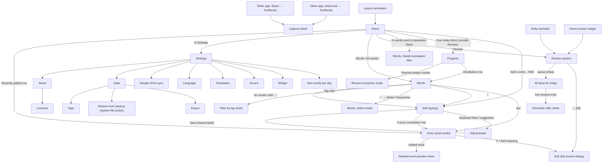

# ToriWords Android — UI

This file describes the Android screens: the navigation map, Material 3 rules for each screen, Back behaviour, motion and haptics, accessibility, and branding and theme. Behaviour (what a feature does, edge cases, offline) is in [product.md](product.md). Concepts (word, meaning, sentence, card) are defined in [domain.md](domain.md). How things are built is in [architecture.md](architecture.md). All UI strings, in English and Russian, are in [copy.md](copy.md). Every deliberate difference from the iOS app is listed in [ios-differences.md](ios-differences.md).

**Template.** The iOS app on `main` of this repository (`ios/`) is the UI reference. This file adapts it to Material 3 and Android conventions: system Back, predictive back, edge gesture zones, edge-to-edge, launcher wording. Where this file is silent, do what the iOS app does.

**Platform.** Android 12 (API 31) and later, phone-first. Tablets, foldables and resizable windows use the same adaptive layout, with no tablet-specific screens.

**Name.** The UI writes the product name as **"ToriWords"**. The launcher label is "ToriWords" too.

## 1. Presentation baseline

- Material 3 components, with the fixed ToriWords palette (section 7). No dynamic colour.
- Small top app bars: **←**, a title, actions, and **⋮** for overflow. No large titles.
- No floating action button and no bottom navigation bar. One back stack starts at Home.
- M3 alert dialogs for confirmations. Snackbars only for **Undo** after a delete or a row action. M3 modal bottom sheets.
- Settings is an M3 list with section headers. Values show as supporting text. There are no chevrons on rows, except the text chevrons that are part of the copy ("All words ›", "Due today ›").
- Entry edit mode is a full-screen dialog with **✕** and **Save**.
- Touch targets are at least 48 dp, including the icon buttons in the Review header. Icon buttons are standard M3 icon buttons. There are no glass or blur effects.
- Primary actions are **filled** buttons; secondary actions are **outlined** buttons; minor actions ("Not now", "Cancel") are text buttons.

## 2. Navigation map

- The reminder and the widget always open Review, never Progress.
- The capture sheet does not appear in Recents. After Save or dismiss, the user is back in the source app.

## 3. System Back, predictive back, edge-to-edge

**Back order.** System Back (button or gesture) does what **←** does, with these rules:
- Back first closes whatever is open on top: an open row tray, a sheet, a dialog, a menu, or the Review card while it is being dragged (the drag is cancelled).
- Edit mode with unsaved changes asks **"Discard changes?"** (Keep editing / Discard). With no changes it closes at once.
- From the Add preview, Back returns to typing with the text kept, without a prompt.
- From Add typing, Back leaves Add at once, without a prompt, and the typed text is discarded.
- In Review, Back leaves the session (same as ✕). Given answers are kept. In practice, Back leaves practice.
- On the capture sheet, Back slides the sheet away, back to the other app, and nothing is saved.
- On an alert that has only **OK**, Back counts as OK.
- Back on Home leaves the app.

**Predictive back** is on (required on current Android). The previous-screen preview shows only when Back would actually leave the screen. When Back first closes something or asks first (the cases above), there is no preview: that element is handled first.

**Edge gesture zones.** A drag that starts in either system edge gesture zone is always system Back, never a review swipe or a row swipe. The custom swipes start inside the content.

**Edge-to-edge.** Content draws behind the status bar and the navigation bar, with insets applied. The select-mode bottom bar and sheets sit above the gesture handle. The keyboard pushes content up through IME insets; focused fields stay visible.

## 4. Screens

### 4.1 Home

- **Top app bar:** the live header on the left (the ToriWords mark at 32 dp and "ToriWords" in title style, 4.1.1). On the right: **Words** (text button) and **⚙** (Settings).
- Below the bar: the **"Add a word…"** field. It is a button styled as a field and opens Add.
- **Due today block** (a card, radius 16, surface colour). The whole block except the Review button is one tap target with an M3 ripple. Its first line is the text "Due today ›" in secondary colour. The rest depends on the state:

| State | Block content | Tap opens | Review button |
|---|---|---|---|
| Something due | "12 to review · 5 new" (a zero part is dropped: "12 to review", "5 new"). In catch-up, a secondary line under it: "Welcome back — N cards are waiting. We'll spread them over about a week." | Progress | filled **Review** |
| All done today | "All done for today" plus a secondary "Next review: tomorrow" / "in N days" line (left out when nothing is scheduled) | Progress | none |
| Nothing due today (also when every word is paused or known) | "Next review: tomorrow" / "Next review: in N days", or "Nothing to review today" when nothing is scheduled | Progress | none |
| Nothing reviewable, and at least one word needs a translation (N ≥ 1) | "N words need a translation"; never shown with 0 | Words with the **Needs translation** filter | none |
| Empty vocabulary | the block is not shown; the empty-state card shows instead | — | — |

- **Recently added:** a "Recently added" heading and the 5 newest words. Each row shows the word (semibold) and its second line: the primary translation, or "Translation pending" / "No translation found — add your own" / "No translation yet". A tap opens the entry. Under the list: **All words ›** opens Words.
- **Empty state card:** "Build your vocabulary", then "Words you add come back for review just before you forget them.", then two lines with icons, then a footnote and a button:
  - ⌨ "Type it — tap "Add a word…" above";
  - the selection icon with "From any app — select text → ToriWords";
  - the footnote "Works offline: the dictionary is built in.";
  - a filled **Add your first word**.
- Home has no search, no sync status and no translation-model indicator.

#### 4.1.1 Live header

The mark and the name in the Home top app bar are one decorative tap target. A tap does not navigate anywhere. Motion is described in section 5.2. TalkBack reads it as the heading "ToriWords" and announces no action.

### 4.2 Add

- **Typing screen:** top app bar with **←** and the title **Add**, no Save. The field "Add a word…" is focused with the keyboard up. The keyboard action **Next** opens the preview for the typed text.
  - From the second character, an autocomplete list appears. Each row shows the word (semibold) and its part of speech, the primary translation as a second line, and, for words already saved, an **"In your vocabulary"** badge on the right (info fill, accent ink). A tap on such a row opens the entry; any other row opens the preview.
  - Russian typed in the field shows English candidates under a "Russian → English" heading. With none, the line reads "Type the English word or phrase".
  - **Typed sentence** (more than 6 words, or ending with sentence punctuation): the field is followed by word chips under "Tap the word to save", with the footnote "The text is kept as the sentence." The first tap picks a word. A tap next to the selection extends it into a phrase. Any other tap starts again.
  - **Under the empty field**, until the first save in this visit: the Home empty-state card without its button.
  - **After a save:** a "✓ Saved" line (success colour) under the cleared field. Under it, "Related to "<word>"" with related-word rows (4.7), then the widget hint (4.12) when it applies.
- **Preview screen:** a separate screen pushed on top of typing. Top app bar: **←**, the title **Add**, and a **Save** action (enabled whenever the text can be saved). Content, as an M3 list with section headers:
  - the word in the card-word style with ▶, then IPA · part of speech;
  - **Save as** (when the dictionary knows a base form): a two-option segmented button, base form (preselected) / typed form;
  - **Phrases** chips (when the dictionary knows phrases contained in the text): opt-in filter chips;
  - the **"Already in your vocabulary"** banner (info), "Save adds newly checked meanings and the sentence.", with **Open word**. For a known or paused word, the banner reads "You marked this as known" / "You paused this word" with "Save adds the sentence and meanings." and a **Resume learning** switch, applied on Save;
  - **Translation:** variant rows with **checkboxes** (several can be checked). Dictionary variants come first, then the machine variant with a "Machine translation" badge. The first variant is pre-checked. Existing meanings show checked and disabled. Below the variants, the field "Type a translation (optional)". With no variants, a reason line instead (copy.md, Translation-model states). While loading, an indeterminate progress indicator;
  - **Definition:** the definitions of the checked variants, each once;
  - **Sentence (optional)** and **Source (optional)** fields. Under a non-empty sentence: "In this sentence: <machine translation>" in secondary text (not saved);
  - **Tags:** the tag editor (4.6).
- **Save:** the preview closes itself and typing shows the cleared field with "✓ Saved". If saving fails, the dialog "Something went wrong" (OK) appears and the preview stays.

### 4.3 Capture sheet

- **Entry points:**
  - **ToriWords** in the text-selection menu of other apps. In some apps it sits under the menu's overflow ⋮. The app cannot control this and shows no tip about it.
  - **ToriWords** in the Android share sheet (text or a link).
- **Sheet:** an M3 modal bottom sheet over the other app, with a drag handle and the title "ToriWords". Sections in order:
  1. **Text:** for a longer selection, word chips under "Tap the word to save". Otherwise, the editable "Word or phrase" field. Non-Latin text shows "ToriWords saves English words and phrases" in danger colour under the field, and Save stays disabled.
  2. **Save as** / **Phrases** offers, as in the Add preview.
  3. **Already in your vocabulary** (with "Save adds this sentence and source."), or the known/paused banner with **Resume learning**.
  4. **Translation:** checkbox variants (dictionary, then Machine translation) and "Translation (optional)". With nothing to pick, the footer reads "Without a translation the word is saved as "Translation pending"."
  5. **Source:** "Source title", prefilled. For a text selection: the source app's name when Android reports it, otherwise empty. For Share with a link: "<app> · <domain>" or the page title. The last value is offered again for 30 minutes.
  6. **Tags** (collapsed; the last used tags are offered for 30 minutes).
  7. A full-width filled **Save**.
- **Keyboard:** for a short selection the sheet opens without the keyboard. For a link-only share, the word field is focused with the keyboard up, and Save is disabled until a word is typed.
- **After Save:** a **"✓ Saved"** badge (a capsule with a check icon, centred over the sheet) shows for about 0.7 s. Then the sheet closes and the user is back in the source app. There is no toast and no snackbar.
- **Dismiss:** Back, a swipe down, or a tap outside closes the sheet; nothing is saved.

### 4.4 Review

- Full screen, edge-to-edge, with its own header row and no top app bar.
- **Header:**
  - **✕** on the left;
  - **↶** (Undo last answer) next to it, only while an undo exists, hidden otherwise;
  - the position in the centre: "3 / 17", or "Practice · 3 / 17" in practice (TalkBack: "Card 3 of 17");
  - **⋮** on the right, on the back side only: Edit, I already know this, Pause, Delete.
  - All are 48 dp M3 icon buttons.
- **Card:** one surface, flipped around the vertical axis (0.35 s ease-in-out; with Remove animations, a 0.2 s cross-fade). Tapping the card flips it.
  - **Recognition front:** the word in the card-word style with ▶, then the sentence with the word highlighted, then "Tap to show answer".
  - **Recall front:** "Say it in English" at the top, then the Russian translation(s), then the sentence with the word blanked as "______", then "Tap to show answer". No speaker on this side.
  - **Cloze front:** the sentence with the word blanked, larger, then "Fill in the missing word" and "Tap to show answer". Without a usable sentence it shows the translations, as on recall.
  - **Back:** the word with ▶; IPA · part of speech; the translations on one line, comma-separated, each once; each distinct definition once; the sentence (highlighted) with its own ▶ and "— <source>". The back scrolls when long.
- **Buttons** under the card, only after the flip: **Forgot** (filled, danger colour) and **Remembered** (filled, success colour), side by side and full width.
- **Swipe** after the flip: right = Remembered, left = Forgot. Feel and haptics are described in section 5.3.
- **End screens.** The content is centred, with the title in the card-word style. At the bottom: an optional outlined **Learn more new words**, and under it a filled **Done**.

| Screen | Title | Detail lines | Learn more new words |
|---|---|---|---|
| Session finished | "All done for today" | "N cards reviewed · M remembered · K new words"; "Next review: …" | when new words wait and the daily limit is above 0 |
| Opened with nothing due | "Nothing to review today" | "Next review: …" when something is scheduled | same rule |
| Practice finished | "Practice done" | "N cards · M remembered" | never |
| No words at all | "Add words to start reviewing" | — | — (the filled button is **Add a word**, which opens Add) |

- **Reminder offer:** after the first finished session ever, a bottom sheet over the summary (4.12).
- **Rotation, resizing and folding** keep the position and the flip state.

### 4.5 Words and Entry

**Words list**
- **Top app bar:** ←, the title "Words", and these actions:
  - **⇅ Sort**, a menu with radio items Newest / A–Z / Next due;
  - **⋮** with **Select**;
  - **+**, which opens Add (TalkBack: "Add a word").
- **Below the bar:**
  - an M3 search bar, "Search words, translations, sentences";
  - one horizontally scrolling row of filter chips: All, Needs translation, Check translation, Phrases, New, Learning, Known well, Known, Paused, **Tag**. The chips are single-select, except Tag, which combines with the others. The Tag chip label reads "Tag", "work" or "work +1";
  - the count line "214 words · newest first" (or "· A–Z", "· next due first").
- **Rows:** the word (semibold) and its second line (primary translation or state line). The stage badge sits on the right; badge colours are in section 7.2.
- **Row swipe left:** reveals **I already know this** (success colour) · **Pause** (neutral grey) · **Delete** (danger). Paused and known rows show **Resume learning** (accent) instead of the first two. Only one row is open at a time. Scrolling, a tap elsewhere or Back closes it. The same actions exist as TalkBack custom actions on the row.
- **Select mode** is entered by **⋮ → Select** or by a **long-press** on a row (TalkBack action "Select").
  - A contextual top app bar shows **Cancel**, "N selected" and **Select all** / **Deselect all**.
  - Rows show checkboxes, and row swipes are off.
  - A bottom app bar shows **Tag** · **Known** · **Pause** · **Delete**. When every selected word is Known or Paused, **Resume learning** replaces Known and Pause. TalkBack reads "Known" as "I already know this".
  - Each action applies at once and ends select mode.
  - **Delete** asks "Delete N words?" / "They are removed with their review history on all your devices." (Delete N words / Cancel), then shows the snackbar "N words deleted" with **Undo**.
  - **Tag** opens the "Add tags" sheet: the tag picker with "Adds tags to N words. Tags they already have stay." and **Add** / **Cancel**. It only adds tags.
- **No results:** "No words match "…"" with a filled **Add "…"**.

**Filter by tag sheet:** a modal bottom sheet titled "Filter by tag". It has **Clear** on the left and **Done** on the right, a checkbox list of tags with word counts, and a full-width **Show N words**. Several checked tags match words with any of them. With no tags at all, the sheet shows "No tags yet. Add tags to words in Add or when editing a word."

**Entry, read mode**
- **Top app bar:** ←, **✎** (Edit) and **⋮**. The ⋮ menu holds I already know this / Pause / Delete, or Resume learning / Delete.
- **Content:**
  - the word in the card-word style with ▶, then IPA;
  - the **Check translation** banner ("Check translation" / "Translation added automatically. Check it.") while the word is flagged;
  - **Meanings:** one row each, with the translation and part of speech, and the definition below. Meanings with the same definition and part of speech are one row, with their translations comma-separated. A meaning without a definition keeps its own row;
  - **Suggested meanings** (dictionary and machine variants the word doesn't have): rows with **Add**;
  - **Sentences**, each with its source. A web source opens the page in the browser;
  - **Tags**;
  - **Note**;
  - **Learning:** the stage and "Next review: …" for each card;
  - **Related words** (4.7);
  - the **Wiktionary** mark when the data came from Wiktionary. It links to the attribution in About.
- **Translation states:**
  - **No translation found:** a warning banner "No translation found — add your own" / "Not reviewed until it has a translation." with **Add meaning** and **Try again**. Try again is disabled while running.
  - **Pending:** "Translation pending" and **Add meaning**.
- **Deleted on another device:** the alert "This word was deleted on another device" (OK). OK closes the screen.

**Entry, edit mode** (a full-screen dialog with ✕ / **Save**; the title "Edit")
- **Word or phrase**, **IPA**.
- **Meanings:** each meaning has Translation, Part of speech and Definition fields, a ⊖ remove control, and a ≡ drag handle to reorder (TalkBack: Move up / Move down).
- **Suggested meanings:** after the meanings, one row per dictionary or machine variant the draft doesn't have. Each row has a green ⊕, the translation, and a "Machine translation" badge for machine variants (TalkBack: "Add meaning <translation>"). A tap adds it as a meaning. Removing a meaning offers its variant again.
- **⊕ Add meaning:** adds a blank meaning. Opening edit from **Add meaning** in read mode adds a blank row only when there are no suggestions to offer.
- **Sentences:** each has a Sentence field, a "Source (optional)" field and ⊖. Below them, **⊕ Add sentence**.
- **Tags** (tag editor), **Note**, and a red **Delete word**.
- **Save** is disabled while the word can't be saved. Saving text that equals another word opens the dialog ""X" is already in your vocabulary" / "Merge combines meanings, sentences, tags and review history into one word." (Merge / Cancel). After **Merge**, the merged word opens in read mode. **Cancel** stays in edit.
- **Delete confirmations** (row, ⋮, Review, edit): "Delete "thorough"?" / "It is removed with its review history on all your devices." (Delete / Cancel). Then the snackbar ""thorough" deleted" with **Undo**.

### 4.6 Tags

- **Tag editor** (Add preview, capture sheet, edit mode): input chips with ✕ (TalkBack: "Remove tag <name>"), and an "Add tag" field. Typing lists existing tags with counts and **Create tag "…"**. Matching ignores case and surrounding spaces.
- **Settings → Data → Tags:** an alphabetical M3 list with "N words" as supporting text. A tap opens the **Rename tag** dialog (Name field; Save / Cancel; TalkBack hint "Renames the tag."). Swipe left reveals **Delete**, which asks "Delete tag "…"?" / "It is removed from N words. The words stay."
  - Renaming to an existing name asks ""work" already exists" / "Merge "travel" into "work"?" (Merge / Cancel).
  - The empty state reads "No tags yet" / "Add tags to words in Add or when editing a word."

### 4.7 Related words

- On the entry and after a save in Add: up to 8 rows. Each row shows the word, its primary translation, **+ Add** and **✕**. TalkBack reads ✕ as "Hide <word>". Words already saved show "✓ In vocabulary" instead of + Add. ✕ hides the row for this screen only. When every related word is saved, the row reads "You have all related words". With none known, the section is hidden.
- A tap on a row opens a bottom sheet with the word, ▶, part of speech, translation, a filled **Add to my words** and a text button **Close**.

### 4.8 Pronunciation

- ▶ next to the word speaks it (TalkBack: "Play pronunciation"). ▶ next to a sentence, or a long-press on the word's ▶, speaks the sentence ("Play sentence").
- A tap always speaks at media volume. Auto-play on reveal is skipped while the ringer is on silent or vibrate.
- **No offline English voice:** ▶ looks disabled. A tap opens the dialog "No English voice" with an explanation and **Not now** / **Install voice data** (the system voice-data installer). With no text-to-speech engine at all, the dialog shows only the explanation and **OK**.

### 4.9 Progress

- Its own screen titled "Progress", with ←.
- **Today:** three tiles ("reviewed", "still due", "new words"). When at least one card was answered today, an outlined **Practice today's words** sits under the tiles, with the footer "Doesn't change your schedule."
- **Vocabulary:** rows New, Learning, Known well, Already known, Paused, each with its count. A tap opens Words with that filter.
- **Activity:** a bar chart, "Reviews per day, last 30 days".
- **Captured:** a bar chart, "Words added per week, last 8 weeks".
- **Top sources:** rows with the source label and the number of words.
- **Empty vocabulary** (the last word was deleted while the screen was open): "Build your vocabulary" with a filled **Add a word**.

### 4.10 Settings

**Root** (an M3 list with section headers):

| Section | Rows |
|---|---|
| Learning | **New words per day**, with the value as supporting text → screen |
| Reminders | **Daily reminder** (switch). **Time** (only while the switch is on), with the time as supporting text → M3 time picker dialog (12/24 h follows the device). The notifications-off notice, when it applies. **Widget** → screen |
| Pronunciation | **Accent**, with "US" / "UK" as supporting text → screen. **Auto-play on reveal** (switch) |
| (no header) | **Translation**: "Ready" or "Built-in dictionary" → screen. **Language**: the current language → screen. **Google Drive sync**: status as supporting text → screen. **Data** → screen. **About** → screen |

**New words per day:** a screen with one row, a stepper (− / value / +; 0–50) reading "10 new words a day". Footer: "Counts words, not cards: each new word brings its cards. Applies on all your devices."

**Accent:** a screen with a radio list, US English / UK English. Footer: "Words are spoken with this phone's English voice. Applies to this device only."

**Language:** a screen.
- **Android 13 and later:** a row "App language" with the current value (System / English / Русский), and a text button **Change in system settings ›** that opens the system per-app language screen for ToriWords.
- **Android 12:** a radio list **System / English / Русский**. The choice applies at once; the screen may be recreated.
- Footer on both: "Changes the interface only. Your words, sentences and translations stay as they are."

**Reminders, notifications blocked:** while the switch is on but notifications are not allowed (permission denied, or turned off in Android Settings), the switch **stays on**. A notice appears under it: "Notifications are off for ToriWords", with a text button **Open system settings ›**, which opens the app's notification settings. Each time the user turns the switch on, the app requests the permission; Android shows the request only while it still allows it. No snackbar after a denial.

**Translation:**
- A status card for the English → Russian on-device model, with one state at a time:
  - **Ready**;
  - **Downloading…** with an indeterminate progress bar;
  - **Waiting for Wi-Fi**, with **Download now on mobile data**;
  - **Waiting for network**;
  - **Download failed**, with **Try again**;
  - **Not available on this device** (phones without Google Play services).
  - No state shows a percentage.
- Then the row **Dictionary (Wiktionary)**: Bundled.
- Footer: "Translations for new words come from the built-in dictionary first, then from on-device translation." Exact copy is in copy.md.

**Google Drive sync:**
- **Off:** the line "Your words are stored on this device. Turn on Google Drive sync to back them up and sync between your Android devices. Optional." and a filled **Turn on Google Drive sync**. The button opens the system Google account picker and consent; the app draws nothing of its own. Cancelling changes nothing and shows no message.
- **On:**
  - rows **Google account** (the account name the system shows) and **Status** ("Synced 2 min ago", "Syncing…", "Waiting for network", "Google Drive storage is full", "Check your device time");
  - a first-download progress line while the vocabulary downloads;
  - **Sync now**;
  - **Turn off Google Drive sync**, which asks "Turn off sync?" / "Your words stay on this phone and in Google Drive." (Turn off / Cancel);
  - a red **Delete Drive data…**, which asks "Delete Drive data?" / "This deletes your words from Google Drive. Your other devices keep their copies but stop syncing." (Delete / Cancel). When offline, it shows "No internet connection" / "Connect to the internet and try again. Nothing was changed." (OK).
- **Drive data was deleted** elsewhere: Status reads "Drive data was deleted", followed by a filled **Back up this device again**. Sync now is disabled.
- **Access removed:** Status reads "Google Drive access was removed", with **Turn on Google Drive sync**.
- **Not available:** without Google Play services, the screen shows "Not available on this device" and no button.

**Data:**
- **Export** → screen.
- **Restore from backup**: the supporting text is "Restoring…" while running; the row opens the system file picker for JSON files.
- **Tags**, with the tag count as supporting text → screen.
- A red **Remove all data from this device**. It asks "Remove all data from this device?" (Remove / Cancel), with this body:
  - sync off: "All your words, review history and tags are deleted from this device. This can't be undone.";
  - sync on: "Your words are deleted from this device. They stay in Google Drive and come back at the next sync, unless you delete Drive data in Settings → Google Drive sync." plus "N unsynced changes will be lost." when there are any.
- **Restore results** (alerts with OK):
  - "Backup restored" / "Imported 340 words, 12 merged with existing." (plus "3 words were deleted earlier and were not restored.");
  - "This is not a ToriWords backup" / "Choose a .json file exported from ToriWords. Nothing was changed.";
  - "Update the app" / "This backup was made by a newer version of ToriWords. Update the app to restore it. Nothing was changed."

**Export:**
- A radio choice between two formats:
  - **Backup (JSON)**: "Everything, including review history. Use it to restore.";
  - **Spreadsheet (CSV)**: "One row per word. No review history; can't be restored."
- A filled **Export N words**. With an empty vocabulary it is disabled, with "Add words to export them."
- Footer: "Files with dictionary data include the Wiktionary attribution (CC BY-SA)."
- **While preparing:** "Preparing backup…" / "Preparing spreadsheet…" with an indeterminate indicator and **Cancel** (stops; no file).
- **When ready:** a bottom sheet with two buttons, both always offered:
  - a filled **Share**: the Android share sheet with the file;
  - an outlined **Save to device**: the system "save file" picker, prefilled with the file name; no permission needed.
- File names: `ToriWords-backup-YYYY-MM-DD.json`, `ToriWords-YYYY-MM-DD.csv`.

**About:**
- **Version**; **Source code** ("GitHub ›", opens the repository); **Licences** → screen.
- **Attribution:** "Dictionary data from Wiktionary, CC BY-SA" (link).
- **Privacy:** the privacy note (copy.md). It says the words stay on the device and, when sync is on, in the app's hidden Google Drive folder. It discloses that the on-device translation component sends diagnostics to Google.
- **Licences screen:** sections Dictionary data, Libraries, and the line "The ToriWords name, logo and app icon are not covered by this licence."

### 4.11 Google account and system sheets

The Google account picker and consent, the share sheet, the file pickers, the time picker, the notification permission dialog and the launcher's widget-placement confirmation are all system UI. The app adds nothing around them.

### 4.12 Reminders and widget

- **Reminder offer:** a modal bottom sheet with these contents:
  - "Remind you to review every day?";
  - "Only on days when cards are due. No streaks.";
  - "Usually arrives within a few minutes of this time.";
  - the reminder time, 19:00 by default; a tap opens the time picker;
  - a filled **Turn on reminder** and a text button **Not now**.
  - Back, a swipe down or a tap outside counts as Not now. On Android 13 and later, Turn on reminder shows the system notification permission dialog.
- **Notification:**
  - small icon: the monochrome mark;
  - text: "12 to review", with no title of its own; the system shows "ToriWords" in the notification header;
  - channel: "Daily reminder";
  - a tap opens Review.
  - The notification is removed when today's queue is finished in the app.
- **Home-screen widget** (resizable, 2×1 and 2×2), in the ToriWords palette:
  - 2×1: "12 to review" and "5 new", or "Next review: tomorrow".
  - 2×2: "12 to review · 5 new" and "Tap to start reviewing".
  - For a later day, the widget shows a date: "Next review: Mon, 30 Nov" (short weekday, day, short month, in the app language).
  - It shows "Open ToriWords" when nothing is scheduled, no word is reviewable, the vocabulary is empty, the data is older than 7 days, or the app was never opened.
  - The widget-picker description is "Cards to review today."
  - A tap opens Review, or the app for "Open ToriWords".
- **Widget hint** (a tip card, tip colour):
  - title "Add the ToriWords widget";
  - text "Today's cards on your home screen: touch and hold an empty area, tap Widgets, then find ToriWords.".
  - **On Add**, after a save, while no ToriWords widget is placed and the hint is not snoozed. Order: title → filled **Add widget** (only where the launcher supports placing a widget on request) → text → text button **Not now** (hides it for 24 hours).
  - **Settings → Widget:** a screen titled "Widget" with the same card and no Not now.
  - **Add widget** shows the launcher's own confirmation. When the user comes back after a confirmed placement, the hint on Add is gone, and on Settings → Widget the button is gone. If the launcher refuses the request, the button hides for the rest of the visit to that screen. Cancelling changes nothing.
  - TalkBack: "Add widget, button", with the hint "Places the ToriWords widget on your home screen".

## 5. Motion and haptics

This section describes what the user sees and feels, with timings. The mechanism is in [architecture.md](architecture.md#9-haptics).

### 5.1 Launch

- The system splash shows only the background colour: #F2F2F7 in light mode, black in dark mode. No icon.
- The app then draws the mark at about 150 dp in the centre of the screen. It grows bottom-up like a tree:

| t (s) | Part | Curve |
|---|---|---|
| 0–0.5 | the W appears | strong ease-out, cubic-bezier(0.23, 1, 0.32, 1) |
| 0.3–1.0 | the T stem rises through the W, cutting its gap just ahead of its tip | growth curve, cubic-bezier(0.4, 0, 0.2, 1) |
| 0.85–1.4 | the branch unfurls both ways from the stem top | growth curve |
| 1.25–1.7 | the leaf unfolds from its base on the branch end: from 10 % of its size, turning from 45° to 0° | growth curve |

- **Haptic:** a short rolling vibration of seven soft ticks that swell and fade over 0.3 s. Its last tick lands as the leaf has visibly opened, at about 1.57 s. It plays each time the app starts from scratch (cold start). Returning to an app that is still running shows Home directly, without the animation or the haptic. On phones that can't play the rolling pattern, a single predefined click plays at that moment instead.
- **Hold:** the finished mark holds for **400 ms**, even when the data is already loaded.
- **Still loading** after that: a band at 40 % opacity sweeps across the mark (1.1 s pass, 0.5 s pause) until the data is ready.
- **Exit:** the view fades out over 0.3 s (strong ease-out) and Home appears.
- **Remove animations** (Android accessibility setting): the finished mark fades in over 0.25 s, the haptic plays immediately, the mark holds 400 ms, then fades out over 0.2 s.
- No progress spinner. TalkBack reads "ToriWords". If the data can't be opened, the screen shows "ToriWords could not open its data".

### 5.2 Live header (Home)

- **A tap is a gust of wind:**
  - the crown (branch and leaf) swings about the stem top on a damped spring (period 0.55 s, damping 0.35), peaking at about 6°;
  - the leaf hangs off it on a looser spring (period 0.44 s, damping 0.25), so it lags and overshoots;
  - the W leans from its baseline on its own spring (period 0.4 s, damping 0.45), about 3°;
  - the stem and the gap in the W stay put.
  - Limits: crown ±12°, leaf ±25°, W ±8°.
  - Taps add to the current swing rather than restarting it.
- **Letter wave:** 80 ms after a tap, the letters of "ToriWords" rise 2 dp and settle, left to right, 30 ms apart, 280 ms each. Waves from quick taps add up.
- **Leaf fall:** on every 5th tap, the leaf comes off and falls about 1.5 mark heights over the content below. It drifts side to side and spins, and fades over the last 40 % of a 1.2 s fall. The branch then has no leaf. The next tap grows a new one with the launch unfold (0.45 s).
- **Haptics:** a light click on every tap, and a soft click when the leaf falls.
- The header **ignores Remove animations** on purpose. The motion happens only in answer to the user's own tap, it is small and local, and nothing else on screen moves.
- At rest nothing animates.

### 5.3 Review card

- **Drag:** after the flip, the card follows the finger horizontally and tilts 1° per 15 dp of drag. The first movement decides between dragging the card and scrolling the back.
- **Detent:** when the tilt reaches **10°**, a firm tick plays: releasing now grades the card. Dragging back under 10° plays a soft tick: releasing now springs the card back. The release decision always matches the last tick felt.
- **Release:** at 10° or more, the card grades and flies off to its side, carrying the finger's speed. Under 10°, it springs back upright (spring, 0.35 s, slight bounce).
- **Buttons:** Forgot / Remembered send the card off to its side the same way, without a tick.
- **Next card:** once the card has left, the next one grows in from 90 % scale while fading in (same spring). Input is ignored while a card is flying.
- **Side labels:** "Remembered →" (success badge) appears left of the card while it moves right, and "← Forgot" (danger badge) right of it while it moves left. They tilt with the card, grow from 70 % and fade in with the tilt, fully shown at 10°. TalkBack doesn't read them.
- **Swipe demo**, once ever, on the first flipped card: after 0.4 s the card nudges 70 dp right (0.35 s), then 70 dp left (0.45 s), then springs back. No haptic. Skipped with Remove animations.
- **Flip:** a 0.35 s rotation around the vertical axis; with Remove animations, a 0.2 s cross-fade.
- With Remove animations, a graded card still slides off, because it continues the user's own drag.

## 6. Accessibility and TalkBack

- **Text and display:** the system font size and display size are respected everywhere. Text follows the M3 type scale in the system font. Long Russian strings wrap or truncate with an ellipsis, never clip.
- **Dark theme** on every screen, following the system setting (section 7.2).
- **TalkBack on every screen,** with localised labels (English and Russian). Key labels:
  - **Due today block:** one button. Label "Due today, 12 to review · 5 new"; for all done "All done for today, next review tomorrow"; for nothing due "Due today, next review tomorrow" or "Nothing to review today"; for none reviewable "N words need a translation". Hint "Opens your progress." (none reviewable: "Opens words that need a translation."). **Review** is separate, with the hint "Starts today's review."
  - **Review header:** "Close", "Undo last answer", "Card 3 of 17", "More". The card exposes only its visible side, with the hint "Tap to show answer" and a flip action.
  - **Speaker buttons:** "Play pronunciation", "Play sentence".
  - **Live header:** the heading "ToriWords", with no action.
  - **Logo marks elsewhere** are not read.
- **Every gesture has a non-gesture path:**
  - review swipes ↔ Forgot / Remembered;
  - Words row swipes ↔ the entry's ⋮ and TalkBack custom actions;
  - meaning drag ↔ Move up / Move down;
  - long-press select ↔ ⋮ → Select and the TalkBack action "Select";
  - tag swipe-to-delete ↔ the TalkBack custom action "Delete" on the tag row.
- **Remove animations:** the launch shows the finished mark (section 5.1); the card flip cross-fades; the swipe demo is skipped. The live header is the deliberate exception (section 5.2).
- **Touch targets:** at least 48 dp.

## 7. Branding and theme

### 7.1 The mark

The ToriWords mark is a **T drawn as a tree growing out of a W** (the grass). It is defined on a square frame; the coordinates below are fractions of the frame side, with y going down. The stroke width is 0.12 of the side, with round caps and joins.

- **W** (accent colour): a polyline through (0.17, 0.30) → (0.31, 0.90) → (0.50, 0.30) → (0.69, 0.90) → (0.83, 0.30).
- **Stem** (text colour): a vertical line at x = 0.50, from the W's baseline (y 0.90) up to the branch (y 0.14).
- **Gap:** a band 1.9 stroke widths wide along the stem is cut out of the W, so the background shows through on both sides of the stem.
- **Branch** (text colour): two cubic curves that start at the stem top (0.50, 0.14) and share their tangent there, so together they read as one soft wave.
  - Left half: control points (0.40, 0.08), (0.24, 0.08), ending at (0.12, 0.16).
  - Right half (shorter): control points (0.58, 0.20), (0.66, 0.22), ending at (0.74, 0.20).
- **Leaf** (accent colour, filled): from its base (0.72, 0.21) to its tip (0.96, 0.03). Outgoing curve: control points (0.74, 0.08), (0.84, 0.03). Return curve: control points (0.95, 0.15), (0.86, 0.23).
- **Colours:** text colour T and branch (black in light mode, white in dark mode); accent W and leaf (#12875A light, #2FBF7F dark).
- **Uses:**
  - **Home top app bar:** the mark at 32 dp, then "ToriWords" in title style. The name is never truncated.
  - **Launch:** the mark at about 150 dp (section 5.1).
  - **Launcher icon:** an adaptive icon.
    - The background layer is #F2F2F7.
    - The foreground layer is the mark, sized so that every stroke and the leaf tip stay inside the 66 dp safe zone of the 108 dp canvas. The mark is therefore relatively smaller than on the iOS icon, where it fills 75 % of the side.
    - A night-mode variant (black background, white T, W and leaf #2FBF7F) is used where the launcher supports it.
    - A monochrome layer (the whole mark in one colour, gap kept) provides themed icons.
  - **Notification small icon:** the monochrome mark.

### 7.2 Palette

Fixed brand palette, the same as the iOS app, everywhere (app and widget). There is **no dynamic colour** (Material You). The dark values apply when the system is in dark theme.

| Token | Light | Dark | Use |
|---|---|---|---|
| accent | #12875A | #2FBF7F | primary buttons, links, selected chips, switches on, section headers, the mark's W and leaf |
| background | #F2F2F7 | #000000 | screen background, splash |
| surface | #FFFFFF | #1C1C1E | cards, list groups, sheets, dialogs |
| text | #000000 | #FFFFFF | primary text, the mark's T |
| textSecondary | #6C6C70 | #98989F | supporting text |
| border | #c6c6c8 | #38383A | dividers, outlines |
| danger | #FF3B30 | #FF453A | Delete, Forgot, destructive rows, errors |
| success | #34C759 | #30D158 | Remembered, "I already know this", "✓ Saved" |
| dim | black 40 % | black 40 % | scrim behind dialogs and sheets |
| tip | #FFF4D6 | #3A3220 | tip cards (widget hint) |
| infoFill | #D5EEE2 | #0C3324 | info badges and banners ("In your vocabulary", Learning, Machine translation) |
| successFill | #D8F5DF | #0F3A1C | success badges (Known well, Known) |
| warningFill | #FFF0D1 | #3D2E0A | warning badges and banners (Needs translation, No translation found, Check translation) |
| neutralFill | #E5E5EA | #2C2C2E | neutral badges (New, Paused), cells |

- **Stage badge colours:** Learning = infoFill with accent ink; Known well and Known = successFill; New and Paused = neutralFill; Needs translation = warningFill.
- **M3 roles** map onto these tokens: primary = accent, background = background, surface and surfaceContainer* = surface, onSurface = text, onSurfaceVariant = textSecondary, outline = border, error = danger. Snackbars use the M3 inverse surface derived from text and background.

### 7.3 Shapes and type

- **Shapes:**
  - cards radius 16;
  - list cells and banners radius 12;
  - chips radius 8, height 32;
  - badges radius 6;
  - M3 dialogs radius 28;
  - bottom sheets top radius 28 with a drag handle;
  - M3 buttons pill-shaped, height at least 48 dp; the review grade buttons are full-width, at least 50 dp high.
- **Spacing scale:** 4, 8, 12, 16, 20, 32 dp.
- **Type:** the M3 type scale in the system font, scaling with the system font size.

| Role | Style |
|---|---|
| card word | headline, bold |
| recall translations / Due today counts | title, semibold |
| headings | title medium |
| body | body large |
| secondary | body medium |
| group labels | label small |
