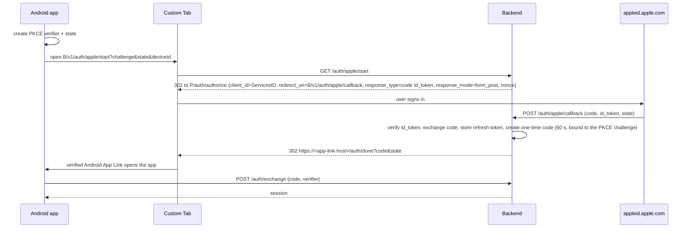

# Auth: optional sign-in, sessions, sign-out and account deletion

Status: **Proposed**. Every choice below waits for owner confirmation (plan step 5). Items that need an explicit owner decision are collected in §10.

Related:
- Decisions: [local-first with own backend](memory://8), [open source](memory://12) (no secrets in clients).
- Product: [account & sync](../product/features/account-sync.md), [domain model: User and Device](../product/domain-model.md).
- Architecture: [backend.md](backend.md) (endpoints, tables), [sync.md](sync.md) (what happens to data on sign-in).

## 1. Principles

- **The account is optional.** Without it the app is complete and never contacts the backend; the only exception is the optional anonymous dictionary download. Sign-in exists only for cloud backup and sync (owner input).
- **Two providers, both platforms:** Sign in with Apple and Sign in with Google, on iOS and on Android. A person with an iPhone and an Android phone can use either provider on both.
  - App Store guideline 4.8 requires an equivalent privacy-focused login next to third-party logins; Sign in with Apple satisfies it.
- **The provider proves identity; the backend issues its own sessions.** Provider tokens are verified once, at sign-in.
- **Identity = provider + subject** (`sub` claim). Email is never used to identify anyone (see §8).
- **Nothing secret in the clients.** The Apple `.p8` key (for the client secret and token revocation) and the session secrets exist only on the backend. Google and Apple client IDs are public identifiers.

## 2. No-account mode

- Every installation generates a random Device ID (UUID) on first run. It is used as the HLC node ([sync.md](sync.md) §3.2) and later as the session's device.
- All records get clocks and ranks from day one, so signing in later needs no data conversion ([sync.md](sync.md) §11).
- No anonymous server accounts. They were rejected because a backup tied to no credential cannot be restored on a new phone, so they add server state without the main benefit.
- **Local-only users are backed up by the OS.** iCloud device backup on iOS; Android Auto Backup within its size limit, or device-to-device transfer. The details are in [local-storage.md](local-storage.md).

## 3. Sign in with Apple

### 3.1 iOS (native)

1. The app shows `SignInWithAppleButton` (AuthenticationServices) with requested scopes **none**: we need neither name nor email. It sets `nonce = SHA256(random)`.
2. It gets `identityToken` (JWT) and `authorizationCode`, then calls `POST /v1/auth/apple {identityToken, authorizationCode, rawNonce, deviceId, platform}`.
3. The backend verifies the JWT:
   - the signature against Apple's JWKS (`https://appleid.apple.com/auth/keys`, cached);
   - `iss = https://appleid.apple.com`;
   - `aud` ∈ {iOS bundle ID, Services ID};
   - `exp`;
   - `nonce = SHA256(rawNonce)`.
4. The backend exchanges `authorizationCode` at `https://appleid.apple.com/auth/token` using a client-secret JWT (ES256, signed with the `.p8` key). It stores Apple's **refresh token encrypted**: it is needed to revoke the authorisation when the account is deleted (§6).
5. The backend finds or creates the user for `(apple, sub)` and returns a session (§5).

### 3.2 Android (web flow through the backend)

Apple has no Android SDK. The web flow uses a **Services ID** and a redirect to our backend; Apple's `response_mode=form_post` requires a server endpoint.

Requirements:
- An Apple Developer Services ID, with the backend domain verified and `…/auth/apple/callback` registered as the return URL.
- `assetlinks.json` on the App Link host, so only our app receives `/auth/done`.
- The one-time code is single-use and expires in 60 s. It is also bound to the PKCE challenge, so a leaked code alone is useless.

Rejected: a custom URL scheme redirect (`toriwords://`). Any app can claim a custom scheme; a verified App Link cannot be claimed by other apps.

## 4. Sign in with Google

| Platform | Client | Token |
|---|---|---|
| Android | Credential Manager (`androidx.credentials`) with the Google ID library, `GetSignInWithGoogleOption`. `serverClientId` = the backend's Web client ID. Nonce set. | ID token with `aud` = Web client ID. |
| iOS | Google Sign-In for iOS SDK (`GIDSignIn`), with `serverClientID` set. Alternative: no SDK, `ASWebAuthenticationSession` + PKCE against Google's OAuth endpoint. | ID token (`aud` = iOS client ID). |

- The app calls `POST /v1/auth/google {idToken, nonce?, deviceId, platform}`.
- The backend verifies the signature against Google's JWKS, `iss` ∈ {`https://accounts.google.com`, `accounts.google.com`}, `aud` ∈ the allow-list of our client IDs, and `exp`. It then finds or creates the user for `(google, sub)`.
- We do not keep Google access or refresh tokens: we call no Google APIs. So there is nothing to revoke at Google on deletion.
- **iOS recommendation:** the official SDK; it is maintained and handles edge cases. The no-SDK alternative is acceptable if dependency count matters more (owner/implementer call, not a product decision).

## 5. Sessions and tokens

| | Opaque tokens checked in the DB | JWT access token + opaque refresh token |
|---|---|---|
| Revocation (sign-out, account deletion) | Immediate. | Only after the access token expires (≤ 1 h), unless sessions are checked on each request anyway. |
| Cost | One indexed lookup per request; trivial at our scale (one server). | Stateless checks; matters only with many servers. |

**Recommendation: opaque tokens.**
- **Access token:** 256-bit random, stored hashed, valid 1 h.
- **Refresh token:** 256-bit random, stored hashed. It is **rotated on every refresh**. Its lifetime slides: 180 days from last use. **Reuse detection:** presenting an already-rotated refresh token revokes the whole session family and requires sign-in again.
- **One session per device.** `GET /account` lists them. "Sign out" on a device revokes only that session.

**Storage on the client:**
- **iOS:** Keychain, `kSecAttrAccessibleAfterFirstUnlockThisDeviceOnly`, so background sync works and tokens are not restored onto another device from a backup. App extensions do not get the tokens: they never use the network ([sync.md](sync.md) §9.2).
- **Android:** the tokens are encrypted with an AES key in Android Keystore and the ciphertext is kept in DataStore. The file is excluded from Auto Backup; a restored ciphertext could not be decrypted on a new phone anyway.

**Expired or revoked session:**
- `401 token_expired`: refresh silently.
- Refresh fails with `session_revoked`: the app switches to local-only mode with all data kept. It shows "You were signed out. Sign in again to continue syncing."

## 6. Account deletion

Required in-app by the App Store for apps that support account creation. Apple also requires revoking Sign in with Apple tokens through its REST API ([TN3194](https://developer.apple.com/documentation/technotes/tn3194-handling-account-deletions-and-revoking-tokens-for-sign-in-with-apple)). Google Play requires an in-app deletion path and a web deletion link.

**Flow (Settings → Account → Delete account):**
1. Confirmation screen: "This deletes your cloud backup and signs out all devices." There is a checkbox **"Also remove my words from this device"**, unchecked by default (see §10, A4).
2. `DELETE /v1/account`. In one transaction, the backend:
   - deletes all `records`, `identities` and the `users` row;
   - marks all sessions `revoked_reason = account_deleted`. Those session rows are kept for 90 days, with no personal data, to tell other devices what happened.
3. After the commit, the backend calls Apple `POST /auth/revoke` with the stored refresh token, retrying if it fails. Google needs no call (§4).
4. The deleting device discards its tokens and cursor. It keeps or removes local data according to the checkbox.
5. Database backups that still contain the account expire with backup rotation (≤ 30 days). The privacy policy states this.
6. **Web deletion link** (Play requirement): a static page explaining in-app deletion, plus a deletion request by email for people who no longer have the app.

**Other devices:** their next request (sync or refresh) gets **`410 account_deleted`**. Proposed behaviour (A4):
- The device switches to local-only mode, **keeps its local data** and shows: "Your Toriwords account was deleted on another device. Your words stay on this device only."
- Rationale: it is consistent with the sign-out default (§7) and never destroys data the user did not explicitly destroy on *this* device.
- Alternative: wipe local data on every device, as the strongest "delete means gone" interpretation.

**Apple server-to-server notifications.** The endpoint `POST /v1/auth/apple/notifications` is registered with Apple.
- `consent-revoked` (the user tapped "Stop using Apple ID" in iOS settings): revoke all sessions of that identity, so devices fall back to local-only. Data stays on the server until the user signs in again or deletes the account.
- `account-delete` (the Apple Account itself was deleted): delete the Toriwords account if Apple is its only identity.

## 7. Sign-out

| | Keep data on the device, local-only (recommended) | Remove data from the device | Ask every time |
|---|---|---|---|
| Matches "the app works fully without an account" | Yes: nothing is lost. | The user loses local access until they sign in again. | — |
| Shared/handed-over phone | Data stays visible. | Clean. | User decides. |
| Risk | Signing in later with a **different** account would upload this data into that account. | Unsynced changes are lost if the device was offline. | One more question. |

**Recommendation:** "Sign out" keeps the data and the app continues local-only. A separate, explicit action "Remove all data from this device" exists in Settings. It warns if there are unsynced changes.

**Guard against mixing accounts:** the app remembers the last account ID it synced with.
- The prompt fires **only** when local data belongs to a *different, known* account: the device was signed in to account X, the user signed out keeping the data, and now signs in to account Y. The app asks once: **"Add these N words to this account"** or **"Remove them from this device first"**.
- Data created while the device was **never signed in** has no previous account. It merges into the account silently on first sign-in, as in [account & sync](../product/features/account-sync.md).
- Signing back in to the **same** account X merges silently.

This is a question about whose data it is, not a sync conflict, so it does not contradict I7.

## 8. Cross-provider identity (Apple vs Google)

The problem: a person signs in with Apple on the iPhone and with Google on the Android phone. Without linking, that creates two accounts, and their words are split.

| | (a) No linking + UI warning | (b) Explicit linking | (c) Automatic linking by verified email |
|---|---|---|---|
| How it works | One identity per account. The sign-in screen and the account screen show which provider is used. A second device's sign-in screen says "Use the same method as on your other device". | While signed in, Settings → Account → "Add Apple / Google sign-in". The new identity is attached to this account. If that identity already owns another account, the two accounts are **merged**: the backend moves all records to one user (IDs are globally unique), and the clients deduplicate through the normal sync merge ([sync.md](sync.md) §7). | On sign-in, if the provider's verified email equals an existing identity's email, attach it. |
| Cost | Lowest. | One endpoint plus an account-merge job; about a day of work. Reuses sync merge. | Low code, but security-sensitive. |
| Risk | The user makes two accounts by mistake. Fixable only by (b) later. | Low. | **Breaks with Apple Hide My Email:** Apple returns a per-app relay address (`…@privaterelay.appleid.com`), which never equals the Gmail address, so linking silently fails. Also an account-takeover vector if any provider ever asserts an unverified email. |

**Recommendation:** (a) in v1, (b) as P1 (the release after v1, or v1 if the owner uses both phones with different providers from day one). Reject (c).

**Email storage:** none. Apple gives the email only on first authorisation and possibly as a relay address. Google's email is not needed for anything. The account screen shows the provider name. It can also show the email from the current device's own sign-in result, kept locally and not sent to the backend.

## 9. Data held by the backend (privacy)

- Provider + subject per identity.
- The encrypted Apple refresh token.
- Sessions: device ID, platform, timestamps.
- The user's vocabulary records ([sync.md](sync.md)).

No names, no emails, no analytics. The App Store privacy label is "Data linked to you: user content, identifiers", used only for app functionality.

## 10. Owner decisions

| # | Decision | Recommendation | Alternatives |
|---|---|---|---|
| A1 | Providers | Apple and Google on both iOS and Android (Apple on Android via web flow) | Apple only on iOS + Google only on Android (simpler, but blocks a mixed-platform user from using one provider) |
| A2 | Session tokens | Opaque access (1 h) + rotating refresh (180 days sliding) | JWT access tokens |
| A3 | **Sign-out** | Keep data on the device, continue local-only. A separate "Remove all data from this device" action. Ask once when signing into a *different* account with local data present. | Remove data on sign-out; ask every time |
| A4 | **Account deletion, other devices** | Keep local data, go local-only, show a notice. The deleting device asks "also remove from this device" (default: keep). | Wipe local data on all devices |
| A5 | **Cross-provider identity** | v1: one identity per account + a UI warning; P1: explicit linking with account merge | Explicit linking in v1; automatic linking by email (rejected: Hide My Email, security) |
| A6 | Email | Not stored on the backend | Store it for support/recovery |
