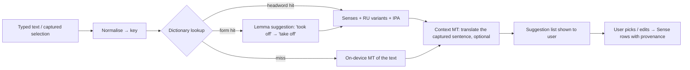

# Enrichment (runtime)

Status: **Proposed**. Pending owner confirmation in step 5. Nothing here is a `decision` yet.

How the app turns typed or captured text into suggested translations, definitions, IPA and pronunciation, offline and for free. The owner has confirmed the sources: on-device translation (Apple Translation / ML Kit) and Wiktionary; per-OS differences in suggestions are acceptable.

Inputs: [domain-model.md](../product/domain-model.md) (*Enrichment*, Sense field provenance). Related: [dictionary-data.md](dictionary-data.md), [capture-and-extensions.md](capture-and-extensions.md), analysis §8.4, §8.7, A6, A13, X8.

## 1. Principles

1. **Dictionary first, MT as fallback and suggestion.** The bundled Wiktionary dictionary gives several sense-tied variants, definitions and IPA, identically on both platforms. On-device MT gives one machine variant and differs per OS.
2. **Store what the user accepts; never re-enrich silently.** Accepted values are written to the Sense with provenance and synced. Platform differences then affect only what is *offered*, never stored data or later behaviour (analysis §8.7). Enrichment fills only empty, user-unedited fields (domain model).
3. **No LLMs on the critical path** (X8): Foundation Models are unavailable for a Russian device language and Gemini Nano is device-limited and beta. Not used in v1.
4. **No network required.** Every step works offline once OS language packs are present; nothing calls our backend.

## 2. Pipeline

Steps:
1. **Autocomplete** (while typing): prefix scan on dictionary `headword.key`, ranked by frequency, phrases included ([dictionary-data.md](dictionary-data.md) §2). Pure SQLite; < 10 ms.
2. **Lookup:** exact `key` hit → headword(s) (several POS possible). Else `form` table → offer the lemma ("Did you mean *run*?") while keeping the user's text an option. Phrases: exact phrase lookup; if the captured text is longer than a known phrase, offer contained dictionary phrases (e.g. *took off* in a sentence → *take off*).
3. **Suggestions:** per sense, RU variants (enwikt translation table + ruwikt definition), EN gloss, POS. Ordered by sense ordinal, then variant rank. Deduplicated by case-insensitive, NFC-normalised text.
4. **MT:**
   - **No dictionary hit:** MT of the text is the main suggestion, labelled "machine translation".
   - **Dictionary hit:** MT of the text is added as one extra variant only if it differs from all dictionary variants.
   - **Captured sentence available:** MT of the **whole sentence** is shown as context help ("in this sentence: …"). It is not stored as a translation unless the user copies a part. This is the most useful MT use for RU learners: single-word MT is ambiguous, a sentence disambiguates.
5. **User decision:** the user picks one or more variants (each becomes a Sense) or types their own. Provenance per field: `wiktionary` (+ `dict_version`, headword key, sense ordinal), `mt_apple`, `mt_mlkit`, `user`.
6. **IPA** from the chosen headword (Wiktionary), stored on the Entry.

## 3. On-device MT per platform

| | iOS: Translation framework | Android: ML Kit Translation |
|---|---|---|
| API | `TranslationSession`, obtained via SwiftUI `.translationTask`; a UI-less initializer `TranslationSession(installedSource:target:)` exists for installed languages (exact availability on iOS `nv`). iOS 18+. | `Translation.getClient(TranslatorOptions(EN, RU))`, `downloadModelIfNeeded(conditions)`, `translate()`. |
| Language data | Downloaded by the OS; the framework asks the user for permission to download if missing. | ~30 MB model per language, downloaded by the app (we request it on Wi-Fi at first run; user can trigger it on cellular). |
| Offline | Yes once installed. | Yes once downloaded. |
| In the share extension | **Not relied on** (`nv` whether it works within extension memory and UI constraints). The app runs MT for pending captures on next foreground. A spike may enable it later. | Same process as the app, so available. |
| RU quality | Single-word: ambiguous. Sentence: decent (`nv`). | Known to be weaker than cloud MT; single-word output often wrong for the context (`nv` for EN→RU specifically). |

Because quality is uneven and outputs differ per OS, MT is never auto-accepted without the user seeing it, with one exception: the *quick save* path (§4).

## 4. Pending enrichment and fallbacks

| Situation | Behaviour |
|---|---|
| Dictionary hit, user confirms | Entry saved with chosen Senses; `enrichment_status = done`. |
| Quick save from share/selection without choosing (if the product offers it) | Entry saved with `enrichment_status = pending`. On next foreground, the app fills the **first dictionary variant**, or the MT result if there's no hit, into the empty translation, marked with its provenance; the user can review it later in the vocabulary list. (Product to confirm: auto-fill vs leaving it for the user.) |
| No dictionary hit, MT language data missing and offline | Saved with `enrichment_status = pending` and no translation; not reviewable until it has one (domain invariant). Retried when MT becomes available. |
| No hit and MT failed/unavailable after retries | `enrichment_status = unavailable`; the user is told and can type a translation. |
| Retry policy | On app foreground and after MT model download completes; give up after the dictionary is checked and MT returned nothing or errored 3 times. Deterministic per device, but per-device results can differ; stored values sync and settle it. |
| Two devices enrich the same pending Entry offline | Automatic enrichment creates its Senses with **deterministic ids**: UUIDv5(entry id, `"auto"`, ordinal). Both devices therefore write the *same* Sense records, and per-field LWW ([sync.md](sync.md)) keeps one value per field instead of producing duplicate Senses. User-chosen Senses keep random UUIDv7 ids. "Fill only if empty" is evaluated locally, so a device that already sees the field filled after sync doesn't overwrite it. |
| "Check translation" ([capture](../product/features/capture-share-selection.md) step 7) | Automatic enrichment sets a synced Entry flag `needs_check = true`. Opening the Entry or reviewing one of its Cards on any device sets it to `false` (LWW), so the filter clears everywhere after sync. |

## 5. Pronunciation (TTS)

| | iOS | Android |
|---|---|---|
| API | `AVSpeechSynthesizer`, `AVSpeechSynthesisVoice(language: "en-US")` (or `en-GB` per a product setting). | `TextToSpeech`, `Locale.US` / `Locale.UK`. |
| Offline | Built-in voices are on-device; enhanced/premium voices need a download in Settings. | Depends on the engine; Google TTS has offline voices once downloaded. |
| Missing voice | Fall back to any `en` voice; if none, hide the play button and show the IPA. | `isLanguageAvailable` → if missing, offer the system "install voice data" intent; else hide play, show IPA. |

Audio is generated on demand and never stored or synced. Voices differ by platform; that's acceptable for audio. Recorded audio (Wiktionary/Commons) is out of v1 because of per-file licences.

## 6. What stays identical across platforms

| Identical (spec + fixtures) | May differ (acceptable) |
|---|---|
| Normalisation and match key; dictionary file and lookup results; autocomplete order; lemma suggestions; dedupe of variants; provenance fields; "fill only empty fields" rule. | MT text; whether MT language data is installed; TTS voice. |

## 7. Open questions

- **Q-E1 (product):** quick save with automatic first-variant fill vs always asking the user (§4).
- **Q-E2 (product):** show sentence MT as context help in the add flow? Recommendation: yes, when a sentence was captured.
- **Q-E3 (product):** US vs UK pronunciation default, or a setting.
