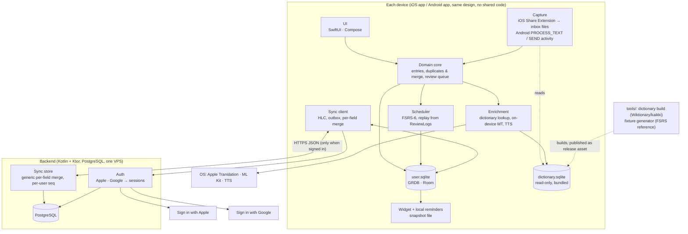

# Architecture overview

Status: **Proposed**. It summarises the architecture documents; every choice waits for owner confirmation (plan step 5).

Toriwords is two native apps and a small backend:
- iOS: Swift/SwiftUI. Android: Kotlin/Jetpack Compose ([memory://7](memory://7)).
- Each app keeps the whole vocabulary locally and works fully offline. An optional account syncs devices through our own backend ([memory://8](memory://8)).
- The clients are open source ([memory://12](memory://12)).
- Domain behaviour is specified once, in the docs plus shared fixtures, and implemented twice.

## 1. Components and boundaries



| Component | Responsibility | Must be identical on iOS and Android? | Document |
|---|---|---|---|
| Domain core | Entries, Senses, Contexts, Sources, Tags; repeat capture; natural-key duplicate merge; review queue and daily limits. | **Yes** (fixtures) | [domain-model.md](../product/domain-model.md), [sync.md](sync.md) §7, [scheduler.md](scheduler.md) §11 |
| Scheduler | FSRS-6 with whole days, a 04:00 day boundary and deterministic fuzz. Card state is derived from ReviewLogs. | **Yes**, bit-exact due days | [scheduler.md](scheduler.md) |
| Local store | SQLite with one logical schema; migrations; OS backup for local-only users. | Same logical schema | [local-storage.md](local-storage.md) |
| Sync client | HLC, outbox, push/pull, per-field merge, tombstones, canonical-ID resolution. | **Yes** (fixtures) | [sync.md](sync.md) |
| Enrichment | Dictionary first, on-device MT as fallback; stores what the user accepts. TTS for pronunciation. | Dictionary results yes; MT and voices may differ (owner-accepted) | [enrichment.md](enrichment.md), [dictionary-data.md](dictionary-data.md) |
| Capture & surfaces | Share/selection capture (iOS inbox, Android in-process), due-count widget, local reminders. | Behaviour yes, mechanism per OS | [capture-and-extensions.md](capture-and-extensions.md) |
| Auth | Optional Apple/Google sign-in, sessions, sign-out, account deletion. | Behaviour yes | [auth.md](auth.md) |
| Backend | Generic record store with per-field merge, plus auth. **No vocabulary logic.** | n/a (single implementation; shares the merge fixtures) | [backend.md](backend.md) |
| Parity fixtures | JSON cases for normalisation, IDs, HLC, merge, sync scenarios, scheduler. | They *are* the definition | [parity-testing.md](parity-testing.md) |

**Boundaries that keep the system simple:**
1. **The network is never on the critical path.**
   - Adding, enriching (dictionary + on-device MT) and reviewing are local.
   - The backend is used only for sync and sign-in.
   - The dictionary is bundled in v1.
2. **Domain logic runs only on clients.** The backend merges by clocks and never reads values, so there are two implementations of domain rules, not three. (A later exception is a possible per-user FSRS parameter optimiser on the backend, [scheduler.md](scheduler.md) §6.)
3. **Derived data is never synced:** Card state, match keys, canonical IDs, stats, widget counts. Any device can rebuild it from synced facts.
4. **Extensions never touch the user database or the network.** The iOS Share Extension writes inbox files; widgets read a snapshot file.
5. **Platform AI only suggests.** Translations from Apple Translation or ML Kit are offered at capture and stored only once accepted. Nothing that must be identical depends on platform ML (analysis §8.7, X8).

## 2. Key flows

| Flow | Path |
|---|---|
| Capture (iOS) | Share Extension → dictionary lookup (read-only) → user picks → inbox file → app imports (repeat-capture merge, HLC, outbox) → MT for pending → widget snapshot. |
| Capture (Android) | `PROCESS_TEXT` activity in the app process → dictionary + ML Kit → the same domain write path. |
| Review | Queue from cached `dueDay` → answer → append ReviewLog → one scheduler step updates the cache → snapshot, widget, reminders. |
| Sync | Push outbox → pull since cursor → per-field merge → dedupe (§7 of sync.md) → replay affected Cards → snapshot. |
| Sign-in | Provider token → backend session → mark all local records pending → push → pull. |

## 3. Repository layout

One monorepo:

```
ios/                 Xcode project: app, Share Extension, widget extension
android/             Gradle project: app (incl. capture activity, Glance widget)
backend/             Ktor service, Docker Compose, migrations (or a separate private repo, see backend.md §7)
spec/
  fixtures/          shared JSON fixtures (parity-testing.md)
tools/
  dictionary/        Wiktionary → dictionary.sqlite build script (Python, dev tool)
  fixtures/          fixture generator wrapping the reference FSRS implementation
docs/
  product/           product spec, domain model, proposed decisions
  architecture/      this folder
LICENSE              code licence
LICENSE-DATA         CC BY-SA 4.0 notice for dictionary data
```

- **CI:**
  - The iOS and Android suites run on changes under their folder or `spec/`.
  - Backend CI runs on `backend/` and on the merge/HLC fixtures.
  - Fixture JSON is validated against its schemas first.
- **No code is shared between `ios/`, `android/` and `backend/`** ([memory://7](memory://7)). They share only `spec/fixtures/` (data) and `docs/`.
- `tools/` are developer scripts. They produce data files (the dictionary, the fixtures); they are not app code.

## 4. Minimum OS versions

Current releases (Nov 2026): iOS 27, Android 17 (API 37); analysis §8.1. Goal G1 is to use the newest *stable* tech ([memory://10](memory://10)). For usefulness, the owner's own phones must be supported, and those are `nv` (analysis §11 Q12).

| Platform | Options | Recommendation | What the floor enables |
|---|---|---|---|
| iOS | iOS 18 (oldest with the Translation framework), iOS 26 (current − 1), iOS 27 only | **iOS 26** (deployment target), built with the iOS 27 SDK; iOS 27-only APIs behind availability checks | Translation framework (`TranslationSession`, iOS 18), Observation (`@Observable`, iOS 17), interactive widgets via App Intents (iOS 17), current SwiftUI. Covers the large majority of active iPhones (`nv`: exact share at release time). |
| Android | minSdk 26 (broad reach), 31 (Android 12), 33 (Android 13) | **minSdk 31**, targetSdk / compileSdk 37 | Material You dynamic colour and the splash-screen API (31). `POST_NOTIFICATIONS` (33) is requested at runtime where present. `PROCESS_TEXT` (23), Credential Manager, ML Kit, Glance and Room all work well below 31. |

If the owner's phone is older than these floors, the floor moves down to the owner's device. Nothing in the design depends on a newer API than iOS 18 / API 26, except the conveniences listed.

## 5. Decisions to confirm (index)

The owner confirms the recommendations collected in each document:

| Area | Document | Items |
|---|---|---|
| Scheduler | [scheduler.md](scheduler.md) | FSRS-6, own implementation per platform, whole days, 04:00 boundary, defaults hidden |
| Local storage | [local-storage.md](local-storage.md) | GRDB (iOS), Room + bundled SQLite (Android), files for extensions |
| Enrichment & dictionary | [enrichment.md](enrichment.md), [dictionary-data.md](dictionary-data.md) | Wiktionary primary, bundled (~25 MB), on-device MT fallback |
| Capture & surfaces | [capture-and-extensions.md](capture-and-extensions.md) | Inbox pattern, snapshot widget, local reminders only |
| Sync | [sync.md](sync.md) §13 | S1–S6: per-field LWW + HLC, deterministic IDs, derived Card state, delete wins, automatic merge, no push |
| Backend | [backend.md](backend.md) §8 | B1–B6: Kotlin/Ktor, PostgreSQL, VPS, hosting location after the reachability question, open-source choice |
| Auth | [auth.md](auth.md) §10 | A1–A6: both providers on both platforms, opaque tokens, sign-out and deletion behaviour, cross-provider identity, no email |
| Platform floors | this document §4 | iOS 26, Android minSdk 31 |
