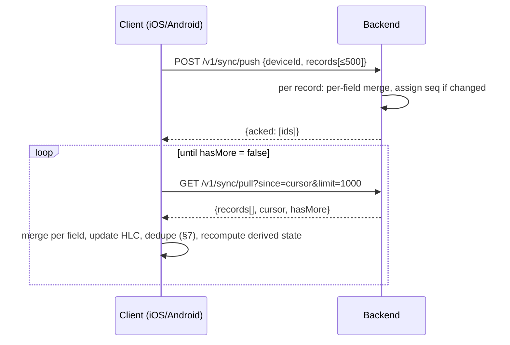

# Sync: data model, merge rules and protocol

Status: **Proposed**. Every choice below waits for owner confirmation (plan step 5).

Related:
- Decisions: [local-first with own backend](memory://8), [native apps, no shared code](memory://7), [open source](memory://12).
- Domain: [domain-model.md](../product/domain-model.md), especially *Duplicates*, *Enrichment* and *Sync requirements*.
- Architecture: [backend.md](backend.md) (server side of this contract), [auth.md](auth.md) (sign-in, sign-out, account deletion), [parity-testing.md](parity-testing.md) (shared fixtures), [scheduler.md](scheduler.md) (replay of ReviewLogs), [local-storage.md](local-storage.md) (how each client stores what this document requires).

## 1. Goals and constraints

1. **Offline first.** Every device keeps the full data set and works without the network. Sync is a background convenience (analysis A4).
2. **No lost answers.** Reviews done offline on several devices all survive (A12).
3. **No "pick a side".** The user is never asked "this device or the cloud". The protocol never needs a one-way full sync, including after schema changes (I7).
4. **Identical behaviour.** iOS, Android and the backend reach the same state from the same inputs. The merge rules are small enough to be fixed by the shared fixtures in [parity-testing.md](parity-testing.md).
5. **Dumb server.** The backend stores and merges records generically. It knows no vocabulary rules: no text normalisation, no duplicate detection, no scheduling. So the domain logic is implemented twice (iOS, Android), not three times.
6. **Scale.** Single user, 1–4 devices. Planning size: 20k Entries, 300k synced records in total (about 200k ReviewLogs). There is no shared or collaborative data in v1.

## 2. What is synced

Everything in the domain model is a **record**: LanguagePair, Entry, Sense, Context, Source, Card, ReviewLog, Tag, EntryTag (the Entry↔Tag link), Device and Settings.

**Not synced (derived locally, recomputed on any device):**
- Entry `match key` and `kind`.
- Card `learning stage`, `due` and all scheduler state (see §5).
- ReviewLog `elapsed since previous review` and `review type`.
- The *canonical ID* columns that resolve merged records (see §7).
- Stats and the due counts used by widgets and reminders.

### 2.1 Record envelope

Every record travels in the same envelope. The server only reads the envelope; field values are opaque to it.

```json
{
  "id": "0192f3c1-7a4e-7cc3-9b1e-3f5a2d6c8e01",
  "type": "entry",
  "schema": 1,
  "owner": null,
  "deleted": false,
  "mergedInto": null,
  "fields": {
    "text":        { "v": "take off", "c": "0192f3c17a4e00001a2b3c4d5e6f7081", "u": 1 },
    "note":        { "v": null,       "c": "0192f3c17a4e00001a2b3c4d5e6f7081", "u": 1 },
    "ipa":         { "v": "/teɪk ɒf/", "c": "0192f3c1802000001a2b3c4d5e6f7081", "u": 0 },
    "enrichment":  { "v": "done",     "c": "0192f3c1802000001a2b3c4d5e6f7081", "u": 0 }
  }
}
```

| Envelope field | Meaning |
|---|---|
| `id` | Record ID (§4). Never changes. |
| `type` | Record type. The server keeps an allow-list of known types. |
| `schema` | Payload schema version of this type (§10). |
| `owner` | The Entry this record belongs to, for Sense, Context, Card, ReviewLog and EntryTag. ReviewLog's owner is its Card's Entry. Used only for server-side cleanup after deletion (§6). |
| `deleted` | Terminal tombstone flag (§6). |
| `mergedInto` | Terminal redirect to a surviving duplicate (§7). |
| `fields` | Map of field name → `{v, c, u}`: value, clock (HLC, §3.2) and author rank (`1` = written by a user action, `0` = written by the app automatically, e.g. enrichment). |

Field names and value types per record type are the client schema, defined in [local-storage.md](local-storage.md) and following the domain model.

## 3. Decision S1: conflict granularity and clock

Two devices change the same record while offline. Which change survives?

### 3.1 Options

| | A. Per-field LWW + HLC | B. Per-record LWW + append-only ReviewLog | C. Per-record LWW + causal base + author rank |
|---|---|---|---|
| Unit of conflict | One field of one record. | Whole record. | Whole record. |
| What is stored per record | A clock and rank per field. | One clock per record. | A clock, a rank and the clock of the server version it was based on. |
| Concurrent edits of *different* fields (phone edits translation, tablet adds a note) | Both kept. | One lost. | One lost. |
| Concurrent edits of the *same* field | Later clock wins. | Later clock wins. | Later clock wins. |
| "Enrichment never overwrites user edits" across devices (domain *Enrichment*) | Holds: per field, a user write (`u=1`) beats an automatic write (`u=0`). A field the user edited is never written by enrichment again, so the rank cannot get stuck. | **Breaks.** Device B's enrichment write (later clock) replaces device A's earlier user edit of another field of the same Sense. | Holds, but only with extra causality tracking. Rank alone is not enough: once a user version wins, a later automatic fill on top of it has rank 0 and would lose for ever. So every write must carry the server version it was based on. That is subtle to get identical on two platforms. |
| Merging two duplicate Entries (§7) | Generic and deterministic: per-field LWW of the two records, copying the original clocks. Every device computes the same survivor without writing new clocks. | Whole-record LWW: one duplicate's fields win entirely, and the other's user edits are lost. | Same as B. |
| Server merge | Generic per field: no domain knowledge. | Generic per record. | Generic, but with causality rules. |
| Storage overhead | About 30 bytes per field (clock + rank), stored as one JSON/BLOB column per row. Small: records have 3–10 fields. | Minimal. | Small. |
| Parity surface (fixtures) | One comparator, applied per field. | One comparator. | Comparator + causality cases. |
| ReviewLog | Immutable, written once: all options treat it identically. | | |

**Clock options** (apply to A–C):
- **Device wall clock.** Simple, but a device whose clock is wrong silently wins or loses.
- **Server-assigned version** (the order in which the server received the change). An edit made offline yesterday and pushed today beats an edit made online an hour ago. That is wrong for an offline-first app.
- **Hybrid logical clock (HLC).** Wall-clock milliseconds, plus a counter, plus the device ID as a tie-break. It respects causality ("I saw your change, my change is later"), stays close to real time, and is about 30 lines per platform. **Chosen for all options.**

### 3.2 Recommendation: A, per-field LWW with HLC and author rank

Option B is cheaper in storage, but it is not safe against the domain's own enrichment rule. It also loses user edits when duplicates merge. C fixes the enrichment case but costs more to get right than A. Option A is the cheapest *safe* option. Its overhead (one extra column) is negligible at our scale. It keeps the server generic, and it makes duplicate merging a pure function.

**HLC format.** The clock is a 32-character lowercase hex string, so string comparison equals clock order:

| Part | Width | Meaning |
|---|---|---|
| `ms` | 12 hex (48 bit) | Unix milliseconds. |
| `counter` | 4 hex (16 bit) | Logical counter within one millisecond. |
| `node` | 16 hex (64 bit) | First 64 bits of the Device ID (random per installation). |

**HLC rules** (each device keeps one persisted HLC state `{ms, counter}` in the local store, shared with its app extensions):
- **Local write:** `pt = now()`. If `pt > ms`: `ms = pt`, `counter = 0`. Otherwise `counter += 1`. If the counter overflows, `ms += 1`, `counter = 0`. Persist the state in the same transaction as the write.
- **Receive** (for each clock `r` in pulled records): `ms' = max(ms, r.ms, pt)`. The counter follows the standard HLC receive rule. **Exception:** a remote `r.ms` more than 24 h ahead of `pt` is not adopted into the local state. The record is still stored, so its fields win until real time passes them. This stops one broken clock from dragging all devices forward.
- The server rejects pushed clocks more than 1 h ahead of server time with `clock_skew`. The client keeps working locally and shows a "check your device time" notice in sync status.

**Field comparator.** This is the only conflict rule. It is fixed by fixtures.

```
wins(a, b) = (a.u, a.c) > (b.u, b.c)      // rank first, then clock (string order)
merge(field_local, field_remote) = wins(remote, local) ? remote : local
```

Equal `(u, c)` means the same write; the values are equal by construction.

**Who writes rank 1.** Any change caused directly by a user action: typing, picking a translation variant at capture, editing, excluding or resuming, tagging, reordering Senses, deleting. Everything else is rank 0: enrichment fills, `enrichment status`, Card creation, `mergedInto`, Device bookkeeping.

**Consequence the owner must accept** (listed in §13): if the same field (e.g. the same Sense's translation) is edited on two devices offline, the later edit wins and the other is discarded without a prompt. With one user, this is rare and matches the product rule "never ask to pick a side".

## 4. Decision S2: identifiers

- **Random IDs: UUIDv7** (RFC 9562), generated on the device, offline. They are time-ordered, so database indexes stay compact, and "smaller ID" roughly means "created earlier", which §7 relies on. Both platforms have UUIDv7 support (or it is a 20-line function). The time component is not trusted for anything except tie-breaking.
- **Deterministic IDs: UUIDv5** (name-based, SHA-1) under one fixed Toriwords namespace UUID, defined once in [parity-testing.md](parity-testing.md). They are used where two devices would otherwise independently create "the same" item with different random IDs, and the item's key never changes:

| Record | ID | Why |
|---|---|---|
| LanguagePair | `v5("pair:" + native + ":" + target)`, e.g. `pair:ru:en` | Every device auto-creates RU→EN on first run. Random IDs would give two pairs after sign-in, and then no Entries would deduplicate. |
| Card | `v5("card:" + entryId + ":" + direction)` | The app creates Cards on every device when an Entry becomes reviewable. |
| Source with URL | `v5("source:" + normalisedUrl)` | "Sources with the same URL are the same Source". URL normalisation is in the fixtures. |
| EntryTag | `v5("entrytag:" + entryId + ":" + tagId)`, with a field `present` (bool, LWW) | Re-tagging after un-tagging must work, so this link uses a flag instead of a terminal tombstone. |
| Settings | `v5("settings")` (per user, since all records are user-scoped) | One synced settings record ([PD-16](../product/proposed-decisions.md)). |
| ReviewLog from import (later) | `v5("import:" + collectionId + ":" + ankiRevlogId)` | Re-importing the same collection does not duplicate history. |

Everything else (Entry, Sense, Context, Source without URL, Tag, ReviewLog, Device) uses UUIDv7. Their natural keys can change (the user can edit the text), so duplicates are resolved by merging (§7), not by ID.

## 5. Decision S3: Card state, stored or derived

| | Stored and synced | Derived from ReviewLogs (recomputed locally) |
|---|---|---|
| Concurrent offline reviews of one Card | Two devices each compute a new state from different histories. LWW keeps one, and the other answer's effect on scheduling is lost even though its ReviewLog survives. | The merged log is replayed. Both answers count. |
| Parity | Each device's stored state depends on what it had seen when it reviewed. | "Same history → same due date" holds by construction (domain invariant). |
| Scheduler changes (new version, new target retention, optimised parameters) | Need a migration of synced state, which is a write storm. | Recompute locally. Nothing is synced. |
| Cost | No replay. | Replay per Card: a few dozen steps, microseconds. Full rebuild for 40k Cards / 200k logs: well under a second. Run it in the background. |
| Query speed (due list, widget) | Indexed columns. | Same: derived columns are cached locally and indexed. |

**Recommendation: derived.** Synced Card fields are only `entry`, `direction` and `createdAt`. Each client caches the scheduler state (`due`, stage, and the scheduler's own variables) in **local-only columns**. It updates them:
- **Incrementally** when the user answers on this device (one scheduler step).
- **By full replay of that Card** when a pull brings ReviewLogs for it, when a merge (§7) changes its canonical Card, or when its Entry is resumed.
- **By full rebuild** of all Cards when the scheduler version, target retention or the parameter set changes. These settings are synced, so every device rebuilds the same way. The day rollover is a constant (04:00) in v1 ([scheduler.md](scheduler.md) §4); if it ever becomes a setting, it must sync too.

**Replay contract** (the details belong to [scheduler.md](scheduler.md)):
- The input is the Card's canonical ReviewLogs sorted by `(reviewedAt, id)` and the synced Settings.
- Each ReviewLog carries `reviewedAt` as a UTC instant in milliseconds **plus the UTC offset in minutes at the time of the answer**. "Which day was this" is therefore fixed by the log itself, not by the replaying device's time zone.
- Derived values per log (elapsed time, review type) are recomputed during replay, never read from storage.
- How imported logs are replayed (including Anki rows that are not answers, such as manual reschedules) is defined in [scheduler.md](scheduler.md) §7.

## 6. Decision S4: deletion

**Recommendation: terminal tombstones, delete wins.**
- Deleting sets `deleted = true` (merge rule: logical OR). Once a record is deleted on any device, it never comes back, even if another device edited it offline.
- On deletion, the deleting device drops all field values except the envelope. When a tombstone is received, the receiver does the same. Personal text (the word, sentences, notes) is not kept on the server or on devices.
- **Only the Entry is tombstoned**, not each child. Its Senses, Contexts, Cards, EntryTags and ReviewLogs are hidden and purged locally on every device, through `owner` and the canonical-ID resolution (§7). Children of a deleted Entry that arrive later from an offline device are dropped on arrival.
- Senses, Contexts, Tags and Sources can be deleted individually; they get their own tombstones. ReviewLogs are never deleted individually.
- **Server cleanup:** when an Entry tombstone is stored, the server deletes the payloads of all records with that `owner`, and of records whose owner Entry redirects to it through `mergedInto`. Later pushes of such children are acknowledged and discarded. This is a privacy measure; client correctness does not depend on it.
- **Tombstones are kept for ever** (envelope only, about 100 bytes). Purging them would need "every device has seen it" tracking, and a device that was offline long enough would otherwise resurrect deleted words.
- **Re-capturing a deleted word** creates a new Entry with a new ID and no history. Deleted Entries do not count for duplicate detection.

Rejected:
- **LWW between delete and edit:** an edit made offline would resurrect a word the user deleted on purpose.
- **Edit wins / un-delete:** the product has no trash and no undo (domain *Entry states*).

## 7. Decision S5: duplicate merge (natural keys)

### 7.1 When duplicates arise

On one device, capture never creates a duplicate: a repeat capture attaches to the existing Entry (domain *Duplicates*). Duplicates appear only when:
- the same word is saved on two devices before they sync (including data created before sign-in);
- the user edits an Entry's text so that its match key equals another Entry's (the product then asks to merge, and the same mechanism runs);
- Senses, Contexts or Tags become duplicates after their parents merge.

### 7.2 Natural keys

They are computed locally with the shared normalisation ([parity-testing.md](parity-testing.md)). Only live records count: not deleted and not merged.

| Type | Natural key |
|---|---|
| Entry | canonical LanguagePair + `matchKey(text)` |
| Sense | canonical Entry + `matchKey(translation)`. If the translation is empty: canonical Entry + `matchKey(definition)`. |
| Context | canonical Entry + `normaliseSentence(sentence)` + canonical Source (or none) |
| Tag | `matchKey(name)` |
| Source with URL, LanguagePair, Card, EntryTag | Deterministic ID (§4): no merge needed, because duplicates collapse into one record. |

### 7.3 Algorithm

It runs on every client after each pull is applied, and after a local edit that changes a natural key. The steps are processed parents first: Entries, then Senses, Contexts and Tags.

1. **Group** live records of one type by natural key. For each group with more than one record:
2. **Survivor** = the record with the smallest `id`, by byte order of the UUID. With UUIDv7 that is the earliest-created one. It is deterministic on every device and needs no coordination.
3. **Losers:** set `mergedInto = survivor.id` (rank 0). Merge rule for this field: non-null wins over null, and of two non-null values the smaller ID wins. Merging three duplicates in two steps on different devices therefore converges. Redirect chains are followed until a live record is reached; cycles are impossible because a target is always smaller than its source.
4. **Fields:** for each field, the survivor takes the loser's field if `wins(loser.field, survivor.field)` (§3.2). **The original clock and rank are copied, and no new clock is generated.** Every device that performs the merge therefore produces byte-identical survivor fields, and repeated merges are no-ops. Key fields (e.g. `text`, "don't" vs "don’t") follow the same rule.
5. **Children are not rewritten.** Senses, Contexts, EntryTags and Cards of the loser keep their `entry` field. Each client resolves references through a **local, non-synced canonical-ID column**: `canonicalEntryId = follow(mergedInto)`. ReviewLogs, which are immutable, keep their `card` field. Their canonical Card is `v5("card:" + canonicalEntryId + ":" + direction)`. No synced writes happen except the losers' `mergedInto`.
6. **Re-check children:** the moved children may now be duplicates (two Senses "взлетать"), so steps 1–5 repeat for the child types. Exact duplicates collapse, which is the domain rule "with exact duplicates dropped".
7. **Recompute** the derived state of the affected canonical Cards by replaying their merged logs (§5).

**Guarantees:**
- The user is never asked anything (I7).
- No ReviewLog is lost.
- User edits are kept by the field comparator: rank 1 beats enrichment, and the later edit beats the earlier one.
- The result is identical whichever device merges, and in any order. These properties are fixtures in [parity-testing.md](parity-testing.md).

**Edge cases:**
- **Survivor already deleted:** deleted Entries do not take part. If device A deleted "mortgage" and device B captured it again offline, B's Entry stays as a new word (§6).
- **Concurrent edit of the loser** after it was merged on another device: the edit lands on the loser's fields, and the loser stays hidden. Mitigation: when a client receives an edit to a merged record, it re-runs step 4 for that record, so the newer user value reaches the survivor through the same comparator. This is deterministic too.
- **User-initiated merge** (text edit collision): the same algorithm, with the same survivor rule. The product shows one merged Entry. Which ID survives is invisible to the user.

## 8. Enrichment vs user edits across devices

The domain rules map directly onto per-field LWW with rank:
- Enrichment writes only fields that are empty **and** whose last write had rank 0. A field with rank 1 is never written by enrichment again, even if the user emptied it. The rank itself is the "user has edited it" provenance flag, so no separate flag is needed.
- If enrichment on device B and a user edit on device A hit the same field concurrently, rank 1 wins regardless of clocks.
- If enrichment on two devices fills the same field differently (iOS vs Android suggestions), the later clock wins. Both values are machine suggestions, which the domain model accepts.
- Enrichment is idempotent. A device that receives an Entry with `enrichment = pending` and empty, rank-0 fields may run enrichment, and two devices doing so converge by LWW.
- Field provenance for attribution (`wiktionary`, `on-device translation`, `user`) is an ordinary field written together with the value it describes. Same clock, same rank, so it can never disagree with its value after a merge.

## 9. Protocol

### 9.1 Overview

Push your changes, then pull everything newer than your cursor. HTTP + JSON, gzip/brotli compression, authenticated with the access token from [auth.md](auth.md). Endpoint details are in [backend.md](backend.md).



### 9.2 Client side

- **Outbox.** Every local write appends `(recordId, fieldNames)` to a local `pending_changes` table in the same transaction. Push sends the current values and clocks of those fields. On ack, the rows whose clocks are unchanged are removed. Retries are safe because the merge is idempotent.
- **Cursor.** One opaque per-account cursor (the server sequence number), stored locally. It advances only after a pulled page is fully applied in one local transaction.
- **Echo.** A device's own pushed changes come back in its next pull. The merge makes them a no-op.
- **Triggers:**
  - app foreground;
  - about 5 s after the last local change (debounced);
  - pull-to-refresh / "sync now";
  - after sign-in;
  - a periodic background task (`BGAppRefreshTask` / WorkManager), best effort.

  There is no server push in v1. A second device sees changes when it next syncs.
- **Extensions** never call the network and never write synced records. The iOS Share Extension drops a capture file into the App Group inbox. The app imports it through the normal write path (HLC + outbox) and pushes later. Widgets only read a snapshot file ([capture-and-extensions.md](capture-and-extensions.md) §3, §5). The HLC state therefore lives only in the app's store.
- **Failures:**
  - Network errors back off exponentially, up to 15 min, while the app is open.
  - On 401, refresh the token ([auth.md](auth.md)).
  - On 426, the client is too old: it keeps working offline and shows an "Update the app to sync" notice.
  - On 410, the account was deleted: see [auth.md](auth.md).

### 9.3 Server side

- Records are scoped by user: `(user_id, id)`.
- **Push:** in one transaction per batch, the server takes the user's row lock and, for each record, merges the incoming fields into the stored ones with the §3.2 comparator, `deleted` (OR) and `mergedInto` (min non-null). If anything changed, it assigns `seq = ++user.seq`. The per-user counter, updated under the row lock, guarantees that cursors never skip a commit, which a global sequence with concurrent transactions could.
- **Pull:** returns records with `seq > since`, ordered by `seq`, with full field maps.
- **Validation:** known `type`, `schema` ≤ the newest known, size limits (record ≤ 64 KB, batch ≤ 2 MB), the clock-skew bound. The server never inspects field values.

### 9.4 Volume

A first pull of the planning size (300k records) is about 60 MB of JSON, roughly 8–12 MB compressed. It is paged (1000 per page) and resumable thanks to the cursor. Steady state is a few KB per sync.

## 10. Schema evolution without full re-upload

- **Additive changes only** within a protocol version: new optional fields with defaults, new record types.
- **Unknown fields are preserved.** A client stores fields it does not know, with their clocks, in an opaque column (for example `extra` JSON), merges them generically and sends them back. An old app version therefore never erases data written by a newer one. This is a hard requirement on [local-storage.md](local-storage.md).
- **Unknown record types:** old clients skip them on pull. A client that learns new types after an update runs a **download-only backfill**: `GET /v1/sync/pull?since=0&types=<new types>`. Nothing is re-uploaded.
- **Semantic changes** to an existing field are not allowed. Introduce a new field instead; the old one is kept read-only until no supported client writes it.
- **Derived-data changes** (normalisation rules, scheduler version) only trigger local recomputation. A normalisation change may surface new duplicates, which merge deterministically (§7).
- **Breaking protocol change:** new path prefix (`/v2`). The server serves the previous major version for at least 6 months. Old clients get 426 afterwards and keep working offline.
- Per-type `schema` numbers let the server refuse records newer than it understands, so the backend is deployed before the apps.

## 11. Lifecycles

| Situation | What happens |
|---|---|
| **No account** | No network calls for sync. Every write still gets HLC clocks and ranks, so signing in later needs no data conversion. No outbox is recorded; on sign-in, every record is marked pending. |
| **First sign-in, account empty** | All local records are marked pending and pushed, then pulled (echo). One-time upload. |
| **First sign-in, account has data** (second device, or data created before sign-in on two devices) | Push all local records, then pull everything. The per-field merge and §7 deduplication combine both sides. Nothing is asked and nothing is lost. The deterministic LanguagePair, Settings and Card IDs collapse automatically. |
| **New device / reinstall** | New Device ID. The local store is empty except the auto-created LanguagePair (deterministic ID) and Settings. Then a full pull. |
| **Sign-out** | Depends on the owner decision in [auth.md](auth.md) §7: keep the data as local-only (recommended), or remove it from the device. The cursor and tokens are discarded either way. |
| **Account deleted on another device** | The next request gets 410 `account_deleted`. Handled as in [auth.md](auth.md) §6. |
| **Settings** | Scheduling-relevant settings (target retention, the parameter set, the daily new-card limit, and the day rollover if it ever becomes a setting) must be in the synced Settings record. Otherwise "same history → same due date" breaks across the user's own devices. Per-device settings (reminder time, UI language) stay local. Input to PD-16. |

## 12. Possible later extensions (not v1)

- **Push-triggered sync** (silent APNs/FCM, or an SSE long-poll), so a second device updates in seconds. Needs push credentials on the backend.
- **End-to-end encryption.** The server merges by clocks only, so field values could be encrypted on the client. The cost is cross-platform key management (Apple and Google keychains do not share keys), so it is out of scope for v1. It is not ruled out.

## 13. Decisions to confirm (owner list)

| # | Proposal | Main alternative |
|---|---|---|
| S1 | Per-field last-writer-wins with a hybrid logical clock. User edits beat automatic fills. Same-field concurrent edits: the later one wins silently. | Per-record LWW (cheaper, but loses concurrent edits and breaks the enrichment rule). |
| S2 | UUIDv7 IDs, plus deterministic IDs for LanguagePair, Card, Source-with-URL, EntryTag and Settings. | Random IDs everywhere, plus merge logic for those types too. |
| S3 | Card scheduling state derived from ReviewLogs and never synced. | Synced Card state (loses concurrent reviews' effect). |
| S4 | Delete wins and is final. A word deleted on one device stays deleted even if reviewed offline elsewhere. | Last-writer-wins between delete and edit. |
| S5 | Automatic, deterministic duplicate merge (earliest-created survives, fields merged per field). | Asking the user (rejected by I7). |
| S6 | No server push in v1: devices sync on open, on change and periodically. | Silent push for near-real-time sync. |
