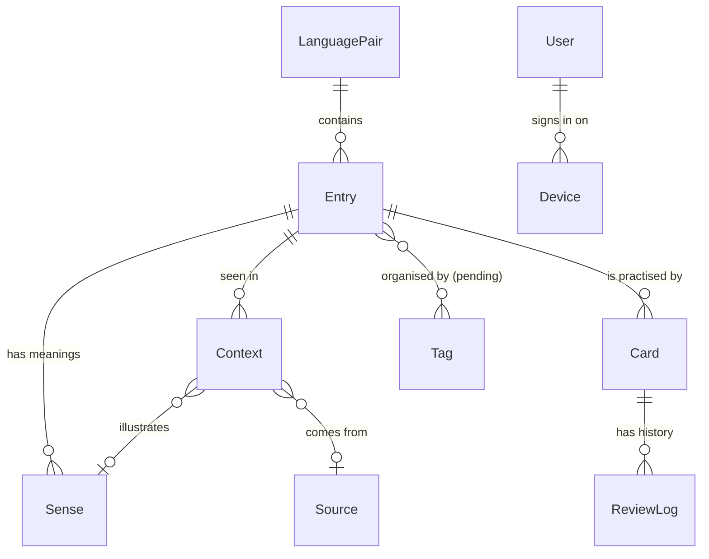
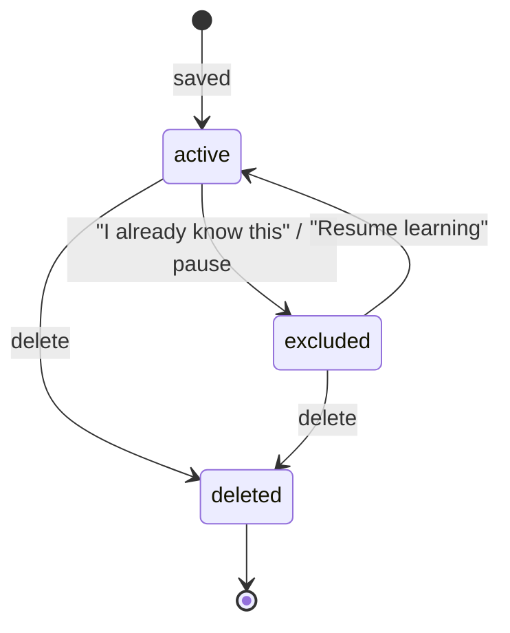

# Toriwords domain model (v1)

Status: **Proposed**. The owner has not yet confirmed the items marked *pending*. The pending decisions are listed in [proposed-decisions.md](proposed-decisions.md).

This document is platform-agnostic. It defines the vocabulary concepts, their fields, states and invariants as the user experiences them. It does not cover storage, sync mechanisms or scheduling algorithms; those are in [`docs/architecture/`](../architecture/). Field names are descriptive, not a schema.

Fields marked **derived** are computed on each device from other data and are never synced, so iOS and Android must compute them identically.

Related decisions: [native apps](memory://7), [local-first with own backend](memory://8), [project goals](memory://10), [primary pair RU → EN](memory://11), [open source](memory://12).

## Overview

| Concept | One-line meaning |
|---|---|
| LanguagePair | The direction the user learns in: native language → target language. |
| Entry | One word or phrase in the target language that the user is learning. |
| Sense | One meaning of an Entry: a native-language translation, optionally with a target-language definition. |
| Context | A real sentence where the user met the Entry. |
| Source | Where a Context came from: a web page, an app, or a title the user typed. |
| Card | One way of practising an Entry (for example EN → RU recognition). The scheduler acts on Cards. |
| ReviewLog | An immutable record of one answer to one Card. |
| Tag (pending) | A user-defined label used to organise Entries. |
| User / Device | The optional account and the devices that sync it. |

**Timestamps.** `created at` and `updated at` fields exist for display and sorting only. Conflicts between devices are never resolved by them; ordering uses the sync clock defined in [sync.md](../architecture/sync.md).

## LanguagePair

| Field | Meaning |
|---|---|
| id | Stable global identifier. |
| native language | Language of translations and the user's own language. v1: Russian. |
| target language | Language being learned. v1: English. |
| created at | When the pair was created. |

**Invariants**
- **Identity is (native, target).** Two LanguagePairs with the same languages are the same pair, including when two devices each created one on first run.
- v1 has exactly one LanguagePair: RU → EN. It is created automatically on first run. The UI does not offer creating or switching pairs.
- The two languages of a pair never change after creation.
- Every Entry belongs to exactly one LanguagePair. Nothing in the model assumes RU or EN, so later versions can add pairs without changing existing data.
- The app's UI language (EN or RU) is independent of the LanguagePair.

## Entry

The word or phrase the user is learning. It is the unit the user sees in the vocabulary list.

| Field | Meaning |
|---|---|
| id | Stable global identifier, assigned on the device that creates the Entry. |
| language pair | The LanguagePair it belongs to. |
| text | The word or phrase in the target language, as the user saved or edited it (for example "take off", "mortgage"). |
| match key | **Derived.** The normalised form of `text` used to detect duplicates. See *Duplicates*. |
| kind | **Derived.** `word` or `phrase`: more than one word means `phrase`. Both kinds behave the same everywhere (see [phrases](features/phrases.md)). |
| pronunciation (IPA) | Optional transcription, from Wiktionary or typed by the user. |
| note | Optional free text from the user. |
| status | `active` or `excluded`. See *Entry states*. |
| excluded reason | When `excluded`: `already known` or `paused`. |
| enrichment status | `pending`, `done` or `unavailable`. See *Enrichment*. |
| origin | How it was created: `typed`, `shared`, `text selection`, or later `imported`. |
| import ref | Optional, for future imports: source collection + source item id (for example an Anki note id). |
| created at / updated at | Display timestamps. |

**Entry states**

- **active:** its Cards take part in review when they are due.
- **excluded:** its Cards never appear in review, but the Entry stays in the vocabulary list and in search. The scheduling history is kept. Resuming continues from that history. `already known` counts as known in [stats](features/stats.md). `paused` does not.
- **deleted:** removed for the user everywhere, together with its Senses, Contexts, Cards and ReviewLogs. **Deletion is terminal** (recommended, *pending* [PD-17](proposed-decisions.md#pd-17-edit-on-one-device-vs-delete-on-another)):
  - a deleted Entry never comes back, even if another device edited or reviewed it offline at the same time; those edits and reviews are dropped when the devices sync;
  - saving the same text again later creates a fresh Entry with no history;
  - example: the user reviews "mortgage" on phone B offline while deleting it on phone A → after sync, "mortgage" stays deleted on both, and phone B's review is gone.
- A short undo right after deleting is *pending* ([PD-15](proposed-decisions.md#pd-15-deletion-recovery)). If adopted, the deletion takes effect only when the undo window closes, so undo never resurrects a synced deletion. See [vocabulary management](features/vocabulary-management.md).

**Invariants**
- `text` is never empty after trimming.
- An Entry can be reviewed only if it is `active` and has at least one Sense with a non-empty translation. An Entry without a translation (enrichment pending or unavailable and nothing typed) is saved and listed, but it gets no Cards in review until it has a translation.
- Within one LanguagePair, at most one non-deleted Entry has a given match key (see *Duplicates*).

## Sense

One meaning of an Entry. An Entry can have several (for example "bank" = банк / берег). Only the meanings the user chose or typed are stored; variants offered during capture and not chosen are discarded.

| Field | Meaning |
|---|---|
| id | Stable global identifier. |
| entry | The Entry it belongs to. |
| translation | Native-language translation (RU), for example "ипотека". Can hold several comma-separated synonyms as the user wrote them. |
| definition | Optional target-language (EN) definition, usually from Wiktionary. |
| part of speech | Optional, from Wiktionary or the user. |
| position | Sortable position among the Entry's Senses. The first is the primary one shown in review. |
| field provenance | For each of translation, definition and part of speech: who filled it (`user`, `wiktionary`, `on-device translation`) and whether the user has edited it. |

**Invariants**
- A Sense has at least one of translation or definition non-empty.
- Senses are displayed sorted by position. Equal positions (for example after concurrent inserts on two devices) are ordered by a deterministic tie-break defined in [sync.md](../architecture/sync.md). The displayed order has no gaps.

## Context

A sentence in which the user met the Entry. Contexts are the main memory aid in review (analysis A2).

| Field | Meaning |
|---|---|
| id | Stable global identifier. |
| entry | The Entry it belongs to. |
| sense | Optional: which Sense this sentence illustrates. |
| sentence | The target-language sentence as captured or typed. |
| highlight | Optional occurrence of the Entry in the sentence, so review can highlight or blank it: **offset and length in UTF-16 code units**. The occurrence may be an inflected form ("took off" for "take off"). |
| source | Optional Source. |
| captured at | When it was captured. |

**Invariants**
- `sentence` is not empty and is at most the length limit defined in [share/selection capture](features/capture-share-selection.md).
- An Entry can have any number of Contexts, including none.
- The highlight, if present, lies inside the sentence and does not split a character.

## Source

Where a Context came from. Several Contexts can share a Source (many words from one article).

| Field | Meaning |
|---|---|
| id | Stable global identifier. |
| kind | `web page`, `app` or `other`. |
| url | Optional, for web pages. |
| title | Optional page title, or a title the user typed (for example "The Bear S2E3"). |
| app | Optional name of the app the text was shared from, when the OS provides it. |

**Invariants**
- At least one of url, title or app is present.
- A Source without Contexts is not shown to the user.

## Card

One way of practising an Entry. Cards are created and removed by the app, not by the user.

| Field | Meaning |
|---|---|
| id | Stable global identifier. |
| entry | The Entry it practises. |
| direction | Which exercise this Card is. Candidates: `recognition` (see EN, recall RU), `recall` (see RU, produce EN), `cloze` (EN sentence with the Entry blanked). The v1 set is *pending* ([PD-1](proposed-decisions.md#pd-1-card-directions-and-exercise-types)). |
| created at | Display timestamp. |
| import ref | Optional: source collection + source card id. |
| learning stage | **Derived.** User-visible stage: `new` (never reviewed), `learning`, `known well`. Thresholds are defined by the scheduler ([scheduler.md](../architecture/scheduler.md)). |
| due | **Derived.** When the Card is next due. |
| scheduling state | **Derived.** Whatever the scheduler needs per Card, recomputed from the Card's ReviewLogs ([scheduler.md](../architecture/scheduler.md), [sync.md](../architecture/sync.md)). |

Only id, entry, direction, created at and import ref are synced.

**Invariants**
- **Identity is Entry + direction.** Cards created independently for the same Entry and direction (for example on two devices) are the same Card.
- A Card exists for every direction in the v1 set as soon as its Entry becomes reviewable. A `cloze` Card (if adopted) also needs at least one Context with a highlight.
- A Card's due date and stage are a pure function of its ReviewLogs, the scheduling settings and the scheduler. The same history gives the same result on iOS and Android.
- Excluding an Entry does not change its Cards' history. Deleting an Entry deletes its Cards.

## ReviewLog

One answer to one Card. ReviewLogs are the history of learning and the basis for scheduling and stats. They store raw facts only.

| Field | Meaning |
|---|---|
| id | Stable global identifier. |
| card | The Card that was answered. |
| reviewed at | Moment of the answer as a UTC instant, plus the device's UTC offset at that moment (needed for "today" in stats and daily limits). |
| rating | The grade in the v1 grading scheme (*pending*, [PD-2](proposed-decisions.md#pd-2-grading)). |
| answer duration | How long the user took to answer. |
| device | The Device the answer was given on. |
| import ref | Optional, only for imported logs: source collection + source log id. |
| original kind / original rating / original interval | Optional, only for imported logs: informational values from the source app (for example Anki review kind, rating 1–4, interval). Not used for scheduling. |
| review type | **Derived:** `first study`, `review` or `relearning`, computed by replaying the Card's merged log. |
| elapsed since previous review | **Derived** by replaying the Card's merged log. |

**Invariants**
- A ReviewLog is never edited after it is written.
- ReviewLogs are removed only together with their Card, when the Entry is deleted.
- Two devices that review the same Card offline both keep their ReviewLogs. Neither answer is lost (unless the Entry is deleted, see *Entry states*).

## Tag (pending)

The organisation shape is *pending* ([PD-3](proposed-decisions.md#pd-3-organisation)). The recommendation is flat, many-to-many tags with no decks.

| Field | Meaning |
|---|---|
| id | Stable global identifier. |
| name | Display name. |

**Invariants (if adopted)**
- An Entry can have any number of Tags. Deleting a Tag never deletes Entries.
- Tags do not split review: there is one review queue for all active Entries.

## User and Device

| Concept | Fields | Meaning |
|---|---|---|
| User | id; linked sign-in identities (provider `apple` or `google` + provider's account id); created at | Exists only after the person signs in. Without a User the app works fully, with all data on the device ([account & sync](features/account-sync.md)). |
| Device | id; platform (`ios` / `android`); display name; first seen | One installation of the app. It exists from first run, signed in or not. |
| Preferences | daily new-word limit, review-day start hour, target retention (if the scheduler exposes it), reminder time, UI language override | Settings ([settings & about](features/settings-about.md)). Settings that affect scheduling are synced; device-only ones are not (*pending* [PD-16](proposed-decisions.md#pd-16-which-settings-sync)). |

**Invariants**
- Data created before sign-in belongs to the User after sign-in, and is merged with that User's existing data (see *Duplicates*).
- How many identities one User can have (Apple, Google or both) is *pending* ([PD-10](proposed-decisions.md#pd-10-apple-and-google-on-one-account)).

## Duplicates

The same item can be created more than once: on two devices offline, before and after sign-in, or by a repeat capture. Each concept has a **natural key**. **Same natural key ⇒ same item**: the items are merged, and the user never sees two.

| Concept | Natural key | Normalised parts |
|---|---|---|
| LanguagePair | native language + target language | — |
| Entry | LanguagePair + match key | `text` → match key |
| Card | Entry + direction | — |
| Sense | Entry + translation (or definition, if the translation is empty) | translation / definition text |
| Source | URL; if there is no URL: title + app | URL; title |
| Context | Entry + sentence + Source | sentence text |
| Tag | name | name: case and surrounding/repeated whitespace ignored |
| Entry ↔ Tag membership | Entry + Tag | — |

- **Normalisation.** The exact rules are fixed by shared fixtures in [parity-testing.md](../architecture/parity-testing.md), so iOS and Android produce identical keys. The product intent for the Entry match key:
  - Ignored: letter case, leading and trailing whitespace and punctuation, repeated inner spaces, typographic variants of apostrophes, quotes and dashes ("don't" = "don’t").
  - Not ignored: inflection ("ran" ≠ "run"), spelling variants ("colour" ≠ "color"), articles that are part of the text ("the" in "the Bear").
  - Translations and sentences are compared with the same rules.
- Because match keys are derived, a future change of the normalisation rules rebuilds them on each device and may then merge Entries that became equal.
- **Repeat capture:** saving text whose natural key matches an existing Entry never creates a second Entry. The new Context is attached to the existing Entry, and a new translation becomes a new Sense only if it is not already there. Details: [duplicates](features/duplicates.md).
- **Editing:** if the user edits an Entry's `text` so that its match key equals another Entry's, the app offers to merge the two. They cannot coexist.
- **Merging** two items with the same natural key:
  - the survivor is chosen by a fixed rule (the earlier-created item, defined exactly in [sync.md](../architecture/sync.md)), never by the device or the user, so every device gets the same result;
  - for Entries: the other Entry's Senses, Contexts and Tag memberships move to the survivor and are themselves merged by their natural keys;
  - ReviewLogs are never rewritten: they are re-attached by reference to the surviving Entry's Card of the same direction, and that Card's derived state is recomputed from the combined log.

## Enrichment

Enrichment fills an Entry's empty fields from Wiktionary or on-device translation ([add word](features/add-word.md), [no-enrichment path](features/enrichment-unavailable.md)).

- **Fills only empty fields.** Enrichment never overwrites a field that has a value.
- **User edits win forever.** A field the user has edited is never changed by enrichment again, even if the user later empties it.
- **Idempotent.** Enrichment may run again at any time, on any device. If an enriched value was lost in a sync conflict with a user edit of another field, a later run fills the empty, non-user-edited fields again. The user sees no difference.
- **Status:**
  - `pending`: captured without enrichment yet (for example saved from the share extension or while translation was unavailable); the app retries automatically.
  - `done`: enrichment ran.
  - `unavailable`: nothing was found or the source is unavailable and retries have stopped; the user is told and can type a translation.
- Enriched values are stored on the Entry and synced. Different suggestions on iOS and Android affect only what is offered at capture, never stored data or behaviour afterwards (analysis §8.7).
- Data that comes from Wiktionary keeps its provenance, so the app can show attribution (CC BY-SA, [open source](memory://12)).

## Sync requirements

Requirements only. The mechanism is decided in [sync.md](../architecture/sync.md).

1. **Stable global IDs.** Every LanguagePair, Entry, Sense, Context, Source, Card, ReviewLog, Tag and Device has a globally unique ID assigned at creation on any device, offline. IDs never change. Items with natural keys (see *Duplicates*) may get deterministic IDs.
2. **Immutable ReviewLog.** ReviewLogs are append-only and hold raw facts only, so concurrent reviews on several devices merge without conflict.
3. **Deletion via tombstone.** A deletion is itself a synced change, so a deleted item does not come back from another device that was offline. Deletion is terminal (see *Entry states*).
4. **Versioning placeholder.** Concurrent edits of the same item resolve without asking the user, per field or per record, using the sync clock rather than device timestamps. The granularity and clock (for example HLC vs server version) are chosen in [sync.md](../architecture/sync.md).
5. **Natural-key merge.** Items with the same natural key created on different devices merge as described in *Duplicates*. The user never picks "this device or the cloud".
6. **Derived data is not synced.** Card learning stage, due and scheduling state, Entry match key and kind, and ReviewLog review type and elapsed time are recomputed on each device. "Same history → same due date on both platforms" must hold; settings that affect scheduling therefore sync.
7. **Pre-sign-in data.** Everything created while signed out must be uploadable and mergeable on first sign-in without a full re-upload of later changes.

## Future Anki import mapping

Anki import is after v1. The model must be able to receive it without changes:

| Anki | Toriwords |
|---|---|
| Note | Entry. The user maps note fields: which field is the word or phrase (`text`), which is the translation (Sense `translation`), and optionally which is an example (Context `sentence`) and the definition. Other fields go to `note`. |
| Card | Card. A card generated in the "front → back" direction of the mapped fields becomes `recognition`; "back → front" becomes `recall`; a cloze note becomes `cloze` if PD-1 adopts it, otherwise `recognition`. Card types that do not map are not imported, and their notes are still imported as Entries. |
| Revlog entry | ReviewLog with the timestamp, rating (mapped, see below) and answer duration. Anki's review kind (learn / review / relearn / filtered / manual), rating 1–4 and interval are kept in the `original *` fields. |
| Deck | Tag with the deck name (if PD-3 adopts Tags). |
| Note tags | Tags. |
| Suspended card | Entry `excluded` / `paused` when all its cards are suspended. |

- **Re-import is idempotent.** Entries, Cards and ReviewLogs keep an `import ref` (collection + Anki note / card / revlog id). Importing the same collection twice, or on two devices, does not duplicate history.
- **Not answers.** Anki revlog rows of kind manual / rescheduled are kept for history but ignored by the scheduler (to be confirmed in [scheduler.md](../architecture/scheduler.md)).
- **Rich text:** Anki fields are HTML. Import converts them to plain text, keeps line breaks, and drops formatting. Media (images, audio) is not imported in the first version of import. The user is told how many fields had media.
- **Ratings:** if PD-2 adopts two buttons, Anki "Again" maps to the failing grade and Hard/Good/Easy map to the passing grade. If PD-2 adopts four buttons, the mapping is one to one.
- **Duplicates:** an imported note whose `text` matches an existing Entry merges into it (see *Duplicates*), and review histories are combined.
- How imported history turns into scheduling state is defined in [scheduler.md](../architecture/scheduler.md).
