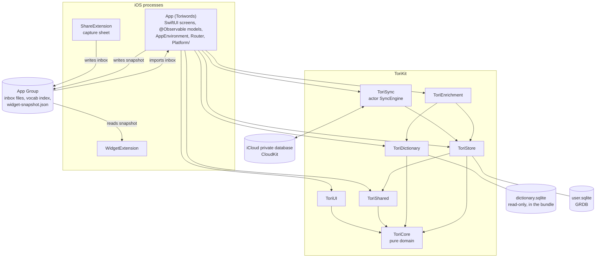

# ToriWords for iOS

The native iOS app (SwiftUI, iOS 18+) and its Swift package **ToriKit**.

## Prerequisites

| Tool | Version | Pinned in |
|---|---|---|
| Xcode | 27.x (iOS 27 SDK; deployment target iOS 18) | `.github/workflows/ios.yml` (`XCODE_VERSION`) |
| Tuist | see file | `ios/.tuist-version` |
| Swift on Linux (ToriKit tests only) | see file | repo-root `.swift-version` |
| uv + Python 3.12 (fixtures, dictionary tools) | — | `tools/*/pyproject.toml` |

Install Tuist with [mise](https://mise.jdx.dev): `mise use tuist@$(cat ios/.tuist-version)`.

## Generate and run the app

```sh
cd ios
tuist install            # resolves ToriKit + GRDB (Tuist/Package.swift)
tuist generate           # writes and opens Toriwords.xcworkspace
```

Run the `Toriwords` scheme on a simulator. The generated project and workspace are not committed. Regenerate after
changing `Project.swift`, `Tuist/Package.swift` or adding files.

Command-line build (what CI does):

```sh
xcodebuild build -workspace Toriwords.xcworkspace -scheme Toriwords -configuration Debug \
  -destination "generic/platform=iOS Simulator" CODE_SIGNING_ALLOWED=NO
```

## Architecture

Offline-first, no backend. Each user's data lives in a local SQLite database and syncs through their iCloud private
database. The app target is a thin layer of screens and platform glue; the logic lives in the ToriKit package, split
into modules with dependencies declared in `ToriKit/Package.swift`.



The extensions link only ToriCore, ToriShared, ToriDictionary and ToriUI, and never open the database: the Share
Extension drops a file into the App Group inbox and the app imports it; the widget reads a JSON snapshot the app writes.

| Module | What it holds |
|---|---|
| App (Toriwords) | SwiftUI screens with one `@MainActor @Observable` model each, `AppEnvironment` (composition root, passed through `@Environment`), `Router`, `Platform/` (sync coordinator, reminders, config) |
| ShareExtension | Capture sheet → App Group inbox |
| WidgetExtension | Reads `widget-snapshot.json` from the App Group |
| ToriCore | Pure domain, no UI or storage: IDs, HLC, merge, text keys, capture rules, FSRS scheduler, daily queue, widget snapshot, reminder plan. Builds and tests on Linux |
| ToriShared | App Group layout, inbox files, vocab index, deep links, Darwin notification |
| ToriDictionary | `dictionary.sqlite`, read in place from the app bundle (`immutable=1`) |
| ToriStore | `user.sqlite` on GRDB (`DatabasePool`, WAL): records, outbox, sync apply, queries observed by the UI, backup and export |
| ToriSync | `SyncEngine` (an actor) over the `CloudDatabase` protocol; `CloudKitDatabase` is the iCloud adapter, tests use an in-memory cloud |
| ToriEnrichment | On-device translation (Apple Translation), dictionary lookup, enrichment orchestrator, speech (AVFoundation) |
| ToriUI | Design tokens and shared SwiftUI components |

### Technologies

- **Language and UI:** Swift 6 with complete strict concurrency, SwiftUI, Observation, Swift Charts. iOS 18+, built
  with the iOS 27 SDK.
- **Storage:** GRDB over SQLite. The only third-party runtime dependency, plus swift-crypto on Linux in place of
  CryptoKit.
- **Apple frameworks:** CloudKit, Translation, AVFoundation, UserNotifications, BackgroundTasks, WidgetKit,
  CoreHaptics, CryptoKit.
- **Build:** Tuist generates the project; ToriKit modules link as static frameworks (`Tuist/Package.swift`); settings
  come from xcconfig files (Debug, Release, Personal).
- **Tests:** Swift Testing, with parity fixtures shared with Android (`fixtures`).
- **Tools:** Python with uv builds the dictionary from Wiktionary and validates the fixtures (`tools/`).
- **CI:** GitHub Actions: ToriKit on the iOS Simulator and on Linux, the app build, the Python tools.

## ToriKit tests

On a Mac (iOS Simulator, all test targets including `ToriUITests`):

```sh
cd ios/ToriKit
xcodebuild test -scheme ToriKit-Package -destination "platform=iOS Simulator,name=iPhone 17"
```

On Linux: everything except Apple-only code is behind `#if canImport(...)`. Install the toolchain with
[swiftly](https://www.swift.org/install/linux/); it reads `.swift-version`.

```sh
swiftly install --use                        # once, from the repo root
source ~/.local/share/swiftly/env.sh         # per shell
cd ios/ToriKit && swift test
```

The parity fixtures are found from the test sources' location. Set `TORI_FIXTURES=/path/to/fixtures` to use
another checkout. On the simulator, pass it as `TEST_RUNNER_TORI_FIXTURES`.

Fixture and dictionary tools have their own tests (CI: `tools.yml`):

```sh
cd tools/fixtures && uv run python validate.py && uv run pytest
cd tools/dictionary && uv run pytest
```

## Dictionary

The offline EN→RU dictionary `dictionary.sqlite` (about 60 MiB, CC BY-SA 4.0) is **not** in git.

- **Sample:** `ios/Resources/dictionary-sample.sqlite` is committed. It is a few hundred headwords from the same build,
  with the same schema. Debug builds, tests and CI work with it.
- **Full file:** run `tools/dictionary/fetch.sh` before a Release build. It downloads the GitHub Release asset named in
  `tools/dictionary/release.json` to `ios/Resources/dictionary.sqlite`, then checks it against the committed
  `dictionary.sqlite.sha256`. On a mismatch it deletes the file and fails.
- **Release hand-off:** `tools/dictionary` builds the file and the owner publishes it as a GitHub Release
  (`gh release create dictionary-<ver> …`). The owner then commits `release.json`, `dictionary.sqlite.sha256`,
  `build-report.md` and the refreshed sample. See `tools/dictionary/README.md`.
- **Rebuild:** `cd tools/dictionary && uv run python -m toridict build`. It downloads the pinned Wiktionary dumps
  (several GB, cached) and gives the same bytes for the same inputs.

CI downloads the full file only when the Release asset exists. Otherwise it builds Debug with the sample.

## App icon

- **Asset:** `Resources/Assets.xcassets/AppIcon.appiconset` has single-size 1024×1024 images: `AppIcon.png` (light, opaque,
  no alpha channel, as App Store Connect requires) and `AppIcon-dark.png` (dark, transparent background). iOS derives
  the tinted and clear looks from these.
- **Source:** the images are `LogoMark` (`ToriKit/Sources/ToriUI/Brand.swift`) at 75 % of the side: light colours on
  `Palette.background` light (#F2F2F7) for `AppIcon.png`, dark colours on transparent for `AppIcon-dark.png`. Redraw both
  PNGs from it when the mark changes.

## Configuration

All build settings live in `Config/Shared.xcconfig`. It holds no secrets.

| Key | Meaning |
|---|---|
| `DEVELOPMENT_TEAM` | Your Apple team ID, needed for device builds. |
| `TORI_APP_GROUP_ID` | `group.com.toriwords.app`. Shared by the app, Share Extension and widget. |
| `TORI_BG_REFRESH_TASK_ID` | `com.toriwords.app.refresh` (`BGAppRefreshTask`). |
| `TORI_URL_SCHEME` | `toriwords`, for `toriwords://review` and `toriwords://add?text=…`. |

There is no backend: sync uses the iCloud private database (CloudKit container `iCloud.com.toriwords.app`).

### Bundle IDs and capabilities

| Target | Bundle ID | Notes |
|---|---|---|
| `Toriwords` (app) | `com.toriwords.app` | Entitlements: App Group, iCloud (CloudKit, container `iCloud.com.toriwords.app`). Background fetch (`BGTaskSchedulerPermittedIdentifiers`). URL scheme `toriwords`. |
| `ToriwordsShare` | `com.toriwords.app.share` | Share Extension (text, one web URL, Safari web page with `ExtensionPreprocessing.js`). Entitlement: App Group. |
| `ToriwordsWidget` | `com.toriwords.app.widget` | WidgetKit (small, medium, lock-screen circular and rectangular). Entitlement: App Group. |

All three targets: iOS 18.0, Swift 6 language mode, `CFBundleLocalizations` en + ru. The app sets
`ITSAppUsesNonExemptEncryption = NO` and is portrait-only on iPhone (all orientations on iPad).

### Signing

CI builds unsigned (`CODE_SIGNING_ALLOWED=NO`). For a device:

- Set `DEVELOPMENT_TEAM`.
- Let Xcode manage signing.
- Register the App Group `group.com.toriwords.app` and the iCloud container `iCloud.com.toriwords.app` (CloudKit) for the app ID.

Without the App Group entitlement, `AppGroup.shared` is nil. Sharing, the widget snapshot and the vocab index are then
off, and the app still runs.

### Free Apple ID (Personal Team)

The `Toriwords-Personal` scheme builds the `Personal` configuration (`Config/Personal.xcconfig`) for a free Apple ID.
A Personal Team cannot sign iCloud or App Groups, so that build has no entitlements, no iCloud sync (the Settings
row shows "—"). Share capture and the widget need the App Group, so in this build ToriWords is not listed in Share
(the extension's activation rule is `FALSEPREDICATE`), Home does not mention it, and the widget offers no sizes (not
in the widget gallery). Words, review, speech, translation and the
dictionary work. It installs next to the full app under its own bundle ID, and Xcode must reinstall it every 7 days.

1. Xcode → Settings → Accounts: add your Apple ID.
2. Copy the template and fill in your Personal Team ID and a bundle ID prefix of your own. The copy is gitignored:

   ```sh
   cp Config/Personal.local.xcconfig.example Config/Personal.local.xcconfig
   ```

3. `tools/dictionary/fetch.sh` (full dictionary; without it the build uses the sample), then `tuist generate`.
4. Run the `Toriwords-Personal` scheme on the iPhone. On the phone: turn on Developer Mode, and after the first install
   trust the developer profile (Settings → General → VPN & Device Management).

## Specs and fixtures

- Parity fixtures shared with Android: `fixtures/`. See `fixtures/README.md`. That covers normalization, IDs,
  HLC, merge, capture, the scheduler and the multi-device `sync/` scenarios. `known-deviations.json` must be `[]`.
- CI workflows: `.github/workflows/toriKit-linux.yml`, `tools.yml` and `ios.yml`.
