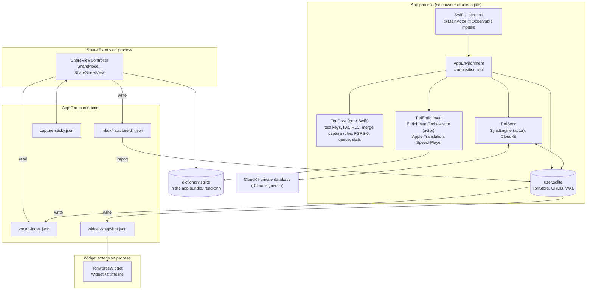

# ToriWords for iOS: architecture

This file covers how the iOS app is put together: platform and stack, targets and entitlements, modules, concurrency, files on the device, start-up, launch animation, haptics, background entry points and deep links, observability, performance targets, repository layout, CI and release.

Related files:
- [data-model.md](data-model.md): local database, settings storage, backup, export and restore.
- [sync.md](sync.md): iCloud (CloudKit) sync.
- [scheduler.md](scheduler.md): spaced repetition, day model, queue, widget snapshot, reminders.
- [capture-and-enrichment.md](capture-and-enrichment.md): capture, dictionary, translation, pronunciation.
- [testing.md](testing.md): parity fixtures and test suites.
- [product.md](product.md), [domain.md](domain.md), [ui.md](ui.md), [copy.md](copy.md): behaviour, concepts, screens and wording.

The code in `ios/` is the reference implementation. Where this file and the code disagree, the code wins and this file gets fixed. The Android app follows these rules; its deliberate differences are listed in `android/docs/ios-differences.md`.

## 1. System overview

ToriWords is local-first. Each device keeps the user's whole vocabulary in a local SQLite database (`user.sqlite`) and works fully offline. There is no ToriWords server and no app account. When the user is signed in to iCloud, the app syncs merged records through the user's **CloudKit private database** (container `iCloud.com.toriwords.app`), and other iOS devices on the same Apple Account merge them. There is no sync between iOS and Android. A JSON backup file is the only way to move words between the two platforms ([data-model.md](data-model.md#9-export-and-restore)).

Principles:
1. **Local-first.** Every feature except iCloud sync and the one-time Apple Translation language download works offline. No screen waits for the network.
2. **No account, no backend.** The app talks only to CloudKit (when the user is signed in to iCloud and the build has sync enabled) and to Apple's language-data download for Apple Translation. Both are system services.
3. **Domain logic runs on the device and is pinned by fixtures.** Text keys, IDs, clocks, merge, capture text rules, FSRS-6, the day model, the daily queue and the widget snapshot live in `ToriCore` and must behave exactly like Android. The shared JSON fixtures in `fixtures/` are normative ([testing.md](testing.md)).
4. **Derived data is never synced.** Card scheduling state, due days, match keys, canonical IDs, search folds and all counts are recomputed locally.
5. **Three processes, one database owner.** The app process is the only one that opens `user.sqlite`. The Share Extension and the widget extension are separate processes. They talk to the app only through files in the shared **App Group** container: the Share Extension writes an inbox file per capture and reads a vocabulary index and its sticky fields; the widget reads a snapshot file ([Files on the device](#6-files-on-the-device)).
6. **Machine output only suggests.** Dictionary and Apple Translation results are offered and stored only when the user accepts them. The one exception is the automatic fill of words saved without a translation ([capture-and-enrichment.md](capture-and-enrichment.md)).
7. **No analytics, crash or ads SDKs.**



## 2. Platform and stack

| Item | Value |
|---|---|
| Language | Swift 6 language mode with **strict concurrency checking set to complete** (`SWIFT_VERSION = 6.0`, `SWIFT_STRICT_CONCURRENCY = complete`). The pinned toolchain for the Linux CI job is in the repo-root `.swift-version`. |
| UI | SwiftUI with Observation (`@Observable`). Swift Charts on the Progress screen. UIKit only where SwiftUI has no API: the Share Extension's principal view controller, `UIImpactFeedbackGenerator`, `UIApplication.openSettingsURLString`. Colours are the fixed ToriWords palette in light and dark (`ToriUI`), no global accent colour in the asset catalogue. Visuals: [ui.md](ui.md). |
| SDK levels | **Deployment target iOS 18.0.** Built with Xcode 27 and the iOS 27 SDK (`XCODE_VERSION: "27"` in CI). APIs newer than iOS 18 (for example `TranslationSession(installedSource:target:)` on iOS 26) are used behind `#available`. |
| Devices | iPhone and iPad (`destinations: [.iPhone, .iPad]`). Portrait only on iPhone; all orientations on iPad. There are no iPad-specific screens. |
| Localisation | English and Russian (`CFBundleLocalizations = [en, ru]`), String Catalogs (`Localizable.xcstrings`) in each target. Symbol generation and `SWIFT_EMIT_LOC_STRINGS` are off. Learning content is never translated. |
| Persistence | **GRDB 7** over the system SQLite: `DatabasePool` (WAL) for `user.sqlite` in `ToriStore`; a read-only `DatabaseQueue` for the dictionary in `ToriDictionary`. Per-device settings in `UserDefaults` ([data-model.md](data-model.md)). |
| Background | `BackgroundTasks` app refresh (`.backgroundTask(.appRefresh(…))`), WidgetKit timelines, `UserNotifications` calendar triggers. No background modes other than `fetch`. |
| Dependencies | Apple frameworks: SwiftUI, Observation, Charts, CloudKit, Network (`NWPathMonitor`), Translation, AVFoundation, UserNotifications, BackgroundTasks, WidgetKit, CoreHaptics, CryptoKit. Third-party: **GRDB.swift ≥ 7.12** only. `swift-crypto` is linked on Linux only, so `ToriCore` tests run there. **Nothing else.** No analytics, crash or ads SDKs. |
| Crypto | CryptoKit `SHA256` (fuzz seed, URL keys, UUIDv5 via the `ToriID` helpers), `SystemRandomNumberGenerator` (UUIDv7 random bits). |
| Project generation | **Tuist 4.218.0** (`ios/.tuist-version`). `Project.swift` and `Workspace.swift` are the source of truth; the Xcode project is generated and not in git. External packages are declared in `Tuist/Package.swift` and built as **static frameworks**. |
| Tests | Swift Testing in `ToriKit` test targets (`swift test` on macOS and Linux, `xcodebuild test -scheme ToriKit-Package` on a simulator). The app project has no test targets ([testing.md](testing.md)). |

## 3. Targets, App Group and entitlements

All three targets are defined in `ios/Project.swift`. Identifiers come from `ios/Config/Shared.xcconfig`, so a personal build can override them.

| Target | Product | Bundle ID | Responsibilities |
|---|---|---|---|
| `Toriwords` | App | `$(TORI_BUNDLE_ID)` = `com.toriwords.app` | All screens, the database, sync, enrichment, reminders, background refresh. |
| `ToriwordsShare` | Share Extension (`.appExtension`) | `$(TORI_BUNDLE_ID).share` | Capture sheet ([capture-and-enrichment.md](capture-and-enrichment.md)). Depends on `ToriCore`, `ToriShared`, `ToriDictionary`, `ToriUI`. No `user.sqlite`, no network, no Keychain. |
| `ToriwordsWidget` | Widget extension | `$(TORI_BUNDLE_ID).widget` | Home Screen and Lock Screen due-count widget ([scheduler.md](scheduler.md#widget-snapshot)). Depends on `ToriCore`, `ToriShared`, `ToriUI`. |

**Build settings** (all targets): `SWIFT_VERSION 6.0`, `SWIFT_STRICT_CONCURRENCY complete`, `STRING_CATALOG_GENERATE_SYMBOLS NO`, `SWIFT_EMIT_LOC_STRINGS NO`. Configurations: `Debug` and `Release` (both `Config/Shared.xcconfig`) and `Personal` (`Config/Personal.xcconfig`).

**`Config/Shared.xcconfig`:**

| Setting | Value |
|---|---|
| `DEVELOPMENT_TEAM` | `TEAMID0000` (placeholder) |
| `TORI_BUNDLE_ID` | `com.toriwords.app` |
| `TORI_APP_GROUP_ID` | `group.com.toriwords.app` |
| `TORI_BG_REFRESH_TASK_ID` | `com.toriwords.app.refresh` |
| `TORI_URL_SCHEME` | `toriwords` |
| `TORI_CLOUD_SYNC` | `YES` |

**Entitlements:**
- App: App Group `group.com.toriwords.app`; iCloud services `CloudKit`; container `iCloud.com.toriwords.app`.
- Share Extension and widget: the App Group only.

**App `Info.plist` keys:** `CFBundleDisplayName` "ToriWords"; `UILaunchScreen` with `UIColorName = LaunchBackground`; supported orientations as in the stack table; `ITSAppUsesNonExemptEncryption = false`; URL scheme `$(TORI_URL_SCHEME)`; `BGTaskSchedulerPermittedIdentifiers = [$(TORI_BG_REFRESH_TASK_ID)]`; `UIBackgroundModes = [fetch]`; `ToriCloudSync = $(TORI_CLOUD_SYNC)`.

**App resources:** the String Catalog, `Resources/dictionary*.sqlite` (the full `dictionary.sqlite` when fetched, else `dictionary-sample.sqlite`) and `Assets.xcassets`. A pre-build script **fails a Release build without `Resources/dictionary.sqlite`**. Debug falls back to the committed sample.

**Share Extension `Info.plist`:** the activation rule and `NSExtensionJavaScriptPreprocessingFile = ExtensionPreprocessing` ([capture-and-enrichment.md](capture-and-enrichment.md#share-extension)).

### Personal configuration

The `Personal` configuration and the `Toriwords-Personal` scheme let a contributor run the app on their own device with a free Personal Team, which cannot use App Groups, iCloud or push:
- `Config/Personal.xcconfig` includes `Shared.xcconfig`, sets `TORI_CLOUD_SYNC = NO` and then `#include? Personal.local.xcconfig` (git-ignored; template `Personal.local.xcconfig.example`) for the contributor's team and bundle ID.
- `CODE_SIGN_ENTITLEMENTS` is empty, so no App Group and no iCloud entitlement is requested.
- A pre-build script writes a Share Extension `Info.plist` whose activation rule is `FALSEPREDICATE`, so the extension never appears in the share sheet.
- At run time `AppConfig.cloudSyncEnabled` is false (`ToriCloudSync == "NO"`), so the sync coordinator never attaches; `AppGroup.shared` is nil, so App Group files are skipped and the widget offers no families.

The full app works otherwise, with local data only. Steps: `ios/README.md`.

**App icon:** the ToriWords tree mark (a tree "T" growing out of an accent "W", with a waved branch and an accent leaf) at 75 % of the icon on a light background, with dark and tinted variants in `Assets.xcassets`. The asset catalogue holds single-size 1024×1024 images (`AppIcon.png`, light and opaque; `AppIcon-dark.png`, dark on a transparent background); iOS derives the tinted variant. The mark's geometry is defined by `LogoMark` in `ToriKit/Sources/ToriUI/Brand.swift`. Redrawing steps: `ios/README.md`. Art details: [ui.md](ui.md).

## 4. Swift package modules

`ios/ToriKit/Package.swift` (tools version 6.2; platforms iOS 18, macOS 15) holds all logic outside the app targets. Arrows are the only allowed dependencies.

| Module | Contents | Depends on |
|---|---|---|
| `ToriCore` | Pure Swift, no Apple UI frameworks: text normalisation and keys, URL key, UUIDv7/UUIDv5 (`ToriID`), unsigned-byte ID order, HLC, field comparator and envelope merge, capture text rules, FSRS-6, day model, daily queue, review session, sentence rotation, widget snapshot and display, reminder plan, stats, wire types. Time is always passed in. | `swift-crypto` on Linux only |
| `ToriShared` | The App Group contract between processes: `AppGroup` paths, `AtomicFile`, inbox file format and `Inbox`, `VocabIndex`, `CaptureSticky`, widget snapshot read/write, `InboxNotification` (Darwin notification), `DeepLink`, `SharePayload` and `CaptureDraft`. | `ToriCore` |
| `ToriDictionary` | Read-only access to `dictionary.sqlite`: autocomplete, lookup, forms, contained phrases, reverse RU→EN, related words, `meta`. | `ToriCore`, GRDB |
| `ToriStore` | `user.sqlite`: schema, migrations, the write path that stamps HLC clocks and outbox rows, capture and edit use cases, inbox import, duplicate merge, canonical-ID resolution, replay, queries, App Group file writer, launch and restore, export/restore. | `ToriCore`, `ToriShared`, GRDB |
| `ToriSync` | `SyncEngine` (actor) over the CloudKit private database ([sync.md](sync.md)). | `ToriCore`, `ToriStore` |
| `ToriEnrichment` | `EnrichmentOrchestrator` (actor), suggestions, `AddDraft` and autocomplete merge, `DictionarySearch`, `AppleTranslator` and `TranslationBridge`, `SpeechPlayer` and `VoicePicker`. | `ToriCore`, `ToriDictionary`, `ToriStore` |
| `ToriUI` | Palette and typography, shared components, `LogoMark`, `BrandHeader` with `SwayModel`. | `ToriCore` |

Test targets: `ToriTestSupport` (shared helpers, fixture loading) and one test target per module (`ToriCoreTests`, `ToriSharedTests`, `ToriDictionaryTests`, `ToriStoreTests`, `ToriSyncTests`, `ToriEnrichmentTests`, `ToriUITests`).

The app target (`ios/App/`) holds the screens, their models, `AppEnvironment` (the composition root) and the platform adapters in `App/Platform/` (`SyncCoordinator`, `ReminderScheduler`, `AppConfig`).

## 5. Concurrency

- The whole code base compiles under Swift 6 strict concurrency (`complete`). Values that cross isolation domains are `Sendable`.
- **UI state is `@MainActor`.** `AppEnvironment`, every screen model, `TranslationBridge`, `SpeechPlayer` and `ReminderScheduler` are `@MainActor`; the models are `@Observable`.
- **One `ToriStore` per process,** owned by `AppEnvironment`. It wraps a GRDB `DatabasePool`: one serialised writer and concurrent WAL readers. All writes go through `ToriStore.write { tx in … }`, which runs one transaction and stamps clocks and outbox rows inside it. UI reads observe the database with GRDB `ValueObservation`.
- **Actors serialise long-running services:** `SyncEngine` (one sync cycle at a time; triggers are coalesced) and `EnrichmentOrchestrator` (one pass at a time; a trigger during a pass schedules one more pass).
- **Heavy start-up work** (opening and migrating the store, launch and restore) runs in `Task.detached` off the main actor.
- **Answer commits** run synchronously in `ToriStore.write` on the main actor when they are triggered (next answer, close, background), so leaving the screen cannot cancel a commit half-way.
- **Non-Sendable system objects** (`TranslationSession`) are confined to one serial loop and marked `nonisolated(unsafe)` only there.

## 6. Files on the device

| Path | Content | iCloud backup | Writer → reader |
|---|---|---|---|
| `Application Support/user.sqlite` (+ `-wal`, `-shm`) | User data ([data-model.md](data-model.md)). | Yes | app → app |
| `Application Support/device-marker` | The Device ID of this installation (16 bytes). Detects a restore. Written atomically. | **No** (`isExcludedFromBackup`) | app → app |
| App bundle `dictionary.sqlite` | The read-only dictionary, opened in place ([capture-and-enrichment.md](capture-and-enrichment.md#dictionary)). | — (part of the app) | build → app and Share Extension |
| App Group `inbox/<captureId>.json` | One pending capture per file. | App Group container | Share Extension → app |
| App Group `vocab-index.json` | Duplicate hints and tag names for the capture sheet. | App Group container | app → Share Extension |
| App Group `capture-sticky.json` | Sticky capture fields and the one-time tip flag. | App Group container | Share Extension → Share Extension |
| App Group `widget-snapshot.json` | Widget data ([scheduler.md](scheduler.md#widget-snapshot)). | App Group container | app → widget |
| `UserDefaults.standard` (app) | Per-device settings: accent, auto-play on reveal, swipe demo shown, reminder offer shown, reminder on/time, widget-hint snooze, installed dictionary version. | Yes | app → app |

**App Group files** (`ToriShared/AppGroup.swift`):
- The container is `group.com.toriwords.app`. `AppGroup.shared` is nil when the entitlement is missing (Personal builds); every caller then skips the App Group step.
- Every file is written by `AtomicFile`: encode to JSON with sorted keys, write `.tmp-<name>` in the same directory (creating it if needed), then rename over the target. Readers never see a half-written file.
- After writing an inbox file, the Share Extension posts the Darwin notification `com.toriwords.inbox.changed` (`InboxNotification`). The app observes it while running and imports at once.

SQLite settings for `user.sqlite`: UTF-8 encoding (set before any table exists), WAL (the `DatabasePool` mode), `synchronous = NORMAL`, foreign keys on (GRDB default). When the app goes to the background it runs `PRAGMA wal_checkpoint(TRUNCATE)`, so the backed-up file is consistent and small.

## 7. Start-up, first run, restore and reinstall

The app has two cold-start entry points that touch user data: the scene (`.task { await env.launch() }` on the root view) and the background refresh task. Both call the same idempotent `AppEnvironment.launch()`. `AppEnvironment.phase` is `launching`, then `ready` or `failed`. While `launching`, the root view shows only the background; `failed` shows "ToriWords could not open its data".

`performLaunch` steps, in order:

1. **Open and migrate** `user.sqlite` in `Application Support` ([data-model.md](data-model.md#7-migrations)), off the main actor.
2. **Launch check** (`ToriStore.launch(deviceMarker:displayName:)`, `ToriStore/Launch.swift`), off the main actor:
   - **Existing:** the `device` row with `is_this_device = 1` has the ID stored in `device-marker`. Nothing to do.
   - **Fresh install** (no device row): create the Device row (new UUIDv7, `platform = ios`, `display_name = UIDevice.current.model`, `first_seen`, rank 0), write the marker, and create the LanguagePair (`v5("pair:ru:en")`) and Settings (`v5("settings")`: `new_words_per_day = 10`, default FSRS parameters, `params_id = fsrs6-default-1`, `scheduler_version = 1`) defaults with rank 0.
   - **Restored** (a device row exists but the marker is missing or holds another ID; this is an iCloud device backup restore or a device-to-device transfer): in one transaction:
     - generate a new Device ID, set `is_this_device = 0` on the old row, insert the new row;
     - reset the CloudKit bookkeeping (`CloudMeta.reset`: change tokens and zone state);
     - mark every synced record pending (`Outbox.markAll`, tombstones included), because the restored database is an older snapshot than iCloud.

     Then write the new marker.
3. **Dictionary:** open the bundled dictionary in place (`AppDictionaryLoader`), delete a legacy copy in the App Group if one is left from older builds, and compare its version with the `dictionaryVersion` stored in `UserDefaults`.
4. **Import the inbox** (captures saved by the Share Extension while the app was not running).
5. **Attach sync** (`SyncCoordinator.attach`) if `AppConfig.cloudSyncEnabled`.
6. **Create the enrichment orchestrator** with the store, the dictionary and `AppleTranslator`.
7. `phase = ready`; start observing the store and the inbox notification.
8. **Then, in a background task:** if the dictionary version changed, `updateDictionary` (retries `unavailable` Entries), else `runPending`; then a sync cycle if the app is active. Write the App Group files at once (vocabulary index, widget snapshot) and refresh the reminders.

**On becoming active:** import the inbox, run pending enrichment, sync.

**Observers while running:**
- Any vocabulary change (`store.vocabularyChanges()`) → App Group files and reminders rewritten after a 2 s debounce.
- The Darwin inbox notification → import the inbox.

**Uninstall + reinstall** is a fresh install: `Application Support`, `UserDefaults` and the marker go with the app. With iCloud on, the first sync then pulls the user's records back ([sync.md](sync.md)). **Settings → Data → Remove all data** clears the store on this device only (`removeAllDataFromDevice`), serialised with a running sync cycle.

## 8. Launch animation

The user-visible description is in [ui.md](ui.md). Mechanism (`App/LaunchView.swift`):

- `UILaunchScreen` shows only the `LaunchBackground` colour. The first SwiftUI frame is `LaunchView`, an overlay above the root view in the same colour.
- The overlay draws the 150 pt `LogoMark`, which grows in four parts:
  - **W:** 0.5 s, ease-out `cubic-bezier(0.23, 1, 0.32, 1)`.
  - **Stem:** rises through the W from 0.3 s for 0.7 s.
  - **Branch:** unfurls from 0.85 s for 0.55 s.
  - **Leaf:** unfolds from its base from 1.25 s for 0.45 s.

  Stem, branch and leaf use `cubic-bezier(0.4, 0, 0.2, 1)`.
- **Hold:** the finished mark stays for 400 ms, even when the data is already ready.
- **Still launching:** `phase == launching` after the mark is drawn. A dim band (40 % opacity) sweeps across the mark (1.1 s pass, 0.5 s pause) until launch completes.
- **Leave:** fade out over 0.3 s (ease-out) while moving 8 pt up, then remove the overlay.
- **Launch haptic:** the rolling haptic ([Haptics](#9-haptics)) is scheduled so its last tap lands at about 70 % of the leaf unfold (`leafDelay + 0.7 × leafDuration` = 1.565 s after start).
- **Reduce Motion:** no drawing. The finished mark fades in over 0.25 s, the haptic ends as the fade ends, then the 400 ms hold, no sweep or offset, and a 0.2 s fade-out.
- Accessibility label "ToriWords".

## 9. Haptics

This section is the single owner of the haptic mechanism. The user-visible behaviour and timing are in [ui.md](ui.md). Haptics never carry information that is not also visible.

### 9.1 Launch roll

`LaunchHaptic` plays a CoreHaptics pattern on a `CHHapticEngine`: 7 transient events with sharpness 0.25. As (time s, intensity) pairs: (0, 0.35), (0.04, 0.6), (0.08, 0.85), (0.12, 1.0), (0.17, 0.75), (0.23, 0.45), (0.30, 0.2).
- Skipped when `CHHapticEngine.capabilitiesForHardware().supportsHaptics` is false (iPad, older devices).
- The pattern starts at (target end − 0.30 s). The engine uses auto-shutdown, so it stops once the pattern ends.
- The system haptics setting applies (CoreHaptics plays nothing when System Haptics is off).

### 9.2 Review swipe detent

While a Review card is dragged horizontally (`DragGesture`, minimum distance 20 pt), crossing the grade angle (±10°) in either direction "arms" a grade, and dropping back under it disarms. Releasing the card grades with the **armed** rating; with nothing armed it springs back. The haptic fires only when the armed state changes:

| Event | Feedback |
|---|---|
| Armed (crossed the grade angle) | `UIImpactFeedbackGenerator(style: .rigid).impactOccurred()` |
| Disarmed (back under it) | `UIImpactFeedbackGenerator(style: .soft).impactOccurred(intensity: 0.6)` |

### 9.3 Home header taps

The live header (behaviour in [ui.md](ui.md)) gives a light click on every tap and a softer click when the leaf falls. `BrandHeader` uses SwiftUI `sensoryFeedback`:

| Event | Feedback |
|---|---|
| Tap on the header | `.sensoryFeedback(.impact(weight: .light), trigger: taps)` |
| Leaf falls (every 5th tap) | `.sensoryFeedback(.impact(flexibility: .soft), trigger: drops)` |

The header ignores Reduce Motion, and so do its haptics.

No other haptics in v1. The swipe demo and the grade buttons play none.

## 10. Background work and entry points

| Entry point | Mechanism | Purpose | Details |
|---|---|---|---|
| App refresh | `BGAppRefreshTask` `com.toriwords.app.refresh`, served by SwiftUI `.backgroundTask(.appRefresh(…))`. Requested on every transition to the background with `earliestBeginDate` = now + 4 h; the system decides when it runs. | Background sync, enrichment, App Group files, reminders | below |
| Share Extension | Separate process, started by the share sheet | Capture | [capture-and-enrichment.md](capture-and-enrichment.md#share-extension) |
| Widget timeline | WidgetKit asks the widget extension for a timeline; the app calls `WidgetCenter.shared.reloadAllTimelines()` after each snapshot write | Due count on the Home and Lock Screen | [scheduler.md](scheduler.md#widgetkit-timeline) |
| Daily reminder | Up to 7 one-shot `UNCalendarNotificationTrigger` requests scheduled ahead by the app | "N to review" | [scheduler.md](scheduler.md#reminders) |
| Sync triggers | `SyncCoordinator`: outbox growth (local change, 5 s debounce), `NWPathMonitor` (network back), `CKAccountChanged`, becoming active, entering the background | Sync while iCloud is available | [sync.md](sync.md) |

**Background refresh steps** (`AppEnvironment.backgroundRefresh`), checking for cancellation between steps:
1. `launch()` (idempotent);
2. import the inbox;
3. a sync cycle;
4. pending enrichment;
5. write the App Group files and reload the widget timelines;
6. refresh the reminders;
7. request the next refresh.

**Entering the background** (`scenePhase == .background`):
1. commit the pending review answer and pending deletions (Undo window);
2. mark the translation bridge inactive and cancel its queued requests;
3. stop speech;
4. write the App Group files (vocabulary index, widget snapshot) and reload the widget timelines;
5. refresh the reminders;
6. `PRAGMA wal_checkpoint(TRUNCATE)`;
7. request the next background refresh;
8. let the sync engine finish or schedule its background work.

### Deep links

The app registers the URL scheme `toriwords` (`$(TORI_URL_SCHEME)`). `ToriShared/DeepLink.swift` parses:

| URL | Action |
|---|---|
| `toriwords://review` (also `toriwords:review`) | Opens Review (normal review, never practice). Used by the widget (`widgetURL`) and the reminder (`userInfo["url"]`). |
| `toriwords://add?text=<text>` | Opens Add with the text pre-filled. If Review is open, its pending answer is committed and Review closes first. The text is trimmed and cut to 5,000 code points (`Capture.maxCharacters`); an empty text opens an empty Add. |

Any other URL is ignored. The notification tap is delivered through `UNUserNotificationCenterDelegate` (completion-handler form, hopped to the main thread) to the same handler.

## 11. Header sway model

The Home header (mark + "ToriWords") reacts to taps (behaviour in [ui.md](ui.md)). `SwayModel` in `ToriKit/Sources/ToriUI/BrandHeader.swift` holds the physics:
- Three damped springs (unit mass), angles in degrees, positive clockwise:
  - crown (branch + leaf about the stem top): response 0.55 s, damping 0.35, limit ±12°;
  - leaf (about its base): response 0.44 s, damping 0.25, limit ±25°, driven by the crown's acceleration × 1.2;
  - grass (the W, skewed from its baseline): response 0.4 s, damping 0.45, limit ±8°.
- A tap adds to each part's current speed the speed that, from rest, peaks at about 6° (crown) and 3° (grass).
- Integration: semi-implicit Euler in substeps of at most 1/240 s.
- Every 5th tap the leaf falls (1.2 s); the next tap grows a new one.

Frames are driven only while something moves. The sway does not check Reduce Motion: it only follows the user's own tap and stays small and local.

## 12. App language

- The app language is the iOS per-app language: **iOS Settings → ToriWords → Language**. The system stores the choice.
- Settings → Language shows the current language with **Change in iOS Settings ›**, which opens `UIApplication.openSettingsURLString`.
- Without a per-app choice, the app follows the device language when it is English or Russian, otherwise English (the development language).

## 13. Observability and privacy

- **No analytics, crash or ads SDK in the app.** No telemetry endpoint, no install ID, no local telemetry tables.
- Crash data comes only from **App Store Connect / Xcode Organizer** (users who share analytics with developers) and TestFlight feedback.
- **Local logging:** `os.Logger` with subsystem `com.toriwords.app`, never logging user content (words, translations, sentences, titles, URLs) and kept on the device. **Not yet implemented:** the code has no `Logger` calls; errors are shown in the UI or dropped.
- **Apple Translation** runs on the device; the language-data download comes from Apple. **CloudKit** data stays in the user's private database. There is no third-party network traffic.
- Settings has no privacy switches. The About privacy note says: data stays on the device and, with iCloud, in the user's own iCloud; no ToriWords server; no analytics, tracking or crash SDK ([copy.md](copy.md)).

## 14. Performance targets

Reference device: a current mid-range iPhone. **Not yet implemented:** there are no automated performance tests or benchmarks in the repository; the targets are checked by hand.

| Operation | Target |
|---|---|
| Autocomplete query (user words + dictionary) | < 10 ms |
| Selection → saved in the Share Extension (dictionary hit) | ≤ 2 s |
| Share Extension memory | well under the system's extension limit (about 120 MB): the dictionary is opened per capture with a small page cache, and the vocabulary index is read lazily |
| App cold start to Home | ≤ 1.5 s (the launch animation's own 1.7 s plus hold is not counted) |
| Full Card rebuild (40k Cards / 200k logs; after a change of `fsrs_w`, `desired_retention` or `scheduler_version`, [scheduler.md](scheduler.md#replay-and-rebuild)) | < 1 s. Runs off the main actor; the UI stays usable. |
| First pull of 300k records | paged, resumable, UI usable throughout |
| Main thread | no network I/O; database work on the main actor is limited to short single-transaction writes and reads |

## 15. Repository layout

```
ios/
  docs/                 this specification
  README.md             build and run, architecture summary, modules, technologies
  Project.swift, Workspace.swift, Tuist.swift   Tuist manifests (the Xcode project is generated)
  .tuist-version        pinned Tuist version
  Tuist/Package.swift   external packages (GRDB), built as static frameworks
  Config/               Shared.xcconfig, Personal.xcconfig, Personal.local.xcconfig.example
  App/                  app target: AppEnvironment, screens and models, Platform/ adapters,
                        LaunchView, Localizable.xcstrings
  ShareExtension/       ShareViewController, ShareModel, ShareSheetView, ExtensionPreprocessing.js
  WidgetExtension/      ToriwordsWidget
  Resources/            Assets.xcassets, dictionary-sample.sqlite
                        (dictionary.sqlite: build artefact, not in git)
  ToriKit/              Swift package: Sources/ (7 modules), Tests/ (8 targets)
fixtures/               shared with Android (not under ios/)
tools/dictionary/, tools/fixtures/   dev tools (Python), not app code
.swift-version          pinned Swift toolchain (Linux CI)
```

**Dictionary file.** The full `dictionary.sqlite` (about 61 MiB, CC BY-SA 4.0) is not in git.
- `tools/dictionary/fetch.sh` downloads the GitHub Release asset named in `tools/dictionary/release.json` into `ios/Resources/` and checks it against the committed `tools/dictionary/dictionary.sqlite.sha256`.
- Without the full file, Debug builds use the committed sample `ios/Resources/dictionary-sample.sqlite` (same schema).
- Release builds fail without the full file.

## 16. Build, CI and release

**Build.** `tuist install`, then `tuist generate`, then build the `Toriwords` scheme in Xcode 27. Signing uses the team in the xcconfig; contributors without the team use the Personal configuration ([Personal configuration](#personal-configuration)).

**CI** (`.github/workflows/`):
- `ios.yml` runs on every pull request, on pushes to `main` that touch iOS paths, and on manual dispatch. A first `changes` job detects changed paths: `ios/**`, `fixtures/**`, `tools/dictionary/release.json`, `tools/dictionary/dictionary.sqlite.sha256`, `tools/dictionary/fetch.sh` or the workflow file. The other jobs are skipped otherwise, so the required checks always report.
  - **ToriKit (macOS):** `swift test` in `ios/ToriKit` on the `xcode-27` runner with `TORI_FIXTURES` pointing at `fixtures/`. Pull requests only. It runs natively on macOS, not on a simulator, so the `#if canImport(UIKit)` branches compile in the app build but are not executed in CI; run `xcodebuild test -scheme ToriKit-Package -destination "platform=iOS Simulator,name=iPhone 17"` locally for those.
  - **App build (Debug, simulator):** installs the pinned Tuist, restores the dependency cache, fetches the full dictionary if the release asset is published (else uses the sample, and a broken asset only warns), `tuist install` + `tuist generate`, then `xcodebuild build` of the `Toriwords` scheme, Debug, `generic/platform=iOS Simulator`, unsigned, with the Xcode compilation cache (restored on pull requests, saved on pushes to `main`).
- `toriKit-linux.yml`: installs the toolchain from `.swift-version` with swiftly and runs `swift test` for `ToriKit` on `ubuntu-24.04`. This keeps `ToriCore` free of Apple-only APIs and checks the fixtures on a second libm.
- `tools.yml`: fixture JSON validation against `fixtures/schema/`.

**Release.** **Not yet implemented:** there is no release workflow, no signed archive in CI and no App Store Connect upload. Prerequisites for a release build:
- the full `dictionary.sqlite` fetched (the Release build fails without it);
- the real `DEVELOPMENT_TEAM`, App Group and iCloud container registered for `com.toriwords.app`, its `.share` and `.widget` extensions;
- the CloudKit schema deployed to the production environment ([sync.md](sync.md)).

## 17. Open questions

1. **Local logging.** Whether to add `os.Logger` (subsystem `com.toriwords.app`, no user content) before the first release, or keep the app log-free.
2. **Performance checks.** Whether the targets in [Performance targets](#14-performance-targets) get automated measurements (XCTest metrics or a benchmark target), or stay manual checks before release.
