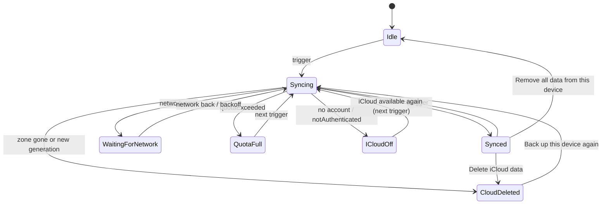

# Sync: data model, merge rules and the sync engine

ToriWords is local-first. All data lives in `user.sqlite` on the phone, and the app is fully usable without sync. There is no ToriWords server and no account.

Sync uses the **iCloud private database** (CloudKit) of the Apple Account the device is signed in to:
- CloudKit only stores record envelopes, one CloudKit record per sync record, in a custom zone.
- All merging happens on the device.
- There is no iPhone↔Android sync. The Android app uses the same data model and merge rules over Google Drive.

**What this file covers:**
- the records and their envelopes, IDs, clocks and the merge rules (shared with Android and pinned by fixtures);
- the outbox, applying pulled data, the sync cycle, errors, status;
- triggers, the iCloud account and the user actions.

**Related files:**
- [CloudKit transport](#cloudkit-transport): how records are stored in CloudKit (zone, record layout, save, fetch, delete, the generation marker).
- [data-model.md](data-model.md): tables and columns.
- [architecture.md](architecture.md): modules and process model.

**Code:** the shared rules live in `ios/ToriKit/Sources/ToriCore` (`HLC.swift`, `Merge.swift`, `Wire.swift`, `ToriID.swift`). Applying records, the outbox, duplicate merge and purge live in `ios/ToriKit/Sources/ToriStore` (`Tx.swift`, `Outbox.swift`, `SyncAPI.swift`, `Maintenance.swift`, `Operations.swift`). The cycle lives in `ios/ToriKit/Sources/ToriSync` (`SyncEngine.swift`, `CloudDatabase.swift`, `CloudKitDatabase.swift`). The app wiring is `ios/App/Platform/SyncCoordinator.swift`.

**Fixtures win:** `fixtures/ids/`, `fixtures/hlc/`, `fixtures/merge/` and the multi-device scenarios in `fixtures/sync/` are normative. Their format is in `fixtures/README.md`. The scenarios use CloudKit vocabulary, so on iOS they run without translation against an in-memory CloudKit fake ([Cloud fake for the fixtures](#cloud-fake-for-the-fixtures)); [testing.md](testing.md) describes how the suites run.

## Goals

- Offline first, and no answers lost.
- The user is never asked to "pick a side", and no one-way full sync is ever needed, even after schema changes.
- A **dumb cloud** that only stores merged envelopes.
- Planning scale: one user, 1–4 devices, 20k Entries, 300k synced records (~200k ReviewLogs).
- No push notifications: another device picks up changes when it next syncs.

## Records

**Synced record types** (wire `type` = table name):

| Wire `type` |
|---|
| `language_pair` |
| `entry` |
| `sense` |
| `context` |
| `source` |
| `card` |
| `review_log` |
| `tag` |
| `entry_tag` |
| `device` |
| `settings` |

**Never synced** (derived locally):
- Entry match key and kind;
- Card stage, due day and all scheduler state;
- ReviewLog elapsed time, review day and review type;
- canonical-ID columns;
- search folds;
- stats, due counts, widget counts.

## Envelope (wire format)

```json
{
  "id": "0192f3c1-7a4e-7cc3-9b1e-3f5a2d6c8e01",
  "type": "entry",
  "schema": 1,
  "owner": null,
  "deleted": false,
  "mergedInto": null,
  "fields": {
    "text":              { "v": "take off",  "c": "0192f3c17a4e00001a2b3c4d5e6f7081", "u": 1 },
    "ipa":               { "v": "/teɪk ɒf/", "c": "0192f3c1802000001a2b3c4d5e6f7081", "u": 0 },
    "enrichment_status": { "v": "done",      "c": "0192f3c1802000001a2b3c4d5e6f7081", "u": 0 }
  }
}
```

| Member | Meaning |
|---|---|
| `id` | UUID string, lowercase, hyphenated. |
| `owner` | The Entry ID for `sense`, `context`, `card`, `entry_tag` (= `entry_id`) and `review_log` (= `owner_entry_id`). Null otherwise. Fixed at creation. Used only by the purge. |
| `fields` | The record's synced columns by column name, plus everything kept in `extra`. |
| `schema` | The payload schema version of this type. |
| `deleted` | Terminal tombstone flag. |
| `mergedInto` | Terminal redirect to the surviving duplicate. |

**Field values:**
- strings, numbers, null;
- booleans (0/1 columns are sent as JSON `true`/`false`);
- IDs as UUID strings;
- `fsrs_w` as a JSON array.

Each field carries:
- `v`: the value;
- `c`: its clock;
- `u`: its author rank.

**Swift notes** (`Wire.swift`, `Records.swift`):
- Envelopes are `Codable` (`SyncRecord = Envelope<WireValue>`). `WireValue` is null, bool, 64-bit integer, double, string or array. When decoding, a JSON boolean is tried first, then an integer, then a double, so `true` never becomes `1`.
- The encoder always writes `owner`, also as an explicit `null`. When decoding, a missing `deleted` means `false` and missing `fields` means `{}`.
- `extra` keeps each unknown field as a full `{v, c, u}` object in JSON.
- When a column is written from the wire, a value of the wrong JSON type for the column (for example a string for an integer column) is stored as NULL.
- Uploads always carry the **full** merged envelope of a record. The outbox only says which records changed.

## IDs

### Random IDs

UUIDv7 (RFC 9562), generated on the device:
- 48-bit Unix ms;
- version 7;
- 12 random bits;
- the variant bits;
- 62 random bits.

The random bits come from the system random number generator (`SystemRandomNumberGenerator`). The time part is used only for ordering and tie-breaks.

### Deterministic IDs

UUIDv5 (SHA-1: CryptoKit `Insecure.SHA1`, swift-crypto on Linux) under the ToriWords namespace **`6f1c2a4e-3b7d-5e59-9a0c-5d8e7f2b1c34`**, fixed forever. Names are UTF-8, and IDs inside names are lowercase hyphenated strings.

| Record | Name |
|---|---|
| LanguagePair | `pair:<native>:<target>`, i.e. `pair:ru:en` |
| Card | `card:<entryId>:<direction>` |
| Source with URL | `source:<urlKey>` |
| EntryTag | `entrytag:<entryId>:<tagId>` |
| Settings | `settings` |
| Automatic Sense | `autosense:<entryId>:<ordinal>` |
| Imported ReviewLog (later) | `import:<collectionId>:<ankiRevlogId>` |

> Not yet implemented: the imported-ReviewLog name. `ToriID.swift` has helpers for all other names; Anki import does not exist yet.

All other records use UUIDv7:
- Entry;
- user-chosen Sense;
- Context;
- Source without URL;
- Tag;
- ReviewLog;
- Device.

### ID order

IDs are 16-byte BLOBs. "Smallest ID" always means **unsigned** byte order: SQLite BLOB order, or the `ToriID` comparator in Swift, which compares the two big-endian `UInt64` halves (`high`, then `low`). Pinned by `fixtures/ids/byte-order.json`.

## Hybrid logical clock

**Format:**
- 32 lowercase hex characters: `ms` (12 hex, 48-bit Unix ms) ‖ `counter` (4 hex) ‖ `node` (16 hex = the first 64 bits of the Device ID).
- String order = clock order.

**State:**
- `{ms, counter}` is kept in `sync_state.hlc`.
- It is persisted in the same transaction as each write.
- One stamp per write call.

**Local write.** Let `pt = now()`:
- If `pt > ms`: `ms = pt`, `counter = 0`.
- Else: `counter += 1`.
- On counter overflow (> 0xFFFF): `ms += 1`, `counter = 0`.

**Receive** (each clock `r` in pulled records):
- Standard HLC receive with `ms' = max(ms, r.ms, pt)`.
- **Except:** a remote `r.ms` more than **24 h** ahead of `pt` is not adopted. The record is still stored, and its fields still win. (A clock exactly 24 h ahead is adopted.)

The receive runs for every field of every pulled record, also for records that are then dropped (children of deleted Entries).

### Author rank `u`

**Rank 1:** any change caused directly by a user action:
- typing, picking a variant, editing;
- exclude and resume;
- tagging and untagging;
- reordering Senses;
- deleting.

**Rank 0:** everything automatic:
- enrichment fills and `enrichment_status`;
- **both setting and clearing `needs_check`**;
- Card creation and `mergedInto`;
- Device bookkeeping;
- LanguagePair and Settings defaults.

### Comparator

The only conflict rule (`fixtures/merge/field-comparator.json`):

```
wins(a, b) = (a.u, a.c) > (b.u, b.c)        // rank first, then clock string
merge(local, remote) = wins(remote, local) ? remote : local
```

**Envelope merge** (`fixtures/merge/envelope.json`):
- `deleted` = OR.
- `mergedInto`: non-null beats null; the smaller ID beats the larger.
- Fields are merged per field.
- Unknown fields are kept, and disjoint field sets are unioned.
- A tombstone drops all field values.
- A push with only some fields merges exactly like a full envelope.

On iOS the merged `schema` is the larger of the two, and `owner` is always the local one (it is fixed at creation).

**Local write rules:**
- A no-op write (same value, rank not rising) creates no clock and no outbox row.
- An automatic (rank 0) write never replaces a rank-1 field.

**Accepted consequence:** if the same field is edited on two devices offline, the later edit wins silently.

**Device-time warning:**
- After each save, the engine compares the device time with the newest CloudKit modification date of the records **just saved** in that save. Fetched records are not used, because their dates may be old.
- More than **1 h** apart in either direction sets an in-memory `clockWarning`, and the status shows "Check your device time".
- A later save within 1 h clears it.
- It never blocks or delays sync.

## Outbox

**Pending changes:**
- Every local write to a synced record upserts `pending_changes(record_id, type, field, clock)` in the same transaction, **but only while the outbox is active**: `cloudUser` is set and `cloudDeleted` is unset (`outboxActive` in `Tx.swift`, read once per write transaction).
- Envelope changes use the field names `_deleted` and `_mergedInto`.
- `field = '*'` means the whole record. It is used when iCloud first becomes available, after an iCloud account switch, after a device restore and for Back up this device again. Every row of every known type gets one, tombstones included, all with one clock.
- `field = '_cloudDelete'` (clock `''`) asks for the deletion of a purged child record from the cloud ([Cloud purge](#cloud-purge)). It replaces all other rows of that record. Such rows are never part of an upload batch.

**While the outbox is inactive:** no outbox rows are written, but every write still gets clocks and ranks.

**iCloud temporarily off** (signed out, iCloud Drive or the app's iCloud switch turned off) does **not** stop the outbox: `cloudUser` stays set, so changes keep queueing and go out when iCloud is back.

**After an upload:** an uploaded batch deletes the outbox rows whose `clock` equals the clock that was sent. Rows rewritten in the meantime stay.

## Sync cycle

One cycle at a time. The steps (`SyncEngine.cycle`):

1. **Account check:**
   - Ask CloudKit for the account status. Not available: status **iCloudOff**, stop.
   - If the iCloud user record name differs from `cloudUser` (first availability, or an iCloud account switch), run one transaction:
     - store the new `cloudUser`;
     - clear the change token, all stored system fields (`cloud_record_meta`), `zoneCreated`, `zoneGeneration` and `cloudDeleted`;
     - mark every record pending (`*`, tombstones included).
   - The local words then merge silently into that account's iCloud. Nothing is asked.
   - If `cloudDeleted` is set: status **cloudDeleted**, stop.
2. **Clock-ahead check:**
   - If `hlc.ms − lastServerTime > 1 h`, reset `hlc = {ms: max(lastServerTime, now()), counter: 0}`.
   - Re-stamp every pending outbox field (in `record_id`, `field` order): a new local-write clock with the same value and rank, also written to the local `field_clocks`.
   - `lastServerTime` = the newest CloudKit modification date seen on fetched records or own saves.
3. **Zone:** create the zone once per `cloudUser` (`zoneCreated`), then claim or adopt the `zone-info` generation once (`zoneGeneration`) ([Generation marker](#generation-marker)).
4. **Pull:** fetch the zone changes since the change token and apply them, one transaction per fetched page (below). A `zone-info` generation different from the adopted one means another device re-created the zone: **iCloud data was deleted** (below).
5. **Push:** save the pending records, minus excluded ones, in batches ([Save](#save)).
6. **Cloud deletes:** delete the records queued with `_cloudDelete`, up to 300 per request, then drop their rows and their system fields.
7. **After the cycle:**
   - set `lastSyncAt = now`, status **synced**, reset the backoff;
   - rewrite the vocabulary index and the widget snapshot, reload the widget, re-arm the reminder (`afterCycle`).

**iCloud data was deleted** (zone not found, zone deleted by the user, or a new generation): one transaction clears the change token and all stored system fields, sets `cloudDeleted = 1` and **deletes the whole outbox**. The words stay. Status **cloudDeleted**. Back up this device again marks everything pending again, so nothing is lost.

**Superseded cycles:** Remove all data, Delete iCloud data… and Back up this device again bump an in-memory epoch. A cycle checks the epoch after every `await`; if it changed, the cycle stops before writing anything (no stale change token, system fields or status).

## Applying pulled records (one transaction per page)

> iOS differs from Android here: there is no fixed chunk size. Each page CloudKit returns is applied in one GRDB write transaction, together with its change token. The post-write maintenance below runs at the end of **every** write transaction (`Tx.finish`), local or pulled.

**For each record** (`Apply.record`):
1. Unknown `type`: skip it (it stays in iCloud, see [Schema evolution](#schema-evolution)).
2. Run the HLC receive for each field clock.
3. **Child of a known deleted Entry** (by `owner` or canonical owner): drop it, and, while the outbox is active, queue it for the cloud purge (`_cloudDelete`).
4. Not present locally: insert it, with known fields to columns and unknown ones to `extra`. Present: envelope merge. An unchanged result writes nothing.
5. **Tombstone** (new or merged in):
   - drop the field values locally;
   - if it lands on any member of a merge group, write the tombstone on the canonical survivor (outbox `_deleted`) in this transaction. For Entries, every other live member of a deleted group also becomes a value-less tombstone;
   - hide and later purge the group's children.
6. If a field of a **merged loser** changed, or the record just became a loser: re-run the survivor field merge for that record, so a newer user value reaches the survivor.

**The page also carries** the IDs CloudKit reports as deleted. Only hidden children (their owner Entry or its canonical survivor is deleted) are deleted locally; any other local record stays. The system fields of all reported IDs are dropped.

**Then, for the records touched in the transaction** (`Tx.finish`):

7. Recompute derived columns:
   - `match_key`, `url_key`, `name_key`;
   - the canonical-ID columns;
   - `review_day`;
   - search folds.

   Resolve newly arrived parents of orphans.
8. Run the duplicate merge for the affected natural keys, parents first. Repeat canonical resolution and the merge until nothing merges (at most 16 rounds).
9. Create missing Cards for Entries that became reviewable (deterministic IDs, rank 0).
10. Replay the affected canonical Cards ([scheduler.md](scheduler.md)).
11. Purge locally the children of deleted Entry groups ([Local purge](#local-purge)).
12. Store the system fields of the applied records (not of dropped ones), the change token and the HLC, and commit.

The final state must equal applying everything at once. Fixture `sync/012-orphans-across-pages.json` covers a child in one page and its parent in the next.

## Duplicate merge

Pinned by the `sync/` fixtures.

### Natural keys

Every key starts with NFC. The key functions are in `fixtures/normalization/`.

| Type | Natural key |
|---|---|
| Entry | canonical LanguagePair + `matchKey(text)` |
| Sense | canonical Entry + `t:` `matchKey(translation)`. If the translation is empty: canonical Entry + `d:` `matchKey(definition)`. A Sense with neither never merges. |
| Context | canonical Entry + `sentenceKey(sentence)` (empty for a source-only Context) + canonical Source (the raw `source_id` if the Source is missing, or none) |
| Tag | `tagKey(name)` |
| Source without URL | `matchKey(title)` + app name as stored + whether `kind` is `suggested` (keeps a `suggested` Source apart from a typed title with the same text) |

Sources with a URL never need merging: their ID is deterministic from the URL key.

### Algorithm

The merge runs at the end of every write transaction that touched the records concerned (`Tx.finish`), which covers:
- every pulled page;
- every restore page;
- a local edit that changes a natural key.

The order is Entries, then Senses, Contexts, Tags, Sources.

1. Group live records (not deleted, not merged) by natural key.
2. **Survivor** = the smallest ID (unsigned).
3. **Losers** get `merged_into = survivor.id` (rank 0, outbox).
4. **Fields:**
   - For each field, the survivor takes the loser's `{v, c, u}` if `wins(loser.field, survivor.field)`.
   - The original clocks and ranks are copied; no new clocks are made.
   - These copies are not outbox writes, because every device computes the same result. Only `merged_into` is pushed.
   - The owner column is never copied.
5. **Children are not rewritten.** They resolve through the local canonical-ID columns. ReviewLogs keep `card_id`; their canonical Card is `v5("card:"+canonicalEntryId+":"+direction)`.
6. Re-check child types for new duplicates (repeat steps 1–5).
7. Replay the affected canonical Cards.

### Tags

- **EntryTag membership** of `(canonicalEntry, canonicalTag)` = OR of `present` over all EntryTag records that resolve to it.
- **Tag:** write `present = 1` (rank 1) to `v5("entrytag:"+canonicalEntry+":"+canonicalTag)`, creating it if needed.
- **Untag:** write `present = 0` (rank 1) to every EntryTag record that resolves to the pair.

### Sense order after a merge

`(sense.entry_id == canonical entry ? 0 : 1, position, id)`. A user reorder writes new `position` values (rank 1).

### User-initiated merge

When an edit makes a match key collide with another word, the product asks the user. On confirm, the same algorithm runs.

On iOS, `setEntryText` (and `renameTag` for tag keys) returns "duplicate" and writes nothing while the merge is not confirmed. With the confirmation it writes the new text, and the duplicate merge in the same transaction picks the survivor by the smallest ID. The survivor is not necessarily the edited word.

## Deletion

### Delete wins

- Deleting sets `deleted = true`, and the merge is an OR.
- Once a record is deleted on any device it never comes back, even if another device edited or reviewed it offline.
- An Entry (or Sense, Context, Tag, Source) is deleted when **any** record of its merge group carries a tombstone. The client then writes the tombstone on the canonical survivor.

### What gets tombstoned

- Only the Entry is tombstoned, not each child.
- Its Senses, Contexts, Cards, EntryTags and ReviewLogs are hidden through `owner` and canonical resolution, then purged locally. Children that arrive later are dropped.
- Senses, Contexts, Tags and Sources can be deleted individually; ReviewLogs never are.
- Deleted Entries do not count for duplicate detection.
- Re-capturing a deleted word creates a new Entry with no history.
- Tombstones are kept forever (envelope only, about 100 bytes).

### Deletion with Undo

- During the Undo window (4 s) the Entry is only hidden; nothing is written.
- The tombstone is written (rank 1, one transaction) when:
  - the window closes;
  - another delete starts;
  - the app goes to the background (`didEnterBackground` calls `PendingDeletion.commit()` before anything else that touches the store).
- A crash inside the window leaves the Entry undeleted.

### Local purge

- While the outbox is **inactive**: immediate, in the deleting transaction.
- While the outbox is **active**: once the Entry tombstone has been saved to iCloud, in the transaction that acknowledges it, followed by the cloud purge. A tombstone that arrives by pull is purged in the pulling transaction. It covers the whole merge group.

The purge deletes the rows of `sense`, `context`, `card` and `entry_tag` whose `entry_id` or `canonical_entry_id` is in the group, and the `review_log` rows whose `owner_entry_id` is in the group. An Entry that still has a pending `_deleted` outbox row is not purged yet.

### Cloud purge

This is for privacy, not correctness. Once an Entry tombstone has been saved, or a pulled tombstone lands on a merge group, the client removes from iCloud:
- every record owned by any Entry of that group: Senses, Contexts, Cards, EntryTags, ReviewLogs;
- every non-tombstone record of the group's Entries.

It keeps the tombstones, so no word text remains in iCloud.

On iOS the local purge queues each purged child as a `_cloudDelete` outbox row (while the outbox is active). Step 6 of the cycle deletes those CloudKit records. Group members other than the survivor are turned into value-less tombstones by the tombstone propagation, so their saved records carry no text either.

**Purge on sight:** a device that later fetches a live child of a tombstoned group (a late upload from an offline device) purges it the same way. Entry tombstones stay forever, so delete still wins everywhere.

## Schema evolution

- **Unknown fields** go to `extra`, and are merged and uploaded back unchanged.
- **Unknown record types** are skipped on pull and not stored locally. They stay untouched in iCloud: no device deletes them, because the cloud purge only deletes records it purged locally.
- **Backfill:** after an app update that knows a new type, the app runs a download-only backfill: one fetch with no change token, applying only records of the newly known types. Nothing is re-uploaded. It waits while `cloudDeleted` is set. (Not needed in v1: no new types exist yet.)

  > Not yet implemented. The skipped type names are returned by `applyCloudChanges` (`PulledPageResult.skippedUnknownTypes`) but not stored.
- **A newer `schema`:** known fields are applied, and unknown ones go to `extra`.
- **Within an envelope version, changes are additive only:**
  - new optional fields with defaults;
  - new record types.

  A field's meaning never changes: add a new field instead.
- **Derived-data changes** (normalisation, scheduler version) only trigger local recomputation.
- **A breaking envelope change** needs a new CloudKit record type (`Record` is the only one today) or a new zone, so that old app versions keep syncing the old records. There is no file layout on iOS.

## Errors and backoff

`CloudKitDatabase` maps every `CKError` to a `CloudError` (`CloudDatabase.swift`). A `partialFailure` maps to its first item error that is not "batch request failed".

| CloudKit error | `CloudError` | Reaction |
|---|---|---|
| `networkUnavailable`, `networkFailure`, and anything not listed | `network`, `other` | Exponential backoff with ±20 % jitter: 5 s, 10 s, 20 s … up to 15 min, while the process lives. Status "Waiting for network". |
| `serviceUnavailable`, `requestRateLimited`, `zoneBusy` | `rateLimited(retryAfter)` | Wait for CloudKit's retry-after (30 s if none), then run again. The status stays at the last resting state (Synced, or Not synced yet). |
| `quotaExceeded` | `quotaExceeded` | Stop this cycle. Status "iCloud storage is full". Retried on the next trigger. Local use continues. |
| `notAuthenticated` | `notAuthenticated` | Status "iCloud is off: words stay on this device". The outbox keeps queueing. |
| `zoneNotFound`, `userDeletedZone` | `zoneNotFound`, `zoneDeleted` | iCloud data was deleted ([Sync cycle](#sync-cycle)). |
| `changeTokenExpired` on fetch | `changeTokenExpired` | Clear the change token and fetch everything again, once per cycle. |
| `limitExceeded` on a save request | `limitExceeded` | Halve the batch (down to one record) and retry. |
| Per-record `serverRecordChanged` | — | Conflict: merge the server copy ([Save](#save)). |
| Per-record `unknownItem` | — | The stored system fields point to a deleted CloudKit record: drop them and save again as a new record. |
| Per-record `batchRequestFailed`, or no result | — | Retry in the next round. |
| Per-record `limitExceeded`, `unknownItem` after mapping, `changeTokenExpired` or any other error | — | Keep the record's outbox rows but exclude it from uploads until the app version changes. |
| Per-record network, rate-limit, quota, authentication or zone error | — | Fails the whole cycle with the reaction above. |

`changeTokenExpired`, `limitExceeded` and `unknownItem` that reach the cycle as a whole-request error are treated like network errors.

**Excluded records:**
- Excluded records are stored as `excludedRecords = {appVersion, ids}` and cleared when the app version changes.
- An envelope over **64 KB** (encoded JSON) is never uploaded and is excluded the same way.

**Stalled pushes:** a push round that saves nothing (only conflicts, retries or exclusions) counts as stalled. After **3** stalled rounds in a row the push gives up; the cycle still completes, and the remaining rows go out on the next trigger.

## Sync status



At launch the state comes from storage alone: **cloudDeleted** if `cloudDeleted` is set, else **synced** at `lastSyncAt` if it is set, else **idle**.

| State | Status line in Settings → iCloud sync | Sync now |
|---|---|---|
| Idle (never synced on this install, or after Remove all data) | "Not synced yet" | enabled |
| Syncing (the first sync is a normal cycle; the app stays usable) | "Syncing…" | disabled |
| Synced | "Synced {time ago}", e.g. "Synced 2 min ago" | enabled |
| WaitingForNetwork | "Waiting for network" | enabled |
| QuotaFull | "iCloud storage is full" | enabled |
| ICloudOff | "iCloud is off: words stay on this device" | disabled |
| CloudDeleted | "iCloud data was deleted" + **Back up this device again** | disabled |
| Idle, Syncing or Synced with `clockWarning` | "Check your device time" (sync continues) | as the underlying state |

The Settings root row shows "On" (Idle, Synced), "Syncing…", "Waiting for network", "Off", "Storage full" or "Deleted". Exact copy: [copy.md](copy.md).

## Triggers and background work

**Concurrency:**
- `SyncEngine` is a Swift actor and runs one cycle at a time.
- A trigger during a running cycle sets a re-run flag; the running cycle then runs once more. Triggers coalesce this way.
- The app holds one engine (`SyncCoordinator`), so foreground, background-refresh and manual triggers never run two cycles at once.

**Triggers** (each runs a cycle; the cycle itself stops at once while iCloud is off or `cloudDeleted` is set):

| Trigger | iOS mechanism |
|---|---|
| Launch and app comes to the foreground | After launch, and on every `didBecomeActive`: inbox import, pending enrichment, then `syncIfActive` |
| ~5 s after the last local change (in-app edits, answers, captures, inbox imports) | A store observation of the outbox row count; when it grows, the engine restarts a 5 s debounce |
| Leaving the foreground | `didEnterBackground`: a pending debounce is cancelled and the cycle runs at once, so local edits go out before suspension |
| "Sync now" | Direct call from Settings |
| Back up this device again | Direct call |
| Background refresh | `BGAppRefreshTask` (`.backgroundTask(.appRefresh)`), requested at every background transition with an earliest start of 4 h; runs launch, inbox import, one cycle, pending enrichment and the App Group files |
| Network back after a failure | `NWPathMonitor`: a satisfied path while the state is WaitingForNetwork runs the cycle at once |
| iCloud account changed | `CKAccountChanged` notification: one cycle, whose account check handles sign-in, sign-out and switch |
| Backoff and retry-after | A sleeping task in the engine, while the process lives |

**Rules:**
- **Capture:** the Share Extension never syncs; it writes an inbox file. The app imports the inbox on launch, on foreground and on the extension's Darwin notification; the import grows the outbox, which starts the debounce.
- **Pending deletions** are written in `didEnterBackground` (see [Deletion with Undo](#deletion-with-undo)), before the background flush.
- **No background processing task:** long work (first sync, large backlogs) is resumable and continues in the next cycle.
- Builds without the CloudKit entitlement (`ToriCloudSync = NO`, the Personal configuration) create no engine; sync is absent.

## Authorization

There is no sign-in, session or token store of our own. iOS handles the Apple Account; the app only reads the iCloud account status.

### Turning sync on

There is no in-app switch. Sync is on whenever the device is signed in to iCloud and iCloud is allowed for ToriWords. The first cycle that finds an available account stores `cloudUser` and marks everything pending ([Sync cycle](#sync-cycle)).

### Account and tokens

- The account is identified by the iCloud user record name (`CKContainer.userRecordID().recordName`, an opaque ID scoped to the container), stored in `sync_state.cloudUser`. No email address or name is stored.
- CloudKit handles authentication; there are no tokens in the app.
- A different user record name is an account switch: the local words merge silently into the new account's iCloud.

### Turning sync off

- The user turns iCloud off for ToriWords in iOS Settings (Settings → iCloud sync has an **Open iOS Settings** button and explains this).
- The status becomes "iCloud is off: words stay on this device". `cloudUser` stays, so the outbox keeps queueing.
- The iCloud copy stays.

### Release prerequisite

The iCloud container `iCloud.com.toriwords.app` with the CloudKit entitlement, and the record types `Record` and `ZoneInfo` deployed to the production CloudKit schema before release.

### Devices without iCloud

- Without an iCloud account the status is "iCloud is off: words stay on this device", and the app works locally.

### Privacy

- The private database is visible only to the user's own Apple Account. iOS shows its size under iCloud storage, where the user can also delete it.
- Nothing is sent anywhere else.

## User actions

### Delete iCloud data…

Settings → iCloud sync, after a confirmation dialog ("This deletes your words from iCloud. Your other devices keep their copies but stop syncing."). Disabled while iCloud is off or the data is already deleted.
1. Delete the `Toriwords` zone (a missing zone counts as deleted).
2. On this device:
   - set `cloudDeleted = 1`;
   - clear the change token and the stored system fields;
   - delete the outbox;
   - keep the words.
3. Other devices find the zone gone (or a new generation) on their next sync and enter the same state.

Any cycle that was running is superseded before and after the zone deletion.

**Offline or on failure:** nothing changes locally. A network error shows "No internet connection" / "Connect to the internet and try again. Nothing was changed."; any other error shows "Something went wrong" / "iCloud data was not deleted. Try again later." ([copy.md](copy.md)).

**Deleted in iOS Settings:** if the user deletes the app's iCloud data in iOS Settings, CloudKit reports `userDeletedZone`, and every device enters the same state.

### Back up this device again

Shown only while `cloudDeleted` is set. One transaction:
- clears `cloudDeleted`, `zoneCreated`, `zoneGeneration`, the change token and the stored system fields;
- marks every record pending.

A cycle then creates the zone, claims or adopts the generation and uploads. A failure shows "Something went wrong" / "Try again later." (or the no-connection dialog).

### Remove all data from this device

Settings → Data; it warns about unsynced changes first. Through the engine, so a running cycle is superseded. One transaction:
- deletes all user records (all synced tables except `device`) and the outbox;
- re-creates the LanguagePair and Settings defaults;
- clears the change token and the stored system fields.

Then `lastSyncAt` is cleared and the status becomes Idle ("Not synced yet").

What stays:
- Device rows;
- `cloudUser`, `cloudDeleted`, `zoneCreated`, `zoneGeneration`, `excludedRecords`, `hlc`, `lastServerTime`.

While the outbox is active, the warning says the words stay in iCloud and come back at the next sync, unless iCloud data is deleted in Settings → iCloud sync, and how many unsynced changes will be lost.

### Device restore

When an iCloud or Finder device backup restored the database (detected at launch by the missing or different `device-marker`, see [data-model.md](data-model.md#10-os-backup)):
- the app gets a new Device ID;
- it clears the change token and the stored system fields (they are an older snapshot than the cloud);
- it marks every record pending.

`cloudUser`, `cloudDeleted` and the zone keys stay. If the restored phone uses another Apple Account, the next account check treats it as a switch.

### Restore from a backup file

- It runs one sync cycle before the restore and one after it (`ios/App/Settings/DataView.swift`); each is a no-op while iCloud is off or the data was deleted.
- Every inserted or updated record gets a `*` outbox row (only while the outbox is active).

## CloudKit transport

`CloudKitDatabase.swift` implements the `CloudDatabase` protocol over `CKContainer(identifier: "iCloud.com.toriwords.app").privateCloudDatabase`. CloudKit never merges; the engine does. CKSyncEngine is not used.

### Zone and record layout

- One custom zone **`Toriwords`** (owner: the current user). It is created with `modifyRecordZones` once per `cloudUser`; creating an existing zone is harmless.
- One CloudKit record per sync record:
  - record type **`Record`**;
  - record name = the sync record ID (lowercase UUID string);
  - fields `type` (string), `schema` (int), `owner` (string or absent) and `envelope` (bytes: the full envelope as JSON).
  - Only `envelope` is read back; the other fields are informational.
- One marker record **`zone-info`** of record type `ZoneInfo` with the string field `generation` ([Generation marker](#generation-marker)).
- A fetched record of another record type, or one whose envelope does not decode, is ignored.

### System fields

- After every successful save and every fetch, the engine stores the record's archived CloudKit system fields (`encodeSystemFields`, secure coding) in `cloud_record_meta(record_id, system_fields)`.
- A save rebuilds the `CKRecord` from these system fields, so CloudKit can check the change tag. A record without stored system fields is saved as a new `CKRecord`.
- The system fields and the change token are cleared together whenever the local copy may be older than the cloud: account switch, Back up this device again, iCloud data deleted, device restore, Remove all data.

### Save

- A batch holds up to **300** records (`pendingPush`, in `record_id` order), then as many as fit in **2 MB** of encoded envelopes. Records over **64 KB** are excluded first.
- Saved with `modifyRecords(savePolicy: .ifServerRecordUnchanged, atomically: false)`.
- Per record:
  - **saved**: store the new system fields, acknowledge the rows (clock equal to the sent one), use its modification date for `lastServerTime` and the device-time warning;
  - **conflict** (`serverRecordChanged`): apply the server copy as if pulled (merge, and store its system fields), so the next round sends the merged record with the current change tag;
  - **unknownItem**: drop the system fields; the next round saves it as a new record;
  - **retry**: nothing; the next round sends it again;
  - **failed**: exclude it, or fail the cycle ([Errors and backoff](#errors-and-backoff)).
- A `limitExceeded` on the whole request halves the batch and retries.
- The push loops until the outbox has nothing more to send, or after 3 stalled rounds.

### Fetch

- `recordZoneChanges(inZoneWith: Toriwords, since: token)`, page by page while `moreComing`.
- The change token is stored as base64 of the archived `CKServerChangeToken` in `sync_state.changeToken`, in the same transaction as the page.
- A nil token fetches the whole zone.
- A page holds changed records, deleted record IDs and possibly the `zone-info` marker. Records are applied ([Applying pulled records](#applying-pulled-records-one-transaction-per-page)); deletions only purge hidden children locally.
- Modification dates of fetched records update `lastServerTime`.

### Delete

- `modifyRecords(deleting:)` with up to 300 record IDs, non-atomic. An `unknownItem` (already gone) counts as deleted.
- Used only for `_cloudDelete` rows.

### Generation marker

- On its first cycle for a `cloudUser`, after creating the zone, a device saves `zone-info` with a new random generation (`UUID().uuidString`), with `.ifServerRecordUnchanged`.
- If another device already saved it (`serverRecordChanged`), the device adopts the server's generation instead.
- The adopted value is stored in `zoneGeneration`.
- A fetched `zone-info` whose generation differs from `zoneGeneration` means the zone was deleted and re-created by another device's Back up this device again: this device enters **iCloud data was deleted** and keeps its words until the user backs it up again.

### Local state

Local-only state, never synced. Columns are in [data-model.md](data-model.md).

**`sync_state` keys** (`SyncAPI.swift`):

| Key | Meaning |
|---|---|
| `cloudUser` | iCloud user record name the local data syncs with. |
| `changeToken` | Base64 of the archived zone change token. |
| `zoneCreated` | `1` once the zone was created for `cloudUser`. |
| `zoneGeneration` | The adopted `zone-info` generation. |
| `cloudDeleted` | `1` when iCloud data was deleted. |
| `hlc` | Clock state. |
| `lastServerTime` | Newest CloudKit modification date seen. |
| `lastSyncAt` | End of the last successful cycle. |
| `excludedRecords` | `{appVersion, ids}`. |

The outbox is active when `cloudUser` is set and `cloudDeleted` is unset.

**System fields:** `cloud_record_meta(record_id PK, system_fields BLOB)`, one row per record known to be in the cloud.

### Mapping to the shared cloud interface

The engine talks to the `CloudDatabase` protocol (`CloudDatabase.swift`); the Android app implements the same interface over Drive. The CloudKit adapter:

| Interface | CloudKit |
|---|---|
| `accountStatus` | `CKContainer.accountStatus()`; `.available` plus the user record name, else unavailable. |
| `ensureZone` | `modifyRecordZones(saving: [Toriwords])`. |
| `claimZoneGeneration` | Save `zone-info` if unchanged; adopt the server value on conflict. |
| `fetchChanges` | `recordZoneChanges(since:)`: records, deleted IDs, the marker's generation, token, `moreComing`. |
| `save` | `modifyRecords` with `.ifServerRecordUnchanged`. Outcomes: saved / conflict / unknownItem / retry / failed. |
| `delete` | `modifyRecords(deleting:)`. |
| `deleteZone` | `modifyRecordZones(deleting: [Toriwords])`. |

Error mapping: [Errors and backoff](#errors-and-backoff).

### Cloud fake for the fixtures

The multi-device scenarios in `fixtures/sync/` run against `InMemoryCloud` (`ios/ToriKit/Tests/ToriSyncTests/InMemoryCloud.swift`), which models the iCloud private database as the engine uses it:
- one zone per iCloud user, with a change log, `seq`-based change tokens and per-record change tags;
- "if server record unchanged" saves, so a stale change tag is a conflict that returns the server copy;
- zone deletion by the app and in iOS Settings (`userDeletedZone` until the zone is created again), and re-creation as a new zone epoch;
- the `zone-info` generation marker;
- modification dates from the scenario's cloud clock;
- page limits, scripted errors and outcomes, and a hook that runs another device's cycle before the next save (`racedBy`).

Like CloudKit it never merges; the newest save wins. How the suites run: [testing.md](testing.md).

## Open questions

- `ios/ToriKit/Sources/ToriCore/HLC.swift` still contains `serverAccepts(_:serverTime:)`, a clock-skew rule of the retired own backend. Nothing calls it. Remove it, or keep it for a future server?
- Unknown record types are not stored locally and their names are not remembered, so the download-only backfill would have to fetch the whole zone and cannot tell which types became known. Store the skipped type names in `sync_state` before a second record type is added?
- After 3 stalled push rounds the cycle reports Synced although outbox rows remain. Should the status reflect pending rows?
