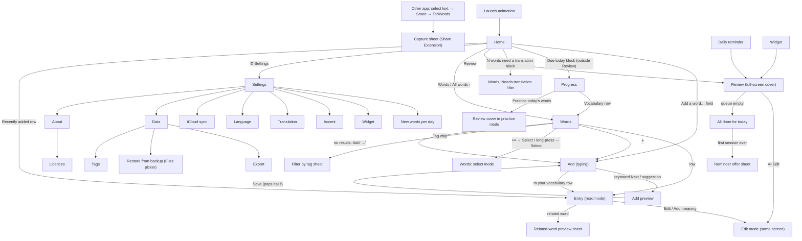

# ToriWords iOS — UI

This file describes the iOS screens: the navigation map, the rules for each screen, Back and the edge swipe, motion and haptics, accessibility, and branding and theme. Behaviour (what a feature does, edge cases, offline) is in [product.md](product.md). Concepts (word, meaning, sentence, card) are defined in [domain.md](domain.md). How things are built is in [architecture.md](architecture.md). All UI strings, in English and Russian, are in [copy.md](copy.md). Every deliberate difference from the Android app is listed in [android/docs/ios-differences.md](../../android/docs/ios-differences.md).

**Source.** This file describes the iOS app as built: `ios/App`, `ios/ToriKit/Sources/ToriUI`, `ios/ShareExtension` and `ios/WidgetExtension`. The iOS app is also the UI reference for Android, which adapts it in [android/docs/ui.md](../../android/docs/ui.md).

**Platform.** iPhone, phone-first, SwiftUI. iPad runs the same adaptive layout, with no iPad-specific screens. On iOS 26 the system draws Liquid Glass toolbars and buttons; the app adds glass only to the Review header icons.

**Name.** The UI writes the product name as **"ToriWords"**. The Home Screen label is "ToriWords" too.

## 1. Presentation baseline

- Native SwiftUI with the fixed ToriWords palette (section 7). The app tint is the accent colour.
- Inline navigation titles (no large titles) in every pushed screen. One navigation stack starts at Home. There is no tab bar.
- Review is a **full-screen cover** over the Home stack, with its own navigation stack (so **••• → Edit** returns to the same card).
- Lists are native grouped (inset grouped) lists; the Words list is a plain list. Settings drill-in rows show a trailing value in secondary colour and a chevron.
- System alerts for confirmations; system confirmation dialogs for "Delete iCloud data"; system sheets (medium or large detents) for pickers and previews.
- An in-app **toast** with **Undo** after a delete (section 4.5). No other toasts.
- Entry edit mode is the same screen switched to an editing list (Contacts style) with **Cancel** and **Done** in the navigation bar.
- Touch targets are at least 44 pt: header icons, speaker buttons, rows, variant rows.
- **Buttons:**
  - primary: full-width filled, radius 12, at least 50 pt high, white semibold text (accent; danger for Forgot, success for Remembered);
  - secondary: full-width, accent text on the neutral fill, radius 12, at least 50 pt high ("Learn more new words", "Practice today's words");
  - minor actions ("Not now", "Close", "Cancel") are plain text buttons.

## 2. Navigation map

- The reminder and the widget always open Review, never Progress. A widget that shows "Open ToriWords" opens Review too, which then shows its own empty or nothing-due screen.
- The capture sheet runs inside the other app. After Save or Cancel, the user is back in that app.

## 3. Back, the edge swipe and the Review cover

**Back.** Every pushed screen has the system **‹ Back** button and the edge swipe from the left. These rules apply:
- **Edit mode** hides Back, which also turns off the edge swipe. Edit mode is left only by **Cancel** or **Done**. Cancel with unsaved changes asks **"Discard changes?"** (Keep editing / Discard); with no changes it closes edit mode at once.
- From the **Add preview**, Back returns to typing with the text kept, without a prompt.
- From **Add typing**, Back leaves Add at once, without a prompt, and the typed text is discarded.
- **Words select mode** hides Back; **Cancel** ends select mode.
- An open Words row swipe closes on scroll or on a tap elsewhere, before anything else happens.

**Review cover.** Review is presented full screen with no navigation bar, so there is no back edge: the card swipe starts anywhere on the card. **✕** leaves the session (given answers are kept); in practice, ✕ leaves practice.

**Sheets.** Sheets close with a swipe down or their own Cancel / Close / Done. The capture sheet closes only with **Cancel** or **Save**; nothing is saved on Cancel.

**Keyboard.** The keyboard pushes list content up; focused fields stay visible. Add focuses its field on appear.

## 4. Screens

### 4.1 Home

Behaviour: [First run, Home and launch](product.md#510-first-run-home-and-launch).

- **Navigation bar:** the live header on the left (the ToriWords mark at 32 pt and "ToriWords" in headline style, 4.1.1), drawn without the iOS 26 shared glass background. On the right: **Words** (text button) and **⚙** (Settings; VoiceOver "Settings").
- Below the bar: the **"Add a word…"** field. It is a button styled as a field (neutral fill, radius 12, at least 48 pt high) and opens Add.
- **Due today block** (a card, radius 16, surface colour). The whole block except the Review button is one tap target, with a list-row press highlight. Its first line is the text "Due today ›" in secondary colour. The rest depends on the state:

| State | Block content | Tap opens | Review button |
|---|---|---|---|
| Something due | "12 to review · 5 new" (a zero part is dropped: "12 to review", "5 new"). In catch-up, a secondary line under it: "Welcome back — N cards are waiting. We'll spread them over about a week." | Progress | filled **Review** |
| All done today | "All done for today" plus a secondary "Next review: tomorrow" / "in N days" line (left out when nothing is scheduled) | Progress | none |
| Nothing due today (also when every word is paused or known) | "Next review: tomorrow" / "Next review: in N days", or "Nothing to review today" when nothing is scheduled | Progress | none |
| Nothing reviewable, and at least one word needs a translation | "N words need a translation" | Words with the **Needs translation** filter | none |
| Empty vocabulary | the block is not shown; the empty-state card shows instead | — | — |

- **Recently added:** a "Recently added" heading and the 5 newest words. Each row shows the word (semibold) and its second line: the primary translation, or "Translation pending" / "No translation found — add your own" / "No translation yet". A tap opens the entry. Words in a pending delete (Undo window) are hidden. Under the list: **All words ›** opens Words.
- **Empty state card:** "Build your vocabulary", then "Words you add come back for review just before you forget them.", then two lines with icons, then a footnote and a button:
  - ⌨ "Type it — tap "Add a word…" above";
  - the share icon with "From any app — select text → Share → ToriWords" (left out in builds without the shared app container, which have no Share Extension);
  - the footnote "Works offline: the dictionary is built in.";
  - a filled **Add your first word**.
- Home has no search, no sync status and no translation indicator.

#### 4.1.1 Live header

The mark and the name in the Home navigation bar are one decorative tap target. A tap does not navigate anywhere. Motion is described in section 5.2. VoiceOver reads it as the heading "ToriWords" and announces no action. The header's text size is capped at the xxxLarge Dynamic Type size so it cannot crowd the trailing buttons; the name is never truncated.

### 4.2 Add

Behaviour: [Add a word by typing](product.md#51-add-a-word-by-typing), [Duplicates](product.md#53-duplicates), [Saving without enrichment](product.md#54-saving-without-enrichment), [Phrases](product.md#55-phrases).

- **Typing screen:** inline title **Add**, ‹ Back, no Save. An inset grouped list. The field "Add a word…" is focused with the keyboard up (no autocapitalisation, no autocorrection). The return key reads **Next** and opens the preview for the typed text.
  - From the second character, an autocomplete section appears. Each row shows the word (semibold) and its part of speech, the primary translation as a second line, and, for words already saved, an **"In your vocabulary"** badge on the right (info fill, accent ink). A tap on such a row opens the entry; any other row opens the preview.
  - Russian typed in the field shows English candidates as ordinary autocomplete rows. With none, the line reads "Type the English word or phrase".
  - **Typed sentence** (more than 6 words, or ending with sentence punctuation): a section headed "Tap the word to save" with the footer "The text is kept as the sentence.". In it:
    - when the dictionary knows phrases inside the text, a scrolling row of phrase chips; a tap on one opens the preview for that phrase at once;
    - the sentence's word chips, wrapped like text. The first tap selects a word. A tap next to the selection extends it into a phrase. A tap on the only selected word clears it. Any other tap starts again;
    - while something is selected, a filled **Continue**, which opens the preview for the selection.
  - **Under the empty field**, until the first save in this visit: the Home empty-state card without its button.
  - **After a save:** a "✓ Saved" label (success colour) in the field's footer while the field is empty. Under it, "Related to "<word>"" with related-word rows (4.7), then the widget hint (4.12) when it applies.
- **Preview screen:** a separate screen pushed on top of typing. Inline title **Add**, ‹ Back, and **Save** (semibold) on the right, enabled whenever the text can be saved. Content, as an inset grouped list:
  - the word in the card-word style with ▶, then IPA · part of speech;
  - **Save as** (when the dictionary knows a base form): a segmented control, base form (preselected) / typed form;
  - the **"Already in your vocabulary"** banner (info), "Save adds newly checked meanings and the sentence.", with **Open word**. For a known or paused word, the banner reads "You marked this as known" / "You paused this word" with "Save adds the sentence and meanings." and a **Resume learning** switch, applied on Save;
  - **Translation** (section header): variant rows with round **checkboxes** (several can be checked). Dictionary variants come first, then the machine variant with a "Machine translation" badge. The first variant is pre-checked. Existing meanings show checked and disabled. Below the variants, the field "Type a translation (optional)". With no variants, the line "No suggestions: the word is not in the dictionary, and on-device translation isn't available. Type a translation (optional)." While loading, a spinner;
  - **Definition:** the definitions of the checked variants, each once;
  - **Sentence (optional)** and **Source (optional)** fields. Under a non-empty sentence: "In this sentence: <machine translation>" in secondary text (not saved);
  - **Tags:** the tag editor (4.6).
  - *Partly implemented:* the preview has no **Phrases** chips. Phrases contained in a typed sentence are offered on the typing screen only (above); the capture sheet offers them for captured text (4.3).
- **Save:** the preview pops itself and typing shows the cleared field with "✓ Saved". If saving fails, the alert "Something went wrong" (OK) appears and the preview stays.

### 4.3 Capture sheet

Behaviour: [Capture via Share](product.md#52-capture-via-share), [Duplicates](product.md#53-duplicates), [Phrases](product.md#55-phrases).

- **Entry point:** select text in any app → **Share** → **ToriWords**, or share text or a link from any app's share menu.
- **Sheet:** the Share Extension's sheet over the other app: a form with the inline title "ToriWords", **Cancel** on the left and **Save** (bold) on the right. Sections in order:
  1. **Tip** (first share capture only): "Tip: put ToriWords first" / "In the share menu, scroll the app row to More → Edit and drag ToriWords to the top.", on the tip colour.
  2. **Text:**
     - for a longer selection, word chips under "Tap the word to save" (picked chips are accent-filled with white text), then the picked text with its IPA;
     - otherwise, the editable "Word or phrase" field (headline style), its IPA, and the field "Sentence (optional)". Non-Latin text shows "ToriWords saves English words and phrases" in danger colour under the field, and Save stays disabled.
  3. **Save as** / **Phrases:** the base-form segmented control, and contained phrases as small bordered buttons (opt-in; the section header "Phrases" shows when there is no base form).
  4. **Already in your vocabulary**, or "You marked this as known" / "You paused this word" with a **Resume learning** switch. Under it, up to 3 existing translations and "Save adds this sentence and source.". Info fill.
  5. **Translation:**
     - with dictionary variants: the header "Translation · Wiktionary", rows with square checkboxes, each with the translation and a "<part of speech> · <definition>" line. No machine translation in the sheet;
     - with none: "Not in the dictionary" (or "The dictionary is ready after you open ToriWords once" when the dictionary can't be opened), the field "Translation (optional)", and the footer "Without a translation the word is saved as "Translation pending".".
  6. **Source:** the source title field, prefilled with the page title (or the title last used within 30 minutes). Its placeholder is the link's domain, or "Source title". Under it, the source label in footnote style: "Safari · theguardian.com" when the share comes from Safari, otherwise the domain alone.
  7. **Tags:** a collapsed disclosure row "Tags" showing the current tags. Expanded: a comma-separated field (placeholder "work, travel") and the last used tags as small buttons (offered for 30 minutes).
- **After Save:** a **"✓ Saved"** capsule (material background, check icon, centred over the sheet) shows for 0.7 s. Then the sheet closes and the user is back in the source app.
- **Save failure** (the shared app container can't be opened): the alert "Could not save. Open ToriWords once, then try again.".
- **Cancel:** closes the sheet; nothing is saved.

### 4.4 Review

Behaviour: [Review](product.md#56-review).

- A full-screen cover with its own header row and no navigation bar.
- **Header** (at least 44 pt high):
  - **✕** on the left (VoiceOver "Close");
  - **↶** next to it (VoiceOver "Undo last answer"), only while an undo exists, hidden otherwise;
  - the position in the centre: "3 / 17", or "Practice · 3 / 17" in practice (VoiceOver "Card 3 of 17");
  - **•••** on the right, on the back side only (VoiceOver "More"): Edit, I already know this, Pause, Delete.
  - The icons have 44 pt circular targets. On iOS 26 each sits in an interactive Liquid Glass circle.
- **Card:** one surface (radius 16), flipped around the vertical axis (0.35 s ease-in-out; with Reduce Motion, a 0.2 s cross-fade). Tapping the card flips it.
  - **Recognition front:** the word in the card-word style with ▶, then the sentence with the word in bold, then "Tap to show answer".
  - **Recall front:** "Say it in English" at the top, then the Russian translation(s), then the sentence with the word blanked as "______", then "Tap to show answer". No speaker on this side.
  - **Cloze front:** the sentence with the word blanked, larger, then "Fill in the missing word" and "Tap to show answer". Without a usable sentence it shows the translations, as on recall.
  - A front sentence scrolls when taller than 200 pt.
  - **Back:** the word with ▶; IPA · part of speech; the translations on one line, comma-separated, each once; each distinct definition once; a divider, then the sentence (word in bold) with its own ▶ ("Play sentence") and "— <source>". The back scrolls when long.
- **Buttons** under the card, only after the flip: **Forgot** (danger) and **Remembered** (success), filled, side by side and full width.
- **Swipe** after the flip: right = Remembered, left = Forgot. Feel and haptics are described in section 5.3.
- **End screens.** The content is centred, with the title in the card-word style. At the bottom: an optional secondary **Learn more new words**, and under it a filled **Done**.

| Screen | Title | Detail lines | Learn more new words |
|---|---|---|---|
| Session finished | "All done for today" | "N cards reviewed · M remembered · K new words"; "Next review: …" | when new words wait and the daily limit is above 0 |
| Opened with nothing due | "Nothing to review today" | "Next review: …" when something is scheduled | same rule |
| Practice finished | "Practice done" | "N cards · M remembered" | never |
| No words at all | "Add words to start reviewing" | — | — (the filled button is **Add a word**, which closes the cover and opens Add) |

- **Reminder offer:** after the first finished session ever, a sheet over the summary (4.12).
- A delete made in Review shows its Undo toast inside the cover.
- An error while saving an answer shows the alert "Something went wrong" (OK).

### 4.5 Words and Entry

Behaviour: [Words and the entry screen](product.md#57-words-and-the-entry-screen).

**Words list**
- **Navigation bar:** ‹ Back, the inline title "Words", and on the right:
  - **•••** (VoiceOver "More"), a menu with **Select** (disabled while the list is empty) and **Sort**, a submenu with Newest / A–Z / Next due;
  - **+**, which opens Add (VoiceOver "Add a word").
- **Below the bar:**
  - a search field that is always shown, "Search words, translations, sentences";
  - one horizontally scrolling row of chips: All, Needs translation, Check translation, Phrases, New, Learning, Known well, Known, Paused, **Tag**. The chips are single-select, except Tag, which combines with the others. The Tag chip label reads "Tag", "work" or "work +1";
  - the count line "214 words · newest first" (or "· A–Z", "· next due first").
- **Rows:** the word (semibold) and its second line (primary translation or state line). The stage badge sits on the right; badge colours are in section 7.2. Words in a pending delete are hidden.
- **Row swipe left** (no full swipe): reveals, from the edge inwards, **Delete** (danger) · **Pause** (grey) · **I already know this** (success). Paused and known rows show **Resume learning** (accent) instead of Pause and I already know this. Delete asks first (below). The swipe actions are also VoiceOver actions on the row.
- **Select mode** is entered by **••• → Select** or by a long-press on a row → **Select** (the context menu; it starts with that row selected).
  - The navigation bar shows **Cancel**, "N selected" and **Select all** / **Deselect all**; Back is hidden.
  - Rows show round checkboxes, and row swipes are off.
  - The bottom toolbar shows **Tag** · **Known** · **Pause** · **Delete**. When every selected word is Known or Paused, **Resume learning** replaces Known and Pause. VoiceOver reads "Known" as "I already know this".
  - Each action applies at once and ends select mode.
  - **Delete** asks "Delete N words?" / "They are removed with their review history on all your devices." (Delete N words / Cancel), then shows the toast "N words deleted" with **Undo**.
  - **Tag** opens the "Add tags" sheet: the tag editor with the footer "Adds tags to N words. Tags they already have stay." and **Cancel** / **Add** (Add is disabled until a tag is chosen). It only adds tags.
- **No results:** "No words match "…"" with a filled **Add "…"**, which opens Add with that text.
- No source filter in v1 ([product.md](product.md#3-later-not-in-v1)).

**Filter by tag sheet:** a sheet titled "Filter by tag" (medium and large detents). It has **Clear** on the left and **Done** on the right, a list of tags with round checkboxes and word counts, and a full-width filled **Show N words** at the bottom. Several checked tags match words with any of them. With no tags at all, the sheet shows "No tags yet. Add tags to words in Add or when editing a word."

**Undo toast:** a dark rounded bar at the bottom of the screen with the message (""thorough" deleted", "N words deleted") and **Undo** in accent. It shows over every screen of the stack for 4 seconds. The words are hidden at once and deleted when the toast goes away, when another delete starts, or when the app goes to the background. VoiceOver reads the toast as one element with an "Undo" action.

**Entry, read mode**
- **Navigation bar:** ‹ Back, **Edit** and **•••** (VoiceOver "More"). The ••• menu holds I already know this / Pause / Delete, or Resume learning / Delete.
- **Content** (an inset grouped list):
  - the word in the card-word style with ▶ and the stage badge, then IPA;
  - the **Check translation** banner ("Check translation" / "Translation added automatically. Check it.") when the word was flagged. Opening the entry clears the flag; the banner stays for this visit;
  - **Meanings:** one row each, with the translation (semibold) and part of speech, and the definition below. Meanings with the same definition and part of speech are one row, with their translations comma-separated. A meaning without a definition keeps its own row; a meaning without a translation shows "—";
  - **Suggested meanings** (dictionary and machine variants the word doesn't have): variant rows with **Add**;
  - **Sentences**, each with ▶ and its source as "— <source>". A web source is a link that opens the page;
  - **Tags** (comma-separated);
  - **Note**;
  - **Learning** (only while the word is being learned): one row per card, "English → Russian", "Russian → English" or "Fill in the blank", with its stage and "Next review: …";
  - **Related words** (4.7);
  - the **Wiktionary** badge when a meaning came from Wiktionary. *Partly implemented:* the badge is not a link to the attribution in About.
- **Translation states** (inside Meanings):
  - **No translation found:** a warning banner "No translation found — add your own" / "Not reviewed until it has a translation." with **Add meaning** and **Try again**. Try again is disabled while running.
  - **Pending:** "Translation pending".
  - **No translation yet:** **Add meaning**.
- **Deleted on another device:** the alert "This word was deleted on another device" (OK). OK closes the screen.

**Entry, edit mode** (the same screen, title "Edit", **Cancel** / **Done**; Done is disabled while the word can't be saved)
- **Word or phrase**, **IPA**.
- **Meanings:** each meaning has Translation, Part of speech and Definition fields, the system ⊖ delete control, and the ≡ reorder handle.
- **Suggested meanings:** after the meanings, one row per dictionary or machine variant the draft doesn't have. Each row has a green ⊕, the translation, and a "Machine translation" badge for machine variants (VoiceOver "Add meaning <translation>"). A tap adds it as a meaning. Removing a meaning offers its variant again.
- **⊕ Add meaning:** adds a blank meaning. Opening edit from **Add meaning** in read mode adds a blank row only when there are no suggestions to offer.
- **Sentences:** a sentence added in this edit has a "Sentence" field and a "Source (optional)" field. Sentences that already exist are shown as text with "— <source>" and can only be deleted (⊖). Below them, **⊕ Add sentence**.
- **Tags** (tag editor), **Note**, and a red **Delete word**.
- **Done** with text that equals another word opens the alert ""X" is already in your vocabulary" / "Merge combines meanings, sentences, tags and review history into one word." (Merge / Cancel). After **Merge**, the merged word opens in read mode. **Cancel** stays in edit.
- Opened from Review's **••• → Edit**, the entry starts in edit mode; Cancel and Done return to the same card.
- **Delete confirmations** (row, •••, Review, edit): "Delete "thorough"?" / "It is removed with its review history on all your devices." (Delete / Cancel). Then the toast ""thorough" deleted" with **Undo**.

### 4.6 Tags

Behaviour: [Tags](product.md#511-tags).

- **Tag editor** (Add preview, entry edit mode, bulk Tag): tag chips with ✕ (info fill; VoiceOver "Remove tag <name>"), and an "Add tag" field. Typing lists existing tags with counts and **+ Create tag "…"**. Matching ignores case and surrounding spaces. The capture sheet uses its own comma-separated field (4.3).
- **Settings → Data → Tags:** an alphabetical inset grouped list with "N words" as the trailing value. A tap opens the **Rename tag** alert (Name field; Save / Cancel; VoiceOver hint "Renames the tag."). Swipe left reveals **Delete**, which asks "Delete tag "…"?" / "It is removed from N words. The words stay."
  - Renaming to an existing name asks ""work" already exists" / "Merge "travel" into "work"?" (Merge / Cancel).
  - The empty state reads "No tags yet" / "Add tags to words in Add or when editing a word."

### 4.7 Related words

Behaviour: [Related words](product.md#513-related-words).

- On the entry and after a save in Add: up to 8 rows. Each row shows the word (semibold), its primary translation, **Add** and **✕**. VoiceOver reads ✕ as "Hide <word>". Words already saved show the badge "✓ In vocabulary" instead of Add and ✕. ✕ hides the row for this screen only. When every related word is saved, the section reads "You have all related words". With none known, the section is hidden.
- A tap on a row opens a sheet (medium detent) with the word and ▶, part of speech, translation, definition, a filled **Add to my words** (or the "✓ In vocabulary" badge) and a text button **Close**.

### 4.8 Pronunciation

Behaviour: [Pronunciation](product.md#512-pronunciation).

- ▶ next to the word speaks it (VoiceOver "Play pronunciation"). ▶ next to a sentence speaks the sentence. A long-press on the word's ▶ speaks its sentence, when there is one; VoiceOver offers this as the action "Play sentence".
- **No English voice:** ▶ looks disabled. A tap opens the alert "No English voice" / "To hear words, download an English voice in Settings → Accessibility → Spoken Content → Voices → English." (OK).

### 4.9 Progress

Behaviour: [Progress](product.md#515-progress).

- A pushed screen titled "Progress", with ‹ Back.
- **Today:** three tiles ("reviewed", "still due", "new words"). When at least one card was answered today, a secondary **Practice today's words** sits under the tiles, with the footer "Doesn't change your schedule."
- **Vocabulary:** drill-in rows New, Learning, Known well, Already known, Paused, each with its count. A tap opens Words with that filter.
- **Activity:** a bar chart, "Reviews per day, last 30 days".
- **Captured:** a bar chart, "Words added per week, last 8 weeks".
- **Top sources:** rows with the source label and the number of words. The rows are display-only (no source filter in v1).
- **Empty vocabulary** (the last word was deleted while the screen was open): "Build your vocabulary" with a filled **Add a word**.

### 4.10 Settings

Behaviour: [Settings and About](product.md#59-settings-and-about), [iCloud sync](product.md#58-icloud-sync), [Export and backup](product.md#516-export-and-backup).

**Root** (a native inset grouped list):

| Section | Rows |
|---|---|
| Learning | **New words per day**, with the value → screen |
| Reminders | **Daily reminder** (switch). **Time** (only while the switch is on), with the time; a tap expands an inline wheel time picker under the row (12/24 h follows the device). The notifications-off notice, when it applies. **Widget** → screen |
| Pronunciation | **Accent**, with "US" / "UK" → screen. **Auto-play on reveal** (switch) |
| (no header) | **Translation**: "Ready" or "Built-in dictionary" → screen. **Language**: the current language, in that language → screen. **iCloud sync**: "On", "Syncing…", "Waiting for network", "Off", "Storage full" or "Deleted" → screen. **Data** → screen. **About** → screen |

**New words per day:** a screen with one row, a stepper (0–50) reading "10 new words a day". Footer: "Counts words, not cards: each new word brings its cards. Applies on all your devices."

**Accent:** a screen with a checkmark list, US English / UK English. Footer: "Words are spoken with this iPhone's English voice. Applies to this device only."

**Language:** a screen with a row "App language" with the current value, and a button **Change in iOS Settings ›** that opens the app's page in iOS Settings, where the per-app language is set. Footer: "Changes the interface only. Your words, sentences and translations stay as they are." There is no in-app language picker.

**Reminders, notifications blocked:** while the switch is on but iOS denies notifications, the switch **stays on**. A notice appears under it: "Notifications are off for ToriWords", with **Open iOS Settings ›**. The app asks for permission each time the user turns the switch on; iOS shows its request only the first time.

**Translation:**
- A row **On-device translation** with one state: **Download** (a button; iOS shows its own download prompt), **Ready**, or **Not available**. A spinner while checking.
- Then the row **Dictionary (Wiktionary)**: Bundled, with "Version <n>" under the title.
- The footer depends on the state:
  - not downloaded: "English → Russian translation runs on this iPhone once its language data is downloaded. Tap Download, or add English and Russian in iOS Settings → Apps → Translate → Downloaded Languages. The dictionary works without it.";
  - not available: "Apple Translation is not available on this device. The built-in dictionary still suggests translations.";
  - otherwise: "Translations for new words come from the built-in dictionary first, then from Apple Translation on this iPhone."
- The state is re-checked when the app comes back from iOS Settings.

**iCloud sync:**
- **Status** row: "Synced <relative time>" (for example "Synced 2 min ago"), "Syncing…", "Not synced yet", "Waiting for network", "iCloud is off: words stay on this device", "iCloud storage is full", "iCloud data was deleted" or "Check your device time".
- **Sync now** (disabled when sync can't run).
- **Back up this device again**, only when iCloud data was deleted elsewhere.
- A red **Delete iCloud data…**, disabled when iCloud is off or the data was already deleted. It opens a confirmation dialog: "This deletes your words from iCloud. Your other devices keep their copies but stop syncing." (Delete iCloud data / Cancel). When offline: "No internet connection" / "Connect to the internet and try again. Nothing was changed." (OK). Other failures: "Something went wrong" / "iCloud data was not deleted. Try again later." (or "Try again later." for Back up this device again).
- **Open iOS Settings**, with the footer "Your words sync through your private iCloud between devices signed in to the same Apple Account. To stop syncing on this device, turn off iCloud for ToriWords in iOS Settings; your words stay on this device."
- There is no in-app on/off switch.

**Data:**
- **Export** → screen.
- **Restore from backup**: the trailing value is "Restoring…" while running; the row opens the Files picker for JSON files.
- **Tags**, with the tag count → screen.
- A red **Remove all data from this device**. It asks "Remove all data from this device?" (Remove / Cancel), with this body:
  - sync off: "All your words, review history and tags are deleted from this device. This can't be undone.";
  - sync on: "Your words are deleted from this device. They stay in iCloud and come back at the next sync, unless you delete iCloud data in Settings → iCloud sync." plus "N unsynced changes will be lost." when there are any.
- **Restore results** (alerts with OK):
  - "Backup restored" / "Imported 340 words, 12 merged with existing." (plus "3 words were deleted earlier and were not restored.");
  - "This is not a ToriWords backup" / "Choose a .json file exported from ToriWords. Nothing was changed.";
  - "Update the app" / "This backup was made by a newer version of ToriWords. Update the app to restore it. Nothing was changed."

**Export:**
- A checkmark choice between two formats:
  - **Backup (JSON)**: "Everything, including review history. Use it to restore.";
  - **Spreadsheet (CSV)**: "One row per word. No review history; can't be restored."
- A filled **Export N words**. With an empty vocabulary it is disabled, and the footer reads "Add words to export them."
- Footer otherwise: "Files with dictionary data include the Wiktionary attribution (CC BY-SA)."
- **While preparing:** "Preparing backup…" / "Preparing spreadsheet…" with a spinner and **Cancel** (stops; no file). There is no percentage.
- **When ready:** the iOS share sheet with the file (Save to Files, AirDrop, Mail…).
- A failure shows "Something went wrong" (OK).
- File names: `ToriWords-backup-YYYY-MM-DD.json`, `ToriWords-YYYY-MM-DD.csv`.

**About:**
- **Version** (with the build number); **Source code** ("GitHub ›", opens the repository); **Licences** → screen.
- **Attribution:** "Dictionary data from Wiktionary, CC BY-SA" (a link to the licence).
- **Privacy:** "Your words are stored on this device and, if iCloud is on, in your private iCloud. Nobody else, including us, can read them. No analytics, tracking or crash-reporting SDKs; no usage data is collected. Only the crash and performance reports of iOS itself exist, if you allowed them in iOS Settings."
- **Licences screen:** sections Dictionary data (the licence text and links to Wiktionary, kaikki.org and CC BY-SA 4.0), Libraries, and the ToriWords licence with the footer "The ToriWords name, logo and app icon are not covered by this licence." Licence texts stay in English.

### 4.11 System sheets

The share sheet, the Files picker, the time pickers, the Apple Translation download prompt, the notification permission alert and the widget gallery are all system UI. The app adds nothing around them.

### 4.12 Reminders and widget

Behaviour: [Reminders and widget](product.md#514-reminders-and-widget).

- **Reminder offer:** a sheet (medium detent) with these contents:
  - "Remind you to review every day?";
  - "Only on days when cards are due. No streaks.";
  - "Reminder time", 19:00 by default, a compact system time picker on the neutral fill;
  - a filled **Turn on reminder** and a text button **Not now**.
  - A swipe down counts as Not now. Turn on reminder shows the iOS notification permission alert the first time.
- **Notification:**
  - text: "12 to review", with no title of its own; iOS shows the app name and icon;
  - default sound;
  - a tap opens Review.
  - Reminders are scheduled for up to 7 days ahead and rescheduled after every change, so a day with nothing left to review gets no notification.
- **Widget** (system widget gallery: "ToriWords", "Cards to review today."), on the surface colour, in four sizes:
  - **Small:** the mark (22 pt), then "12 to review" and "5 new" on two lines, or the single status line.
  - **Medium:** the mark (40 pt), then "12 to review · 5 new" and "Tap to start reviewing", or the single status line.
  - **Lock Screen, rectangular:** "ToriWords", then the status line.
  - **Lock Screen, circular:** the total count and "to review", or the mark when nothing is due.
  - Status line: "12 to review · 5 new" (a zero part is dropped), "Next review: tomorrow", or "Next review: <date>" for a later day (short weekday, day, short month, in the app language; never a time).
  - It shows "Open ToriWords" when nothing is scheduled, no word is reviewable, the vocabulary is empty, the data is older than 7 days, or the app was never opened.
  - The widget refreshes itself at each 04:00 day start for 7 days.
  - A tap opens Review.
  - Builds without the shared app container offer no widget sizes.
- **Widget hint** (a tip banner, tip colour):
  - title "Add the ToriWords widget";
  - text "Today's cards on your Home Screen: touch and hold an empty area, tap Edit → Add Widget, then find ToriWords.".
  - **On Add**, after a save, while no ToriWords widget is placed and the hint is not snoozed, with a text button **Not now** (hides it for 24 hours on this device).
  - **Settings → Widget:** a screen titled "Widget" with the same banner and no Not now.
  - iOS has no way for an app to place a widget, so there is no Add widget button.

## 5. Motion and haptics

This section describes what the user sees and feels, with timings.

### 5.1 Launch

Behaviour: [First run, Home and launch](product.md#510-first-run-home-and-launch).

- The system launch screen shows only the background colour: #F2F2F7 in light mode, black in dark mode.
- The app then draws the mark at 150 pt in the centre of the screen. It grows bottom-up like a tree:

| t (s) | Part | Curve |
|---|---|---|
| 0–0.5 | the W appears | strong ease-out, cubic-bezier(0.23, 1, 0.32, 1) |
| 0.3–1.0 | the T stem rises through the W, cutting its gap just ahead of its tip | growth curve, cubic-bezier(0.4, 0, 0.2, 1) |
| 0.85–1.4 | the branch unfurls both ways from the stem top | growth curve |
| 1.25–1.7 | the leaf unfolds from its base on the branch end: from 10 % of its size, turning from 45° to 0° | growth curve |

- **Haptic:** a short roll of seven soft taps that swell and fade over 0.3 s (low sharpness, so they blur into one movement). Its last tap lands as the leaf has visibly opened, at about 1.57 s. It plays each time the app process starts; returning to a running app shows Home directly. Phones without haptic hardware feel nothing.
- **Hold:** the finished mark holds for **400 ms**, even when the data is already loaded.
- **Still loading** after that: a band at 40 % opacity sweeps across the mark (1.1 s pass, 0.5 s pause) until the data is ready.
- **Exit:** the view fades out over 0.3 s (strong ease-out) while moving up 8 pt, and Home appears.
- **Reduce Motion:** the finished mark fades in over 0.25 s, the haptic plays at once, the mark holds 400 ms, then fades out over 0.2 s without moving.
- No progress spinner. VoiceOver reads "ToriWords". If the data can't be opened, the screen shows "ToriWords could not open its data" with the reason.

### 5.2 Live header (Home)

- **A tap is a gust of wind:**
  - the crown (branch and leaf) swings about the stem top on a damped spring (period 0.55 s, damping 0.35), peaking at about 6°;
  - the leaf hangs off it on a looser spring (period 0.44 s, damping 0.25), so it lags and overshoots;
  - the W leans from its baseline on its own spring (period 0.4 s, damping 0.45), about 3°;
  - the stem and the gap in the W stay put.
  - Limits: crown ±12°, leaf ±25°, W ±8°.
  - Taps add to the current swing rather than restarting it.
- **Press:** the header scales to 97 % while pressed. A drag of 20 pt or more is not a tap.
- **Letter wave:** 80 ms after a tap, the letters of "ToriWords" rise 2 pt and settle, left to right, 30 ms apart, 280 ms each. Waves from quick taps add up.
- **Leaf fall:** on every 5th tap, the leaf comes off and falls about 1.5 mark heights over the content below. It drifts side to side and spins, and fades over the last 40 % of a 1.2 s fall. The branch then has no leaf. The next tap grows a new one with the launch unfold (0.45 s).
- **Haptics:** a light impact on every tap, and a soft impact when the leaf falls.
- The header **ignores Reduce Motion** on purpose. The motion happens only in answer to the user's own tap, it is small and local, and nothing else on screen moves.
- At rest nothing animates.

### 5.3 Review card

- **Drag:** after the flip, the card follows the finger horizontally and tilts 1° per 15 pt of drag. A drag starts after 20 pt; its first movement decides between dragging the card and scrolling the back.
- **Detent:** when the tilt reaches **10°**, a rigid impact plays: releasing now grades the card. Dragging back under 10° plays a soft impact: releasing now springs the card back. The release decision always matches the last tick felt.
- **Release:** at 10° or more, the card grades and flies off to its side, carrying the finger's speed. Under 10°, it springs back upright (spring, 0.35 s, bounce 0.4).
- **Buttons:** Forgot / Remembered send the card off to its side the same way, without a tick.
- **Next card:** once the card has left, the next one grows in from 90 % scale while fading in (same spring). Input is ignored while a card is flying.
- **Side labels:** "Remembered →" (success ink on the success fill) appears left of the card while it moves right, and "← Forgot" (danger ink on a light danger fill) right of it while it moves left. They tilt with the card, grow from 70 % and fade in with the tilt, fully shown at 10°. VoiceOver doesn't read them.
- **Swipe demo**, once ever, on the first flipped card: after 0.4 s the card nudges 70 pt right (0.35 s), then 70 pt left (0.45 s), then springs back. No haptic. Skipped with Reduce Motion (and still counted as shown).
- **Flip:** a 0.35 s rotation around the vertical axis; with Reduce Motion, a 0.2 s cross-fade.
- With Reduce Motion, a graded card still flies off, because it continues the user's own drag.

## 6. Accessibility and VoiceOver

- **Text:** Dynamic Type is respected everywhere (the Home header is capped at xxxLarge, 4.1.1). Text uses the system text styles (section 7.3). Long Russian strings wrap, never clip.
- **Dark Mode** on every screen, following the system setting (section 7.2).
- **VoiceOver on every screen,** with localised labels (English and Russian). Key labels:
  - **Due today block:** one button. Label "Due today, 12 to review · 5 new"; for all done "All done for today, Next review: tomorrow"; for nothing due "Due today, Next review: tomorrow" or "Nothing to review today"; for none reviewable "N words need a translation". Hint "Opens your progress." (none reviewable: "Opens words that need a translation."). **Review** is separate, with the hint "Starts today's review."
  - **Review header:** "Close", "Undo last answer", "Card 3 of 17", "More". The card exposes only its visible side, with the hint "Tap to show answer" and a default action that flips it. On a recall or cloze front, the blank is read as "blank".
  - **Speaker buttons:** "Play pronunciation", with the action "Play sentence" where a sentence exists.
  - **Live header:** the heading "ToriWords", with no action.
  - **Logo marks elsewhere** are hidden from VoiceOver.
  - Selected chips, checkboxes, variant rows and list choices carry the Selected trait.
- **Every gesture has a non-gesture path:**
  - review swipes ↔ Forgot / Remembered;
  - Words row swipes ↔ the entry's ••• and the row's VoiceOver actions;
  - meaning drag ↔ the edit list's reorder handle;
  - long-press select ↔ ••• → Select;
  - tag swipe-to-delete ↔ the row's VoiceOver action "Delete";
  - the Undo toast ↔ its VoiceOver action "Undo".
- **Reduce Motion:** the launch shows the finished mark (section 5.1); the card flip cross-fades; the swipe demo is skipped. The live header is the deliberate exception (section 5.2).
- **Touch targets:** at least 44 pt.

## 7. Branding and theme

### 7.1 The mark

The ToriWords mark is a **T drawn as a tree growing out of a W** (the grass). It is defined on a square frame; the coordinates below are fractions of the frame side, with y going down. The stroke width is 0.12 of the side, with round caps and joins.

- **W** (accent colour): a polyline through (0.17, 0.30) → (0.31, 0.90) → (0.50, 0.30) → (0.69, 0.90) → (0.83, 0.30).
- **Stem** (text colour): a vertical line at x = 0.50, from the W's baseline (y 0.90) up to the branch (y 0.14).
- **Gap:** a band 1.9 stroke widths wide along the stem is cut out of the W, so the background shows through on both sides of the stem.
- **Branch** (text colour): two cubic curves that start at the stem top (0.50, 0.14) and share their tangent there, so together they read as one soft wave.
  - Left half: control points (0.40, 0.08), (0.24, 0.08), ending at (0.12, 0.16).
  - Right half (shorter): control points (0.58, 0.20), (0.66, 0.22), ending at (0.74, 0.20).
- **Leaf** (accent colour, filled): from its base (0.72, 0.21) to its tip (0.96, 0.03). Outgoing curve: control points (0.74, 0.08), (0.84, 0.03). Return curve: control points (0.95, 0.15), (0.86, 0.23).
- **Colours:** text colour T and branch (black in light mode, white in dark mode); accent W and leaf (#12875A light, #2FBF7F dark).
- **Uses:**
  - **Home navigation bar:** the mark at 32 pt, then "ToriWords" in headline style. The name is never truncated.
  - **Launch:** the mark at 150 pt (section 5.1).
  - **Widget:** the mark at 22 pt (small, circular) or 40 pt (medium).
  - **App icon:** the mark at 75 % of the icon side, on the light background, plus a dark-appearance variant. The tinted appearance is generated by iOS from these; there is no separate tinted asset.

### 7.2 Palette

Fixed brand palette, the same in the app, the Share Extension and the widget. The dark values apply in Dark Mode.

| Token | Light | Dark | Use |
|---|---|---|---|
| accent | #12875A | #2FBF7F | app tint, primary buttons, links, selected chips, switches on, the mark's W and leaf |
| background | #F2F2F7 | #000000 | screen background, launch screen |
| surface | #FFFFFF | #1C1C1E | cards, Due today block, review card, tiles, widget background |
| text | #000000 | #FFFFFF | primary text, the mark's T |
| textSecondary | #6C6C70 | #98989F | supporting text |
| border | #C6C6C8 | #38383A | unchecked checkboxes, chevrons |
| danger | #FF3B30 | #FF453A | Delete, Forgot, destructive rows, errors |
| success | #34C759 | #30D158 | Remembered, "I already know this", "✓ Saved", ⊕ add controls |
| dim | black 40 % | black 40 % | scrim |
| tip | #FFF4D6 | #3A3220 | tip banners (widget hint, share-menu tip) |
| infoFill | #D5EEE2 | #0C3324 | info badges and banners ("In your vocabulary", Learning, Machine translation, "Already in your vocabulary"), selected chips, tag chips |
| successFill | #D8F5DF | #0F3A1C | success badges (Known well, Known, "✓ In vocabulary") |
| warningFill | #FFF0D1 | #3D2E0A | warning badges and banners (Needs translation, No translation found, Check translation) |
| neutralFill | #E5E5EA | #2C2C2E | neutral badges (New, Paused, Wiktionary), unselected chips, the "Add a word…" field, secondary buttons |

- **Stage badge colours:** Learning = infoFill; Known well and Known = successFill; New and Paused = neutralFill; Needs translation = warningFill. Badge text is the text colour.
- System lists, alerts, sheets and the navigation bar use the iOS system materials; only the tint is the accent.

### 7.3 Shapes and type

- **Shapes:**
  - cards (Due today, empty state, review card) radius 16;
  - list cells, banners, tiles, buttons and the toast radius 12;
  - chips radius 8;
  - badges radius 6;
  - system alerts and sheets keep the system shapes.
- **Spacing scale:** 4, 8, 12, 16, 20, 32 pt.
- **Type:** system text styles, scaling with Dynamic Type.

| Role | Style |
|---|---|
| card word | title, bold |
| recall translations / Due today counts / tiles | title 2, semibold |
| headings | headline |
| body | body |
| secondary | subheadline |
| group labels, badges | caption (badges medium weight) |

## Open questions

None at the time of writing.
